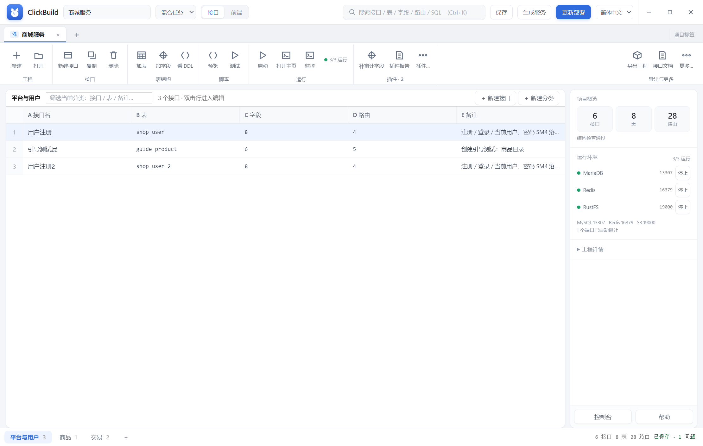
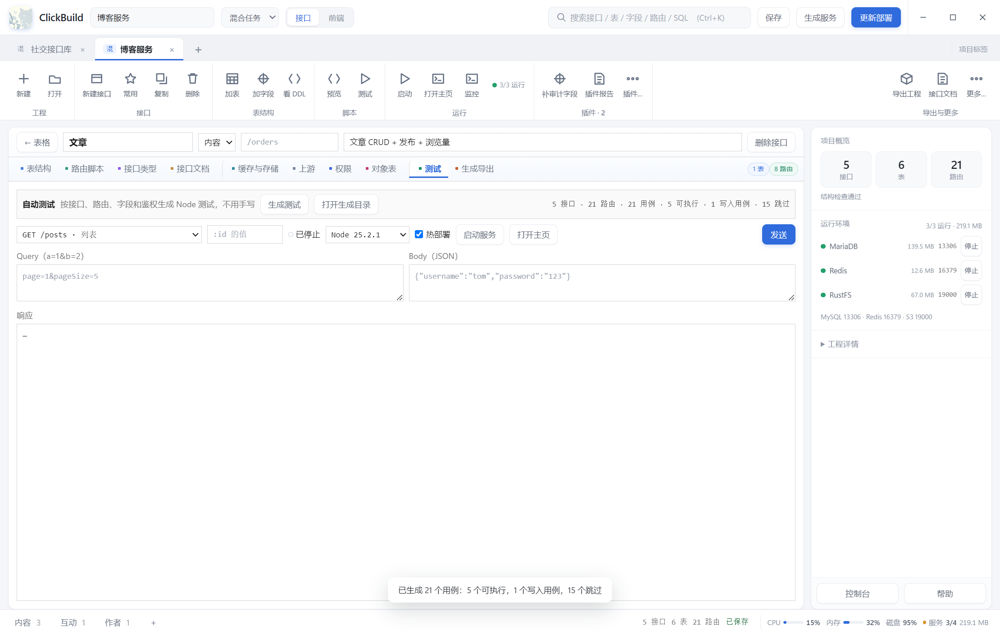
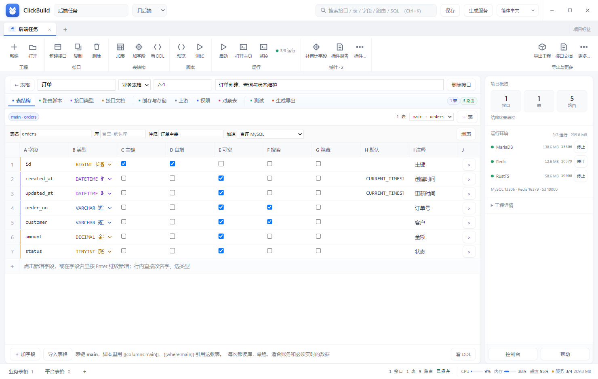

# ClickBuildServer · 接口工作台

> An interface-first backend service generator for Windows: multi-DB tables, scripted SQL, transactions, caching, RBAC, and one-click runnable services — an Electron desktop app with a built-in frontend studio and 26 built-in templates.

[](https://github.com/yxpil/ClickBuildServer/actions/workflows/ci.yml)
[](https://github.com/yxpil/ClickBuildServer/actions/workflows/release.yml)



> WPS 式简约办公风的“服务器制造台”：**一个接口一条线，接口里挂多张表、多个库，每条路由写一段自己的 SQL 脚本**，点一下生成可运行的服务。
>
> 工作中间版本，接口与数据结构仍可能调整。
>
> 内核通用化（Phase 1）的元模型、方言、迁移和反向工程现状见 [docs/KERNEL.md](docs/KERNEL.md)。Rust 全栈产物已通过 `cargo check`，并在真实 MariaDB 上完成启动、登录和列表查询；完整导出不再生成转发 Node 的 Java/Go 启动器。
>
> 实时游戏服务（Phase 4）的长连接、协议、房间同步与生成器改造底稿见 [docs/REALTIME.md](docs/REALTIME.md)。

---

## 它是什么

不是“勾模块 → 整台服务器一次生成”。最小单位是**接口**：

```
接口（订单）
├─ 表 biz_order      （主表，连接 main）
├─ 表 biz_order_item （明细表，可换库/换连接）
└─ 路由
   ├─ GET    /orders          列表（条件查询 + Redis 缓存）
   ├─ GET    /orders/:id      详情
   ├─ POST   /orders          新建（默认事务）
   ├─ PUT    /orders/:id      更新（默认事务）
   ├─ DELETE /orders/:id      删除（默认事务）
   ├─ GET    /orders/with-items   多表 LEFT JOIN
   └─ POST   /orders/tx-demo      插两张表再回滚（演示原子性）
```

每个接口、每条路由都可以单独改 SQL、单独开缓存、单独限流/定时窗/熔断；互不牵连。

## 控制台、脚本助手与搜索（1.1.26）

- 底部控制台改成 IDEA 式的工具窗：可拖拽调高，可同时打开「生成服务 / MariaDB / Redis / RustFS」多个标签，支持过滤、自动滚动、清屏、复制和单标签关闭；`Alt+F12` 或 ``Ctrl+` `` 开关，服务 stdout / stderr 每秒增量刷新，不会整段重刷。
- 路由页右侧新增脚本助手：列表、新增、校验、事务、抓取、等待六类模板，一键插入当前表名、字段列表、WHERE、主键和 `{{body.x}}` 等占位符；`Ctrl+Space` 收起/展开，另有完整语法速查和 `LET / QUERY / EXEC / IF / FOREACH / TX / CRAWL / WAIT` 说明。
- 帮助页顶部新增「在这里能做什么」：建表、生成接口、写脚本、联调、导出五张卡片；新手不用先翻完整文档也能知道下一步点哪里。
- 全局搜索改成打分排序：精确 > 前缀 > 包含，接口 / 路由 / 表 / 字段有优先级，命中词高亮；`↑↓` 选择、`Enter` 跳转，结果超过 60 条时明确显示总数和「显示前 60 条」。点字段结果会直接跳到表结构并聚焦、滚动到该字段。
- 接口列表增加当前分类筛选和 `shown / total` 计数；表头长接口名、表名、备注统一省略号，固定布局不再被撑破。UI 冒烟用 130 个接口验证：工作区和表格无横向溢出，分类筛选能收敛到 1 条，搜索仍能限流和滚动。


## 资源占用分析（1.1.53）

- 底部状态条不再只写「N 接口 / N 表 / N 路由 / 已保存」，右侧新增 CPU、内存、磁盘、服务运行数和进程内存。点这一块会展开资源占用分析，显示系统与本应用自身占用、每个内置服务的 PID / 内存 / 端口，以及按当前阈值生成的排查提示。
- 系统 CPU 用 `os.cpus()` 两次采样的 idle/total 差值计算，内存用 `os.totalmem()/freemem()`，磁盘用 `fs.statfsSync`，网络用 `netstat -e` 两次累计字节差值；服务内存用 `tasklist /FO CSV` 按 PID 读取。系统指标随工作台 4 秒轮询刷新，`tasklist` 结果缓存 6 秒，避免监控本身变成负担。
- 右侧「运行环境」每个内置服务旁也显示实测内存，标题显示运行数与三台基础服务内存合计；服务停止后内存随之消失，不保留旧值。
- 分析阈值：CPU 65% / 85%，内存 80% / 90%，磁盘可用低于 10 GB 或已用 90% 提示注意、可用低于 3 GB 或已用 97% 标为偏高；依赖服务未全部在线会直接点名。服务级目前只采内存，不做高频 CPU 轮询，系统 CPU 与本应用 CPU 已在同一面板给出。
- 资源采样回归 `npm run test:resources` 1/1；中英文面板、1080 / 1240 / 1480 宽度、真实鼠标展开与「立即刷新」均已实机验收。


## 自动生成 API 测试（1.1.54）

- 生成服务、更新部署、导出工程都会一起写出 `tests/api.test.js`、`tests/plan.json`、`tests/README.md`；不用手写测试，也不用另装测试框架，直接跑 Node 原生 `node --test`。
- 默认只生成安全用例：列表路由断言 2xx 且响应里能找到 `rows` / `data` 数组；详情、更新、删除用不存在的 ID 断言 404，但只在脚本里真的出现 `RETURN 404` 时才生成，否则写进跳过原因；带鉴权的路由不带 token 断言 401。
- 写入生命周期（新建 → 详情 → 更新 → 删除）单独计数，默认跳过；在工程目录设置 `CBS_WRITE_TESTS=1` 才执行，`finally` 里会兜底删除新建的记录。新建成功但响应没有 ID 时停止后续步骤并输出诊断，不硬编一个假 ID。
- 上传、上游转发、对象表、网页抓取和自定义脚本不假装通过：默认跳过，原因写进 `tests/plan.json`。测试按 `config.json` 的 `PORT` / `API_PREFIX` 和接口的 `basePath` 拼路径，可用 `CBS_BASE_URL`、`CBS_API_PREFIX`、`CBS_TOKEN`、`CBS_AUTH_HEADER` 覆盖。
- 测试页新增「自动测试」区，显示接口 / 路由 / 用例 / 只读 / 写入 / 跳过计数，可单独点「生成测试」，也可打开生成目录；生成页和生成物表也列出 `tests/` 三件套，生成的 Node 工程带 `npm run test:api`。
- 实机验收：真实「后端任务」工程（`basePath=/v1`）生成 5 个用例，安全用例 4/4 通过，开启写入后 5/5 通过，测试数据最后清到 0 行；生成器回归 `npm run test:testgen` 19/19。



## 界面细节：HTTP 方法配色（1.1.55）

- `GET` 绿、`POST` 蓝、`PUT` 琥珀、`PATCH` 紫、`DELETE` 红，路由列表、接口类型、权限矩阵、缓存表和接口文档统一使用同一套方法徽标；选中路由的左侧色条与底色跟着方法走，脚本编辑区左边也保留同色细边。
- 路由页签下方加分类色点（表结构 / 路由 / 文档 / 缓存 / 测试 / 导出各一色），右侧接口统计改成浅蓝与浅绿胶囊；选中页签有白底与轻描边，不再是一排纯文字。
- 表结构页按字段类型给第一列加 3px 色条并给类型文字着色：数值琥珀、文本蓝、时间紫、语义青、文件粉、布尔绿、JSON 紫；表标签的选中态从黑底改成浅蓝胶囊。
- 这些颜色只做识别，不做主题变量覆盖：浅色 WPS 主题和深色主题下方法色都固定，不随强调色漂移。




## 前端模式（ClickBuild 前端工坊 / .yxpp）

页眉的「接口 / 前端」切换进入内置前端工坊（`renderer/studio.html`，基于官网最新编辑器内核，但外壳、入口与数据语义已改为 ClickBuild 桌面端原生工作台：单条工程顶栏、当前工程上下文、本机资产与本机 `.yxpp` 操作）。

- 工坊以**当前工程**为唯一数据源：不再读写浏览器里的工程草稿，也不显示独立示例站点；没有 `.yxpp` 时先给一张空白画布，第一次编辑就自动生成并绑定到当前工程。界面语言跟随桌面端 `settings.json`，AI 接口地址由桌面端设置管理，工坊不再自行请求官网语言包或账号接口。
- 编辑停手约 1.2 秒自动回写，另有 20 秒定时兜底；切换视图、启动网页前会强制同步。底部状态栏显示「已同步到当前工程」。
- 页眉的「启动」会补齐 MariaDB / Redis / RustFS，生成当前工程、启动网页服务，并直接在浏览器打开 `/` 网页主页；「打开主页」是常驻入口。
- 生成服务时，`.yxpp` 会一起写入产物：`frontend/index.yxpp`、`frontend/project.json`、`public/index.html`。服务的 `/` 优先返回前端页面，`/frontend/index.yxpp` 提供只读工程。
- `.yxpn` 工程包里同样带 `frontend/index.yxpp`，manifest 里有 `frontend` 元信息，换机器也能继续编辑。
- 26 套内置案例全部预置 `.yxpp` 前端；其中 24 套是 PageStudio 原生 `appview` 业务应用（`project.app` + 业务运行时），打开就是真实的列表、表单、详情、后台工作流和行级动作，不是接口清单或请求调试器。商城、点餐、票务、博客、音乐 / 视频、工单、报销、会议、CRM、社交、聊天、预约等都已用真实数据库和真实上传链路逐项验收；问卷系统、活动报名保留各自的公开填写 / 报名页和管理员后台。

## 多语言（1.1.52）

- 安装阶段决定首次语言：NSIS 语言选择页选中文或英文后，安装器把选择写入 `%APPDATA%\click-build-server\clickbuild\install-language.txt`；应用首次启动读取该标记、写入 `settings.json` 的 `language` 并删除标记。之后启动直接沿用保存的语言，不再按系统语言重新猜。
- 桌面端内置 `zh-CN` / `en-US`。工作台与工程历史页的顶栏都有真实可点的语言菜单，选择后写入设置并立即重载；工程历史页语言菜单跟随页头移动，不再被全局标题栏遮挡。
- 英文语言包不是手写文案：`tools/generate-i18n-en.js` 读取中文词条与句式，调用 B 站 Index-Translate 免费公网 API（`https://index-translate.bilibili.com/v1`，默认 `Index-Translate-35B-A3B`）生成 `app/i18n/locales/en-US.json`；占位符先保护再回填，失败重试并自动拆批。历史页、Ribbon、侧栏等界面缺失的中文串放在 `tools/i18n-extra-zh.json`，用 `node tools\generate-i18n-en.js --incremental` 补译。
- 语言包离线存放：`app/i18n/locales/<locale>.json`，含精确词条与动态消息模式；主进程 `app/i18n/index.js` 负责安装期语言、读包和写设置，渲染层 `renderer/i18n.js` 翻译文本节点、`title` / `placeholder` / `aria-label` / `alt` 以及 MutationObserver 新增的节点。
- 已覆盖工作台主界面、工程历史页、Ribbon、四步创建引导、AI / 监控 / 文档 / 插件 / 模版库 / 接口库、接口编辑器六个页签，以及前端工坊（含 iframe 标题、缩放与图标提示）。26 套模版、75 个内置接口的名称、说明和标签都已预翻译；用户自己的工程名、说明等业务数据保持原样。

## 工程历史预览（1.1.14）

- 打开应用先进入工程历史预览页，不再直接把最近工程铺进工作台；选中历史工程后才进入接口工作表。带 `?project=名称` 或 `?openYxpn=路径` 启动时仍直接打开对应工程。
- 预览页列出全部历史工程，显示接口 / 表 / 路由统计、更新时间与工程 JSON 路径。文件被外部删除后仍保留历史条目，卡片标 `LOST` 并显示“找不到文件”；此时打开会提示“找不到文件”。
- 每张历史卡片右上角有大红色圆形删除叉；右键卡片可直接打开、复制或删除工程。复制会生成“工程名 副本 / 副本 2”，删除缺失文件的历史会二次确认并清理索引。
- 预览页下方直接列出全部内置与自存模版，点选后新建工程并进入工作台；已有工程时先确认。新增“音乐网站”和“小说网站”模版，内置模版总数 26。

## 更新部署（1.1.13）

- 顶部「更新部署」按钮，以及服务组的「更新」、前端工坊的「更新部署」，执行同一套流程。
- 点击后先保存当前工程和前端工坊的改动，再重新生成 `server.js`、`src/modules/`、`sql/`、`docs/` 与 `public/index.html`，然后重启生成服务。
- 服务未运行时会自动启动；MariaDB / Redis / RustFS 未运行时会先补齐依赖。
- 更新会清理被删除接口留下的旧模块目录和编号 SQL；`src/modules/_` 开头的自定义模块、用户自己加的 SQL 不会被删。
- 端口被其他进程占用、校验未通过或写入失败时直接返回错误，不会假装部署成功。
- 表结构变更仍只写入新的 `sql/` 文件，已有数据库不会自动迁移；需要保留数据时请自行执行 `ALTER TABLE`。

## 快速开始

### 直接安装（Windows）

```text
dist\ClickBuildServer-Setup-1.1.55.exe
```

安装包 222,017,092 B（约 212 MB），构建时间 2026-11-21 05:41:50，SHA256 `522331518A8023BF0DA287E00AB02E260472C7B06D347C8199DDA13AA2FFAE0E`。

也可以从 GitHub Releases 下载最新版：[ClickBuildServer Releases](https://github.com/yxpil/ClickBuildServer/releases/latest)。

1.1.55 把工作台的接口方法做成固定语义色：GET 绿、POST 蓝、PUT 琥珀、PATCH 紫、DELETE 红，路由列表、详情/更新/删除表、权限矩阵、缓存表与接口文档共用同一套徽标；选中路由的左侧色条、浅色底和脚本编辑区细边都跟着方法走。编辑器页签加分类色点，右侧表 / 路由统计改成浅蓝与浅绿胶囊，表标签选中态由黑底改为浅蓝胶囊；表结构页按字段类型给第一列加 3px 色条并给类型文字着色。颜色只做识别，不跟 WPS 强调色漂移；源码版与 1.1.55 安装版 UI 冒烟均为 136/136。1.1.54 把 API 测试从“手写”改成“跟工程一起生成”：`codegen` 每次生成服务、更新部署或导出工程，都会写出 `tests/api.test.js`、`tests/plan.json`、`tests/README.md`；测试页新增「自动测试」区，可单独点「生成测试」并看到接口 / 路由 / 用例 / 只读 / 写入 / 跳过计数。默认只生成安全用例：列表 2xx 且能找到 `rows` / `data`，详情 / 更新 / 删除用不存在 ID 断言脚本声明的 `RETURN 404`，鉴权路由不带 token 断言 401；上传、上游转发、对象表、抓取和自定义脚本跳过并写明原因。写入生命周期单独计数，默认跳过，只有 `CBS_WRITE_TESTS=1` 才新建→详情→更新→删除，并在 `finally` 里兜底删除；新建成功但响应没有 ID 时停止后续步骤，不编假 ID。真实「后端任务」工程（`basePath=/v1`）生成 5 个用例，只读 4/4、开启写入 5/5，测试数据清到 0 行；`test-testgen` 19/19，模版回归 194/194，多语言 24/24。1.1.53 是前一版的现场监控：底部状态条加入 CPU、内存、磁盘、服务运行数与进程内存，点开是资源占用分析面板，列本应用和每个内置服务的 PID / 内存 / 端口，并按阈值给出排查结论；资源采样全部现场读取，服务内存 `tasklist` 缓存 6 秒，系统指标跟随既有 4 秒轮询，不新增高频定时器。

1.1.48 把「新窗口」从套壳的独立窗口补成真正和主工作台同款：新窗口使用与主窗口一致的无边框窗口（`frame:false` / `thickFrame:true`），不再出现 Windows 原生标题栏，内容直接从 WPS 标签栏开始；子窗口复用同一份工作台，自动带多项目标签、任务类型下拉、未保存点、主题、语言和自绘的最小化 / 最大化 / 关闭按钮，最大化图标会随窗口状态在「最大化 / 还原」之间同步。新窗口按父窗口位置和所在显示器工作区计算大小与位置，优先 1480×940、最小 1080×700，保证不跑到屏幕外；菜单栏、外链打开策略也与主窗口一致。点「新窗口」或标签右键「在新窗口打开」前，若打开的是当前活动工程，会先 `flushAndSave` 当前工程，保存失败就停在原窗口并提示，避免子窗口读到旧磁盘内容。实测子窗口标题栏宽 1480 时 logo、工程名、任务类型、视图切换、搜索、保存 / 生成 / 更新、语言和窗口按钮全部单行显示、无溢出；原生标题栏已消失，最大化状态回传正常。

1.1.47 把“多开项目”真正做成 WPS 式标签，不再靠多个独立窗口。同一个窗口顶部可以并排开多个工程标签，标签显示任务类型、工程名和未保存点；点标签直接切换，点 × 关闭，右键可「在新窗口打开 / 关闭这个标签 / 关闭其他标签」，`Ctrl+Tab` / `Ctrl+Shift+Tab` 循环切换，`Ctrl+T` 新建任务。切换、关闭、新建或套用模版前都会先 `flushAndSave`，把前端画布和工程改动落盘；保存失败就停在原工程并提示，不会静默丢改动。关闭最后一个标签回到工程历史页，关标签不会删工程文件。新增三类工作任务：新建时先选「混合任务（默认）/ 只后端任务 / 只前端任务」。只前端隐藏接口、表结构、脚本、运行和 AI 搜索入口，进入前端工坊；只后端收起前端工坊，保留接口工作台；标题栏的任务类型下拉可随时改，旧工程没有字段时按混合任务处理。历史卡片和标签都显示任务类型，按类型筛选也能命中。任务类型单测 13/13，UI 冒烟 133/133（新增“新建先选三类任务再开新标签”“WPS 式标签可来回切换工程”断言）。

1.1.46 修掉两个真实使用里的硬伤：工作台「新建」不再用示例工程覆盖当前工程，模版「套用」也不再替换当前工程，两个入口都改成先保存当前工程、再新建一个不重名的工程；保存失败就取消新建，原工程和未保存改动都保留。插件系统升到 v2：插件可用 `activate(api)` 注册 Ribbon 命令、接管保存/生成/导出/服务启停、注册工程模版、保存设置与私有数据、读写插件目录、访问网络或在授权后加载 Node 模块；插件面板新增启停、重载、新建脚手架、命令、模版、日志、开发者文档和界面内 API 说明，旧 `apply(project, api)` 继续兼容。内置 `audit-stamp` 用「补审计字段」「插件报告」、`generate.before` 注入和「审计示例」模版证明链路不是空壳。插件回归 22/22，UI 冒烟 131/131（新增“新建先保存再开新工程”“套用模版不覆盖”和插件 Ribbon 断言）。完整插件规范见 [docs/PLUGINS.md](docs/PLUGINS.md)。

1.1.45 是真人模拟暴露问题后的收尾版：同一生成目录重新生成时会清掉 1.1.42 遗留的 `launcher/`，不再让用户看到早已不会运行的 Java/Go 启动器；生成服务停掉后状态继续按本次实际端口探测，不会因为首选端口上恰好有别的程序就误报“生成的服务正在运行”。端口回归 11/11，模版生成回归 194/194。

1.1.44 是全量测试与真人模拟后的修复版：修掉 RustFS 与 RustFS 控制台同时被占用时会分到同一个端口的 bug，现在两个端口分开避让，S3 与控制台都能起来；补齐「同频社区」模版说明与「社区 / 动态」英文词条，国际化回归 20/20；把写死版本号的测试改成语义化版本校验。安装版 UI 冒烟 129/129，源码版 129/129；真实服务端到端、社交接口库、跨库、帮助页、Rust 运行时、内核与真实 MariaDB 全部重跑通过。

1.1.43 把 Phase 1 内核接进主生成链路，并把 Rust 全栈渲染器修到真能跑：`app/generator/sql.js` 统一走 `kernel/dialects`，MySQL / PostgreSQL / SQLite 三种方言可由 `project.dialect` 或 `generateSql(ir, { dialect })` 选择；旧 IR 通过 `kernel/ir-adapter` 转成元模型实体。Rust 生成器修掉搜索文本拼接、`QueryBuilder` 绑定生命周期、`AppError` 错误链、S3 SigV4 返回类型和 bootstrap 返回值，`cargo check` 通过；真实 MariaDB 上完成建表、`cargo run`、admin 登录和列表查询。完整导出不再生成转发 Node 的 `launcher/Server.java`、`launcher/main.go`，Java / Go 只走 `native/`。新增 `test-kernel-sqlgen` 4/4、真实 MariaDB 生成脚本 1/1、Rust 编译 5/5、Rust 运行 2/2。

1.1.42 把路由脚本编辑器补成 IDEA 风格：错误和警告直接标在具体列上，不再整行糊成一片。错误用红色波浪线，gutter 显示红色圆形感叹号；警告用琥珀色波浪线，gutter 显示三角感叹号；鼠标悬停显示错误码、消息和修复建议，点问题面板或 gutter 会精确选中出错的 token。底部状态改成带感叹号徽标的“1 个错误 · 2 个警告”，Problems 面板按严重级别排序并显示行:列。语法分析补齐括号不匹配 / 未闭合、块注释未闭合、字符串引号未闭合、占位符未闭合、空 QUERY / EXEC，并保留未声明变量、赋值未使用等警告；全部 17 个工程 390 条路由实测 0 误报。脚本检查器回归 18/18，UI 冒烟 129/129。

1.1.41 把启动和退出真正收尾干净：启动时先枚举本安装包 `resources/services` 下的 `mariadbd.exe`、`redis-server.exe`、`rustfs-windows-x86_64.exe`，把上次异常退出留下的进程停掉，再分配端口、启动三台服务；退出时弹出关闭提示页，按“生成的服务 → Redis → RustFS → MariaDB”逐个停止，等本次自己启动的端口真正释放后才退出。只处理本安装包路径下的进程，系统安装的 MariaDB 不会被误杀；启动页会写明“上次遗留进程 N 个”，关闭页会显示当前停到哪一台。

1.1.40 启动阶段改成先准备、再进界面：新增独立启动页，显示品牌图、世界轨道加载动画、四段任务（环境与工具链 / 端口分配 / 内置服务 / 工作台）和实时百分比；启动时自动检测 Node、Bun、Java/JDK、Go、Python、Rust、Git，并自动启动 MariaDB、Redis、RustFS。端口被别的程序占用时向后自动避让（最多 40 个），本安装包自己的服务可认领现有进程，启动页和右侧栏都会写明“从哪个端口换到哪个端口”；二次启动或上次异常退出后不会误杀别人的进程。新增 `tools/test-port-fallback.js` 8/8，UI 冒烟 127/127。

1.1.39 把工作台从“按钮全摊开”改成按主任务分组：顶部 Ribbon 从 9 组 30 多个图标收到 6 组 15 个，只保留新建 / 打开、接口、表结构、脚本、运行和导出；模版库、接口库、导入导出、AI、设置、帮助等低频操作收进“更多…”两列说明卡片。右侧固定栏删掉“操作提示”和与底栏重复的工程统计，改成三格项目概览、内置服务运行状态（运行数 / 端口 / 单服务启停）和可折叠的工程详情，宽度 288 → 264；顶部“保存 / 生成服务 / 更新部署”保持唯一主入口，工具条不再重复“保存 / 更新”。源码版 UI 冒烟 126/126。

1.1.38 导出工程改成先选类型、只生成选中一套：Node / Bun、Go、Java、Python 分别只写自己的服务入口、依赖、原生目录与 IDEA 运行配置，不再把四套运行时一起塞进工程；Node 导出不再夹带 `native/java` 和 Java jar，`.run` 启动配置只给 Node / Bun。新增 `tools/test-export-single-runtime.js` 31/31。

1.1.28 把内置案例从“接口说明页”彻底改成真正能用的业务应用：PageStudio 新增原生「业务应用」`appview` 组件，`.yxpp` 带 `project.app` 时由 `app-runtime.js` 按同一份业务模型渲染真实列表、筛选、新建 / 编辑表单、详情、行级动作、统计和后台流程，24 套案例各生成 4–7 个页面；详情改用 `allColumns` 取回隐藏正文，表单会补 hidden 但可写的业务字段，多表接口按路由实际表生成字段，列表支持行级审批 / 加入 / 离开 / 结束 / 核销等动作，并按状态隐藏无效按钮。媒体站有真实上传与 `<audio>` / `<video>` 播放、`Range` 206 静态路由，对象存储不可用时自动落本地 `uploads/`；博客、工单回复、报销审批、会议纪要、餐厅开台下单结账、活动票务核销、CRM 联系人 / 商机、聊天收发、社交 86 条路由都已用真实数据库验收。导出工程不再只有 Node：源码导出弹窗可选 Node / Bun / Go / Java / Python，Python 已实测 `/` 业务前端、`/api` 真实数据、详情正文与回复、日期序列化和本地媒体；Node 模板同步补齐 `/uploads/` 的 MIME 与 Range。案例前端检查 60/60、24/24 生成通过，24/24 真实服务首页冒烟通过，社交 117/117、86/86 路由覆盖。

1.1.27 是 1.1.26 的全量回归基线版本：功能代码与 1.1.26 一致，只同步测试结果与版本文档；本轮完整跑通 26 套测试、1002 条断言，覆盖离线单元、真实 MariaDB / Redis / RustFS、21 套行业案例、社交接口库 86 条路由、问卷/报名真实 HTTP、四套导出运行时、源码版与安装版 UI 冒烟，以及本机真实 Ollama 生成与 UI 追加链路；安装版与源码版 `ui-smoke` 均为 124/124。测试结果表已按本轮实际输出更新，后续版本以这一版作为安装包回归基线。

1.1.26 把工作台补成“新手能直接上手、接口多了也不乱”的版本：底部控制台改为 IDEA 式可拖高工具窗，生成服务 / MariaDB / Redis / RustFS 可同时开多个标签，支持过滤、自动滚动、清屏、复制和单标签关闭，`Alt+F12` 或 ``Ctrl+` `` 开关，日志按行差量刷新；路由页右侧新增脚本助手，提供列表、新增、校验、事务、抓取、等待六类模板和当前表 / 字段 / 占位符 chips，点一下插到光标处，`Ctrl+Space` 收起，另带完整语法速查；帮助页新增“在这里能做什么”五张卡片；搜索改为精确 / 前缀 / 包含打分，命中高亮，`↑↓` 选择、`Enter` 跳转，超过 60 条显示总数和“显示前 60 条”，点字段结果直接跳到表结构并聚焦该字段；接口表新增当前分类筛选与 `shown / total` 计数，长名称省略号，130 个接口下工作区和表格均无横向溢出。验收：`test-i18n` 20/20、`test-pack` 19/19、`test-export-runtimes --no-serve` 17/17，源码版 `ui-smoke` 124/124（含脚本助手、双控制台、130 接口、分类筛选、搜索限流、字段跳转）。

1.1.25 把导出工程的可配置性补齐：导出根目录新增 `config.json`，端口、接口前缀、MySQL、Redis、S3、错误页开关、500 详情、日志等级、缓存前缀、请求体上限和 `RESET_DB` 共 21 个参数都能直接改，不必改源码；键名与运行时环境变量一一对应，优先级为系统环境变量 > `config.json` > `.env` > 内置默认值，`.env` 仅生成全注释的覆盖示例。Node、Python Flask、Go、Java 四套运行时都读取同一份 `config.json`，并统一改为重启生效；Node 的请求体上限、错误页和缓存前缀，Python 的 `MAX_CONTENT_LENGTH`、Go 的 `env()`、Java 的 `Config` 都已接入。配置文件允许用户用记事本保存带 BOM 的 UTF-8，四套读取逻辑都会剥掉 BOM。验收：改 `PORT=18997` 后 Node 在 18997 启动并连接 MySQL/Redis/S3，改 `API_PREFIX=/cfgapi` 后 `/cfgapi/users` 200、旧 `/api/users` 404；Python 18992、Go 18990、Java 18989 同样按配置文件端口和前缀启动；`test-export-runtimes --no-serve` 17/17，`test-integration` 6/6、`test-ai` 18/18、`test-pack` 19/19、`test-i18n` 20/20、`test-rowstore` ok、`test-deploy` 11/11，安装版 `ui-smoke` 114/114。

1.1.24 把生成服务从“接口生成器”扩展成可对接上游、可抓取、可多语言运行、可权限治理的集成平台：新增上游服务器表，支持新增 / 编辑 / 删除、探测 `/openapi.json`、`/swagger.json`、`/api-docs` 并把前 20 条路径一键生成本接口的转发路由；代理路由按 `upstream + target` 转发请求方法、请求体、请求头、响应状态与响应头，固定 target 时路径参数会按顺序拼到上游地址，也支持上游鉴权头、超时和 `stripPrefix`。脚本解释器新增 `WAIT`（最长 60 秒，带 DEBUG 日志）和 `CRAWL`（限制响应大小、超时、默认禁止内网地址，返回 `status / ok / url / contentType / title / text / matched / links / bytes`），与原有 `TX BEGIN / COMMIT / ROLLBACK`、跨库事务提交和回滚一起构成等待与事务能力。新增 Python Flask 原生运行时 `native/python/app.py`：直接读取同一份 `service.json`，用 Flask + PyMySQL + Redis + MinIO 执行同一套脚本 AST，支持列表 / 详情 / 新建 / 更新 / 删除 / 上传 / 代理 / 对象表 / 抓取、SQL 占位符、token 与角色权限；运行时检测新增 Python，生成服务的启动选择可直接拉起 Flask，不经过 Node。接口对象存储抽象为“对象表”：`iface.objects` 配桶 / 前缀 / 每页条数，生成 `GET /objects` 返回 `{ key, name, size, url, lastModified }` 与 marker 分页，支持 `?key=` 删除和 `download=1` 302 到 presigned URL；编辑器新增“对象表”页签，可预览 RustFS / S3 当前桶并一键生成对象表路由。权限控制改为路由 × 角色矩阵：勾选角色自动开启 `auth`，`permissions.enforce` 开启后 token 内 `roles` 与路由角色无交集返回 403，无 token 返回 401；新增 / 删除角色会同步清理路由引用，校验阶段拒绝“路由角色不在权限矩阵里”。脚本执行与控制台联动：路由页新增“试运行”弹窗，按当前启动服务的 `/api + basePath + path` 发请求，支持路径参数与 JSON 请求体，直接显示状态码、耗时、URL 与响应；监控日志行可点击跳到对应接口 / 路由。AI 前端生成修复为模型返回的新前端不再被旧前端覆盖，并加入 `normalizeAiFrontend`、标题 / 按钮对比度修正和前端更新日志；真实 `qwen3.8:27b` 复测从旧前端 29 字符变为 6384 字符、3 个顶层元素的会员管理前端。验收：`test-integration` 6/6、`test-ai` 18/18、`test-pack` 19/19、`test-i18n` 20/20、源码版 `ui-smoke` 114/114；Node 与 Flask 两端均跑通列表 / 详情 / 代理 / 抓取 / 对象表，CRAWL 返回 48 字节与 `WAIT 30ms` 日志，代理 `/echo/123` 上游收到 `/echo/123`。1.1.23 把“表级加速”里被当成查询缓存的四种模式真正落成表存储：Node 运行时新增 `src/rowstore.js`，用嵌入式 SQL 引擎在进程内建表，`redis` 模式读写都走 Redis Hash、写操作不再落 MySQL，`lru` 只存进程内存并按上限淘汰，`lru-redis` 每次写入同步 Redis，`periodic` 按表级 `flushMs` 定期落盘；`TTL`、重启恢复、事务提交 / 回滚、自增主键、单表与多纯表 JOIN 都有测试覆盖。`cache` / `redis-mysql` 仍保持“MySQL 权威写入 + Redis 读缓存”，不再和纯表混称。Go / Java 原生运行时没有纯表引擎，改为启动时拒绝非 `mysql` 模式并明确报错，不再静默直连 MySQL；界面同步标注纯表只由 Node 运行时执行。真实服务验收：`POST /api/posts` 后 MySQL 行数 0、Redis 表 1 行，重启服务仍能读到；真实 Ollama `qwen3.8:27b` 生成 2 个接口耗时 54.9s，`contextUsed:true` 且未重复已有接口；`test-pack` 19/19、`test-i18n` 20/20、安装版 `ui-smoke` 107/107。1.1.22 修复工程历史卡片的红色删除叉视觉偏移：不再用字体字形 `×` 做居中，改为两条 2px 白色短棒按 45° / -45° 在圆心的绝对坐标交叉，圆内十字在任意 DPI 下都对齐圆心。1.1.21 把设置、文件关联与运行时可交付化：设置中心可改 AI 接入方式（Ollama / OpenAI 兼容 / DeepSeek）、endpoint、模型、Key、超时、温度、最大 Token 和五个本地服务端口；`.yxpn` / `.yxpp` 双扩展关联，`.yxpp` 打开只更新前端绑定，不再覆盖同名工程接口。生成器新增 Go 与 Java 原生服务：Go 直接 `go build` 出二进制，Java 用 `javac` 编译 `icb` 包并经 JDBC 运行，均支持路由、脚本、事务、token 与内置函数。表结构新增七种加速模式（直连 MySQL、Redis 查询缓存、Redis 临时缓存表、Redis 热读 + MySQL 权威、LRU 内存淘汰、LRU + Redis 两级、定期刷新），可按表选择 TTL / LRU 上限 / 刷新间隔并全局搜索；新增 CSV / TSV / TXT 表格导入，按列位置替换字段并保留主键、自增与查询属性。回归 `test-pack` 19/19、`test-i18n` 20/20、`ui-smoke` 107/107。1.1.20 修复小窗口与高 DPI 下的布局挤压：标题栏副标题断点提前到 1560，工程名、视图切换、搜索、保存 / 生成 / 更新、语言与窗口控制全部禁止收缩和换行；1080 最小宽度下按钮仍单行可读，1280 宽搜索框缩到 220，Ribbon 在 1320 以下自动换行，全部功能组不再被横向裁掉。1.1.19 新增「问卷系统」和「活动报名」两套可直接使用的业务案例：问卷系统包含公开问卷列表、动态题目渲染（单选 / 多选 / 评分 / 文本）、匿名提交、管理登录、题目编辑、发布 / 结束、逐题统计、答卷明细与 CSV 导出；活动报名包含公开活动页、名额进度、姓名 / 手机号报名、事务名额控制、重复手机号拦截、管理后台、报名名单与 CSV 导出。两套案例各自带管理员表，首次用 `admin / Admin@123456` 登录自动创建并 SM4 入库，不依赖生成服务的全局 `/auth/login`；有答卷 / 报名时删除分别返回 409 `HAS_RESPONSES` / `HAS_SIGNUPS`。真实 HTTP 冒烟 22/22、23/23，全部案例前端回归 60/60。

1.1.18 把内置前端工坊从“官网单文件换皮嵌入”改成 ClickBuild 桌面端原生工作台：整块删除官网游戏逻辑子系统（约 15.8 万字符的样式、面板与 PSGameRuntime），内层顶栏不再显示官网品牌、账号、站点发布、分享、模板、工程、网页 AI 与导出代码入口，只保留“当前工程”上下文和设备、缩放、搜索、中英切换、响应式、撤销/重做、导入导出、同步、部署；官网“网站素材库”与云端筛选整组隐藏，资产面板改为“预设 · 本机项目”，全局搜索过滤官网命令；桌面端原 40px 工坊标题栏收进编辑器顶栏，导入/导出/同步/部署通过 `cbs:app:action` 桥接复用父窗口能力，整个前端只剩一条 46px 原生顶栏；语言由父窗口 `settings.json` 传入并在 `CBS_EMBED` 下使用内置词条，不再请求官网 `/api/ui-i18n`，也不写浏览器语言缓存；主题收紧为 228/292 三栏、纸面 `#F3F3F0`、24px 状态栏。1.1.17 内置前端工坊整体升级为 yxpil.com/studio 最新 `yxpilStudio` 单文件编辑器：左侧改为组件 / 图标 / 资产 / 页面风格，画布带刻度、标尺与多页标签，右栏图层与属性检查器，并保留响应式方案与游戏逻辑面板；桥接改为回传完整 `project` 与 `buildExport(css)` 导出的多页 HTML，父窗口据此生成 `.yxpp`，多页页面与导航不再丢页。嵌入态跳过浏览器工程草稿、网站账号、站点发布、共享工作站、模板中心、工程文件与网页 AI 等联网入口，品牌改为 `CLICKBUILD/FRONTEND`，只保留当前工程同步、预览、SVG 导入与代码导出。案例自带的可交互运行时 HTML 通过 `<!-- cbs:studio-export -->` 标记与编辑器导出页区分，设计编辑不会冲掉登录、路由试运行等脚本。新增多页工程持久化断言，源码版与安装版 `ui-smoke.js` 均 **103/103**。1.1.16 修复高 DPI 下最大化与 1080 窄窗口的标题栏裁切和换行：关闭按钮不再越界，品牌、工程名、搜索、保存/生成/更新、语言选择在 1080 宽仍单行可读；Ribbon 在 1480 默认窗口完整显示全部入口，1080 以下保留横向滚动兜底；工作台套用模版不再把当前工程改名并覆盖同名真实工程；UI 冒烟改用隔离工程并完整恢复用户设置，新增标题栏、Ribbon、窗口控制与数据清理断言。1.1.15 AI 生成接入本机 Ollama（原生 `/api/chat`，模型列表 / 连接测试 / 180 秒超时），同时支持 OpenAI 兼容与本地模拟；请求会携带工程名、分类、接口、表、字段、路由、前端与当前选中项，替换时保留工程名/前端/连接/主题/自定义函数，追加时跳过重复接口与表；HTTP 401/404/500、模型不存在、超时、坏 JSON、空响应不再静默回退，弹窗直接报错且不改动当前工程；新增模拟服务测试 `tools/test-ai.js` 与真实 Ollama 验收脚本。1.0.4 起，生成服务自带 `/help` 帮助页（快速入口、接口路由、请求约定、SQL 占位符、脚本语句、内置函数、curl 示例），并在 `/docs` 和 `/console` 页眉提供入口。1.0.5 统一了失败响应的顶层 `error` / `message`，并修正 7 条内置案例详情路由缺失 404 的问题。1.0.6 把 MariaDB / Redis / RustFS 一并打进安装包，服务路径只从安装资源解析，不再依赖任何用户目录。1.0.7 增加独立工程导出，带 `.idea` 与 Node 运行配置，IntelliJ IDEA 可直接打开。1.0.8 把生成服务改成模块化单体：一个接口一个 `src/modules/` 目录，自动加载，公共能力留在 `server.js`。1.0.9 重做多表切换栏：表多时横向滚动 + 快速下拉，表名/库/注释移到独立一行，不再挤掉右侧控件。1.0.10 补齐空白区域右键菜单、表/字段右键操作和快捷键；自动保存改静默，底栏显示未保存/保存中/已保存。生成服务新增全局 404/500 错误页、`dev.js` 热部署和 Node/Bun/Java/Go 启动选择；导出工程时可关闭错误页或 500 详情。1.1.0 新增「社交接口库」预置工程：9 个接口、86 条路由、18 张唯一表，覆盖账户、好友、私聊、群聊、动态、搜索、通知、收藏、文件、举报和统计；统一用 `onlyId` 标识用户，登录自动下发 HttpOnly cookie，所有表默认无主键。1.1.1 新增单接口库：22 套模版里的 63 个内置接口都能单独浏览、搜索、插入，编辑后的接口可命名存入本地接口库，自存接口重名直接拒绝；插入时接口名、表名、basePath 自动避重。1.1.2 补默认错误语义：新建接口的详情/更新/删除/附件路由对不存在的记录统一返回 404；路径存在但方法不对返回 405 并带 `Allow`；超过 64MB 的请求体返回 413；OpenAPI 补齐 404/405/413 等默认响应。1.1.3 给全部 22 套案例工程补齐完整的 `.yxpp` 前端：每套案例都带前端工程、可直接运行的案例控制台和按案例定制的导航/指标/分类/接口清单；套用模版即可切到前端模式，生成服务的 `/` 直接打开案例前端，支持登录、路由试运行、数据表格与 JSON 响应。1.1.4 把「新建接口」改成四步创建引导：先配接口名/分类/路径前缀，再定主表名与初始业务字段，随后选择基础路由与鉴权方式，最后预览确认；未点确认前不会写入工程，取消也不产生改动。1.1.5 重做前端工作台与启动链路：「启动」直接补齐依赖、生成当前工程、启动服务并打开 `/` 网页主页；前端工坊改用 yxpil.com/studio 最新页面并去掉旧站品牌、外部追踪与浏览器草稿，以当前工程为唯一数据源，编辑自动回写并 20 秒定时兜底，没有 `.yxpp` 时先给空白画布、首次编辑自动绑定。1.1.6 把生成服务控制台的「健康」改成「检查全部」：逐接口检查路由注册、表/字段存在性和脚本语法，返回通过/失败与错误详情；只做只读结构检查，不执行写请求，同时新增 `/_health/interfaces` 接口。1.1.7 给生成服务的列表查询加过滤器：`{{where}}` 支持 `__ne`、`__gte`、`__gt`、`__lte`、`__lt`、`__like`、`__regex`、`__iregex`、`__notregex`、`__contains`、`__startswith`、`__endswith`、`__in`、`__between`、`__isnull`、`__notnull`，`keywordRegex` 对搜索字段走 REGEXP；控制台新增过滤条件输入框，条件自动拼到请求上，字段名走白名单、值全部参数化。1.1.14 新增工程历史预览：启动先进入历史与模版选择页，选中工程后才进工作台；历史卡片支持大红叉删除、右键打开/复制/删除，文件丢失时保留条目并提示“找不到文件”；预览页可直接套用 24 套模版，新增音乐网站与小说网站。1.1.13 新增「更新部署」：顶部、服务组和前端工坊各有一个入口，点击后保存当前工程，重新生成后端路由、SQL、文档与前端页面，自动补齐依赖并重启生成服务；已删除接口的旧模块和编号 SQL 会同步清理，`src/modules/_` 自定义目录和用户 SQL 保留。1.1.12 安装器新增「可选组件」页，可勾选是否安装使用文档与示例工程，生产环境可全部取消；默认勾选，程序本体、运行时和内置服务始终安装。1.1.11 安装器新增中文 / 英文使用条款与免责声明页，明确仅限合法用途并由使用者自行承担责任；项目改为 Apache License 2.0，附完整 LICENSE 与 NOTICE。1.1.10 修复导出工程的 Java / Go 路由骨架：中文接口名不再统一生成 `IfaceItemItemRoute`，类名与文件名一致、Go 常量与函数按路由唯一命名，并加入 `go.mod` 便于编译检查。1.1.9 窗口右上角关闭按钮左移 6px，避免贴住屏幕边缘。1.1.8 增加桌面端中英双语：离线语言包覆盖工作台、创建引导、各弹窗、接口编辑器与前端工坊，22 套模版和 63 个内置接口的元数据一并预翻译；首次启动按系统语言选择，安装器也按 Windows 系统 UI 语言自动切换中英文。

安装包已内置便携 Node（`resources\runtime\node\node.exe`）与三台本地服务（`resources\services\`），不依赖系统 Node，也不要求电脑上预先装数据库；安装时注册 `.yxpn` 文件关联。运行时数据只写用户数据目录，源码和配置里不写死盘符。

### 从源码运行

```bash
npm install
npm start                 # Electron 界面
```

源码运行前先生成内置服务目录（默认从仓库旁边的 `ClickBuild` 复制，也可以用 `CBS_SERVICES_SRC` 指定源目录）：

```powershell
npm run vendor:services
```

脚本只收 MariaDB 必需 bin/lib/share、Redis 运行文件和 RustFS，产物约 432 MB，落在 `vendor/services`（不提交到 Git）。界面右侧“本地服务”里点启动，会拉起这三台内置服务：

| 服务 | 默认端口 | 用途 |
| --- | --- | --- |
| MariaDB | 13306 | 业务表 + 日志表 |
| Redis | 16379 | 缓存 / token / 限流 / 服务间消息 |
| RustFS（S3 兼容） | 19000（控制台 19001） | 附件对象存储 |

再点“生成服务”，产物落在 `generated/iface/<工程名>`，用内置 Node 启动：

```powershell
cd generated\iface\接口工程
$repo = (Resolve-Path '..\..\..').Path
$env:NODE_PATH = Join-Path $repo 'node_modules'
$env:RESET_DB='1'
Join-Path $repo 'runtime\node\node.exe' server.js
```

打开 <http://127.0.0.1:18100/> 是生成服务的控制台，`/docs` 是自动 API 文档，`/help` 是运行时帮助与脚本语法页。

## 不用界面也能生成 / 测试

```bash
runtime\node\node.exe tools\build-iface.js --seed     # 用示例工程生成
runtime\node\node.exe tools\e2e.js http://127.0.0.1:18100   # 23 项端到端断言
runtime\node\node.exe tools\test-pack.js               # .yxpn 打包 / 复制接口 / AI / 文档
runtime\node\node.exe tools\ui-smoke.js 9222           # 界面冒烟（需 --remote-debugging-port=9222）
```

## 界面

- **Excel 网格**：行号 + A–E 列；双击行进入接口编辑器，分类在底部 sheet 页（双击改名、右键新建/导出）。
- **全局搜索** `Ctrl+K`：接口 / 表 / 字段 / 路由 / SQL 一把搜。
- **六页编辑器**：表结构、路由脚本、缓存存储、接口文档、测试、生成导出。
- **Ribbon**：工程、接口、表结构、脚本、运行、导出与更多，再加一个按插件动态出现的「插件」组。
- **新窗口**：从「新窗口」或标签右键打开的新窗口与主窗口同款：无边框自绘标题栏、多项目标签、任务类型、主题、语言和窗口按钮都复用同一套；打开当前工程前先保存，最大化 / 还原状态会回同步。
- **多项目标签**：同一窗口像 WPS 一样开多个工程标签。标签显示任务类型、工程名和未保存点；点标签切换、点 × 关闭、右键可「在新窗口打开 / 关闭这个标签 / 关闭其他标签」，`Ctrl+Tab` / `Ctrl+Shift+Tab` 循环切换，`Ctrl+T` 新建任务。切换或关闭前会先把当前前端画布与工程改动落盘，保存失败就停在原工程。
- **三类任务**：新建任务先选「混合任务（默认）/ 只后端任务 / 只前端任务」。只前端隐藏接口/表/脚本/服务入口，只后端收起前端工坊，标题栏任务类型可随时改；旧工程没有类型时按混合任务处理。
- **模版库**：26 套内置工程（商城 / 视频站 / 音乐网站 / 博客 / 小说网站 / 工单 / 问卷系统 / 活动报名 / 预约 / 跨库订单 / 同频社区 / 聊天等）。套用模版和「新建」都先保存当前工程，再用模版/示例新建一个工程；当前工程不会被覆盖。当前工程也能“存模版”，启动预览页可直接套用全部模版。
- **插件**：`plugins/<id>/plugin.json + index.js`。新插件用 `activate(api)` 注册 Ribbon 命令、接管保存/生成/导出/服务启停、注册模版、保存设置与数据；旧 `apply(project, api)` 继续兼容。面板里可启停、重载、新建脚手架、安装/卸载、看日志和开发者文档。完整规范见 [docs/PLUGINS.md](docs/PLUGINS.md)。
- **内置插件**：`audit-stamp` 演示命令、工程写入、生成钩子和插件模版；`trace-tag` 演示旧写法并注入 `REQ_TAG()`。
- **Defender**：插件面板里可一键把仓库、运行时、生成目录加入 Windows Defender 排除项。
- **右键**：接口行、分类 sheet、路由都能右键（打开 / 复制 / 重命名 / 删除 / 导出）。
- **复制接口**：自动编号 `订单2`、`订单3`，表名同时加后缀，路由路径自动避让。
- **主题**：页眉/页脚/强调色/字体，存在本机设置。
- **截图**：`docs/screenshots`（运行时截）。

## 脚本语法（每条路由一段）

```text
LET $u = QUERY SELECT id, password_hash FROM {{t:main}} WHERE username = {{body.username}} LIMIT 1;
IF LEN($u.rows) == 0
  RETURN 401 { "ok": false, "error": "NO_USER" };
END
IF SM4_DEC($u.rows[0].password_hash, 'clickbuild-key') != {{body.password}}
  RETURN 401 { "ok": false, "error": "BAD_PASSWORD" };
END
LET $t = TOKEN NEW { "onlyId": $u.rows[0].only_id, "username": {{body.username}} };
LOG INFO '登录成功';
RETURN 200 { "ok": true, "token": $t.token };
```

支持：

- `LET $x = QUERY|EXEC SQL;`、`LET $x = 表达式;`
- `IF / ELSEIF / ELSE / END`、`FOREACH $row IN $list / END`
- `TX BEGIN|COMMIT|ROLLBACK`（写路由默认自动事务）
- `HTTP GET|POST|PUT|DELETE 'url' {json}`（服务间调用）
- `PUBLISH 'channel' expr`（Redis 消息）
- `TOKEN NEW|GET|DEL`（onlyId + token 会话）
- `LOG TRACE|DEBUG|INFO|WARN|ERROR|FATAL expr`（彩色控制台 + 落库 + SSE）
- `RETURN [status] {json};`

函数：`HASH / MD5 / SHA1 / SHA256 / SM3 / SM4_ENC / SM4_DEC / SUBSTR / LEFT / RIGHT / LEN / UPPER / LOWER / TRIM / CONCAT / REPLACE / SPLIT / JOIN / NOW / TODAY / UUID / BASE64 / URL_ENC / RAND_INT / MASK / JSON_GET / IF / IN / COALESCE …`，另可在“导出处”写自定义函数。

SQL 里也能直接写这些函数（执行前由解释器算成参数再下发，避免不同数据库函数名打架）。

SQL 里还能引用脚本变量：`$i.product_id` 会自动换成参数，`$oid.rows.0.id` 取上一句结果；显式写法是 `{{vars.i.product_id}}` / `{{last.insertId}}`。

## 占位符

| 占位符 | 展开 |
| --- | --- |
| `{{t:key}}` / `{{table:key}}` | 表名（可带库名） |
| `{{columns:key}}` | 查询列（`*` 或字段列表） |
| `{{insertColumns:key}}` / `{{insertValues:key}}` | 插入列 / 值（值走 `?` 参数） |
| `{{updateSet:key}}` | UPDATE SET 片段 |
| `{{where:key}}` / `{{orderBy:key}}` | 条件（支持 `__gte/lte/gt/lt/like/in/between/ne`、`keyword`、`sort` 白名单） |
| `{{idColumn:key}}` / `{{limit}}` / `{{offset}}` / `{{page}}` | 主键列 / 分页 |
| `{{body.x}}` / `{{query.x}}` / `{{path.x}}` / `{{user.x}}` | 请求与登录态 |
| `{{onlyId}}` / `{{token}}` / `{{uuid}}` / `{{now}}` / `{{remoteIp}}` / `{{traceId}}` | 平台值 |
| `{{objectKey}}` / `{{objectUrl}}` / `{{bucket}}` | 对象存储上传结果 |

## 一条接口连多库多表

每个接口的每张表可选 `conn`（main / 你新加的 mysql 连接）；脚本里可以混着查，事务只对同池生效，跨池失败会写 FATAL 日志并回滚已进入的连接（尽力补偿，不做分布式两阶段）。

服务之间：脚本里 `HTTP` 直连别的服务，或 `PUBLISH` 到 Redis 频道；默认约定 Redis `db0` + `icb:*` 前缀。

## 导出工程（IDEA 可直接打开）

`工程 → 导出工程`（或「生成导出」页）先在弹窗里下拉选择 **导出类型**：Node.js / Bun / Go / Java / Python。选一个父目录后，会在里面新建 `<工程名>` 独立目录，只写入这一套服务端实现和公共的 SQL、文档、`config.json`、`.env`、`public/`、`.idea`，不再把四套运行时一起塞进工程。

- `.idea/clickbuild.iml` + `modules.xml`：IDEA 选 **File → Open** 直接识别工程；Node / Bun 还带 `.run/启动接口服务.run.xml`。
- `README-IDEA.md`：按当前导出类型写启动步骤，不会在 Go 工程里让你 `npm install`。
- 公共文件始终包含 `config.json`、interfaces.json、`sql/`、`docs/`、`public/`、`RUN.md`。
- 导出的工程不依赖 ClickBuild 的安装目录；Node 工程换机器只要 Node 和依赖装好，Go / Java / Python 按 `RUN.md` 的对应命令启动。

`服务 → 微服务` 的独立服务产物同样带 `.idea`，弹窗里可以直接「用 IDEA 打开」。

## .yxpn 工程包

`导出包` 生成 ZIP（纯 Node 实现，带 CRC32）：`manifest.json` + `project.json` + `interfaces.json` + `sql/*` + `docs/*` + 导出代码；如果工程绑定了前端，还会带 `frontend/index.yxpp`、`frontend/project.json` 和 `public/index.html`，manifest 里有 `frontend` 元信息。`导入包` / 双击 `.yxpn` 直接打开（`关联` 按钮写入 HKCU 文件关联）。

## AI 生成（1.1.15）

`AI 生成` 打开对话框，支持三种来源：本机 Ollama（原生 `/api/chat`，`format: json`）、OpenAI 兼容接口（`/v1/chat/completions`）和本地模拟。弹窗里可以直接选模型、填地址 / Key、设超时、测试连接；打开时会探测本机 Ollama 并列出 7 个可用模型，默认超时 180 秒，适合 27B 级本地模型。

- **当前工程上下文**：请求会带上工程名、描述、分类、现有接口、表 key / 表名 / 字段、路由、`basePath`、前端 `.yxpp` 名称与元素数、当前选中接口。弹窗底部会显示“当前工程：X 接口 / Y 表 / Z 路由 · 选中 …”，生成日志会回报“已读取上下文”。
- **替换模式**：用 AI 返回的接口集合替换当前接口，但保留当前工程名、前端绑定、MySQL / Redis / RustFS 连接、主题、服务列表和自定义函数，不再把工程名改成模型随口起的英文名。
- **追加模式**：保留当前接口，只追加新接口；同名接口或同表名会被跳过并提示，若全部重复则明确失败，不会静默覆盖。
- **错误不吞**：HTTP 401 / 404 / 500、模型不存在、超时、空响应、坏 JSON、工程校验失败都会在弹窗里显示“失败：…”并保持当前工程不变。只有显式勾选“失败时退回本地模拟”才会回退，并保留原始错误原因。
- **本地模拟**：未配置或选择“本地模拟”时按“订单/商品/用户/注册/登录/附件”关键词产出工程，不调用真实模型，日志会明确标注。

配置写在 `%APPDATA%\click-build-server\clickbuild\settings.json`，界面保存后形如：

```json
{
  "ai": {
    "provider": "ollama",
    "endpoint": "http://127.0.0.1:11434",
    "model": "qwen3.8:27b",
    "apiKey": "",
    "timeout": 180000,
    "temperature": 0.1,
    "maxTokens": 4096,
    "fallbackMock": false
  }
}
```

OpenAI 兼容服务把 `provider` 改成 `openai`、`endpoint` 填到 `/v1` 即可。`tools/test-ai.js` 用本地模拟服务覆盖成功 / 上下文 / 追加 / 坏 JSON / 401 / 404 / 500 / 超时 / 空响应；`tools/test-ai-ollama.js` 与 `tools/test-ai-ui.js` 用本机真实模型验收。

## 生成出来的服务

- 模块化单体：每个接口一个 `src/modules/<序号_接口名>/` 目录，`index.js` 导出表结构、路由、存储与文档；`src/modules/index.js` 按目录名自动加载，`server.js` 只保留数据库、缓存、鉴权、事务、日志这些公共运行时。
- 多 MySQL 连接池、按连接执行 `sql/*.sql`
- 事务 / 限流 / 时间窗 / 熔断
- 分级日志：控制台彩色 + 内存环形 + SSE + 按等级落 `sys_log`（可换库）
- onlyId + token（Redis，Bearer 或 cookie）
- 对象存储 presigned 上传、回填对象键
- `/_health` `/_meta` `/_routes` `/_docs`(OpenAPI) `/docs`(HTML) `/help`(帮助/语法) `/_logs` `/_logs/stream`
- `RESET_DB=1`：启动时清空本工程库，互不牵连

### 扩展一个接口模块

模块里直接改 `routes` 即可；需要脚本解释器表达不了的逻辑时，给路由加 `handler(ctx, api)`：

```js
module.exports.routes.push({
  method: 'GET', path: '/orders/stat', name: '订单统计',
  handler: async (ctx, api) => ({
    ok: true,
    total: (await api.db.query('SELECT COUNT(*) AS n FROM biz_order'))[0].n,
  }),
});
```

`handler` 和脚本路由共用鉴权、限流、时间窗、事务和 Redis 缓存；`api` 提供 `db.query / db.execute`、`redis`、`s3`、`log`。模块还可导出 `async setup(api)`，在 MySQL / Redis / S3 就绪后做索引、预热、定时任务等初始化，`setup` 里同样能用 `api.db`。新增模块只要往 `src/modules/` 放一个目录，不用改 `server.js`。


## 模版 / 插件 / 文档

- 模版：`app/iface/templates.js`，内置 26 套业务工程（商城 / 视频站 / 音乐网站 / 博客 / 小说网站 / 工单 / 问卷系统 / 活动报名 / 预约 / 跨库订单 / 同频社区 / 聊天 / 视频会议 / CRM / 在线课程 / 餐饮 / 物流 / 预约挂号 / 费用报销 / IoT / 活动票务 / 网课系统 / 装修报价 / 印刷报价 / 软件项目报价 / 货运报价），用户模版落 `%APPDATA%\click-build-server\clickbuild\templates\`。
- 插件：`app/iface/plugins.js`，API v2。新插件 `activate(api)` 注册命令/钩子/模版，旧 `apply(project, api)` 兼容；内置 `plugins/audit-stamp` 演示四类能力和 `plugins/trace-tag` 演示旧写法。完整 manifest、权限、钩子和 API 见 [docs/PLUGINS.md](docs/PLUGINS.md)；回归 `tools/test-plugins-v2.js`。
- 接口文档：编辑器第 3 页可填接口级 7 项 + 每条路由 4 项，直接进 `docs/openapi.json` 与 `/docs`。
- Defender：`app/iface/defender.js`，读写 `Get-MpPreference`；权限不足会原样报错。

### 社交接口库（builtin:social）

- 位置：`app/iface/cases/social.json`，由 `tools/make-social-case.js` 生成；模版卡片显示 **9 接口 · 46 表引用 · 86 路由**，实际落库 18 张唯一表，全部无主键。
- 覆盖：账户身份、好友关系、私聊消息、群聊、动态社区、搜索、通知收藏、文件与安全、统计运维；路由统一前缀 `/social`。
- 身份：注册 / 登录返回 `onlyId` 与 Bearer token，同时下发 `Set-Cookie: icb_token=...; Path=/; HttpOnly; SameSite=Lax; Max-Age=7200`。所有受保护路由只认 token / cookie 里的 `onlyId`，写操作不接受请求体伪造用户 ID；退出登录返回 `Max-Age=0` 清除 cookie。
- 无主键：表结构不强制主键，DDL 不生成空 `PRIMARY KEY ()`，模型校验只给 warning；新建空白表默认只有 `created_at / updated_at`。
- 验收：`node tools/test-social.js http://127.0.0.1:18100`，会真实跑完全部 86 条路由、cookie 下发/清除、私聊/群聊权限、文件上传与统计，结果 **117/117**。

### 单接口库（1.1.1）

- 位置：`app/iface/iface-library.js`；内置条目从 26 套工程模版自动拆出，共 **75 个**，社交接口库贡献 9 个。
- 入口：Ribbon「模版与插件」组新增 **接口库** 与 **存接口**。接口库支持按名称/来源搜索、全部/内置/我的筛选、插入与删除；存接口把当前编辑的接口连表、路由、文档、脚本一起保存。
- 不重名：自存接口名按 `trim + NFKC + 小写` 比较，和全部内置/自存条目都不能重名，重复直接返回“接口库里已有同名接口：…”，不会覆盖。内置条目之间历史遗留的重名仍可浏览，但不会新增同名自存条目。
- 插入避重：只追加、不覆盖。同名接口自动加 ` (2)`；表名冲突加 `_2`；`basePath` 冲突加 `_2`；接口 id 重新生成，插入后整体过模型校验。
- 存储：`%APPDATA%\click-build-server\clickbuild\iface-library\`，一条自存接口一个 JSON；删除只影响接口库，不动当前工程。
- 双保险：原有“把当前工程存为模版”也新增模版同名拒绝（内置与自定义一起比较），覆盖“编辑后的接口库另存为工程模版”的用法。
- 验收：`node tools/test-iface-library.js`，内置 63、社交 9、保存/同名拒绝/插入/自动避重/删除/工程模版重名全部覆盖，结果 **19/19**；真实 UI 冒烟覆盖 63 条渲染、搜索、筛选、插入与删除。

## 微服务 / 守护进程

- `服务 → 微服务`（或接口右键）：按接口 / 分类导出独立服务到 `generated/iface/<名字>`，勾分类自动带整类接口。
- 每个产物自带 `daemon/watchdog.js`（崩溃退避重启，1s→10s）、`daemon/start.ps1`、`daemon/install-service.ps1`（登录自启计划任务）。
- 拆分后记得改 `.env` 的 `PORT`、`MYSQL_DB`、`CACHE_PREFIX`；跨服务用 `HTTP` / Redis `PUBLISH`。

## CI/CD

GitHub Actions 工作流在 `.github/workflows/`：

- `ci.yml`：推送到 `main`、PR、手动触发；Windows runner 上先还原 `vendor/services`，再 `npm ci` → 模型/模版/工程包测试 → `npm run dist:dir` 构建 unpacked 版，并校验 `dist/win-unpacked/ClickBuildServer.exe` 存在。
- `release.yml`：推送 `v*` 标签触发；还原 `vendor/services`，跑同一套回归测试 → `npm run dist` 构建 NSIS 安装包 → 输出 SHA256 到 Actions Summary → 用 `softprops/action-gh-release` 创建 Release 并上传 `.exe` 与 `.blockmap`。

`vendor/services` 不进 Git，CI 从 `services-v1` Release 的 `vendor-services.zip` 还原（约 139.5 MB）；本机构建用 `npm run vendor:services` 从旁边的 `ClickBuild` 目录收集，打包前 `npm run check:services` 会核对 MariaDB / Redis / RustFS 是否齐全。

本地等价命令：

```powershell
npm ci
npm run vendor:services
node tools/test-new-iface.js
node tools/test-templates.js --gen
node tools/test-pack.js
npm run dist:dir   # CI 构建
npm run dist       # 发布安装包
```

`test-help.js` 需要本机 MariaDB / Redis / RustFS（13306 / 16379 / 19000），因此放在本地真实验收，不放进无服务的 GitHub runner。

## 测试

| 套件 | 结果 |
| --- | --- |
| `tools/test-templates.js --gen`（26 套模版 + 插件 + 文档 + 每条详情 404） | **194/194** |
| `tools/test-plugins-v2.js`（命令 / 权限 / 钩子取消与改写 / 模版 / 脚手架 / 安装卸载 / 旧插件兼容） | **26/26** |
| `tools/test-task-types.js`（三类任务常量 / 默认混合 / 落盘重读 / 非法回退 / 历史索引 / 复制保留） | **13/13** |
| `tools/e2e-cases.js`（21 套行业案例真实 HTTP） | **106/106** |
| `tools/test-help.js`（生成服务 `/help`、404/405/413、OpenAPI 默认响应） | **28/28** |
| `tools/test-resources.js`（Electron 真实采样：CPU / 内存 / 磁盘 / 网络、tasklist 进程内存、分析结论、二次采样） | **1/1** |
| `tools/test-testgen.js`（自动测试计划 / 只读写入计数 / 404 与 401 / 跳过原因 / 生成文件语法） | **19/19** |
| `tools/test-new-iface.js`（新建接口默认路由、404 与创建引导参数） | **16/16** |
| `tools/test-social.js`（社交接口库 86 条路由真实 HTTP） | **117/117** |
| `tools/test-iface-library.js`（单接口库 75 内置 / 保存 / 重名 / 插入避重） | **19/19** |
| `tools/smoke-survey.js`（问卷系统真实 HTTP：登录/建卷/发布/答卷/统计/删除保护/关闭） | **22/22** |
| `tools/smoke-signup.js`（活动报名真实 HTTP：名额事务/重复手机号/满员/名单/删除保护） | **23/23** |
| `tools/test-case-frontends.js`（26 套案例完整 .yxpp / 生成产物 / 真实 `/` / 全部接口健康检查 / 过滤正则） | **60/60** |
| `tools/test-filters.js`（过滤器运算符 / 参数化 / 通配符转义） | **15/15** |
| `tools/test-history.js`（历史索引 / 缺失文件 / 复制 / 删除） | **11/11** |
| `tools/test-deploy.js`（更新部署旧产物清理 / 自定义模块与 SQL 保留） | **11/11** |
| `tools/test-i18n.js`（中英词条 / 动态模式 / 安装器语言 / 安装期语言） | **24/24** |
| `tools/ui-smoke.js`（真实 Electron 渲染进程，含历史预览/工程新建/三类任务标签/标签切换/模版不覆盖/插件 Ribbon、自动保存/启动主页、AI 配置与失败保护、新建引导） | **136/136**（源码版 / 1.1.55 安装版） |
| `tools/test-ai.js`（模拟 Ollama / OpenAI：上下文、追加/替换、坏 JSON、401/404/500、超时、空响应） | **18/18** |
| `tools/test-ai-ollama.js` + `tools/test-ai-ui.js`（本机 Ollama `qwen3.8:27b` 真实生成与 UI 追加） | **通过**（48.8s / 46.7s） |
| `tools/test-pack.js`（.yxpn 打包回读 / 复制编号 / AI / OpenAPI） | **19/19** |
| `tools/test-export-runtimes.js --go`（Node/Bun/Java/Go 四套运行时，Java/Go 骨架编译） | **23/23** |
| `tools/test-integration.js`（生成服务集成与导出配置） | **6/6** |
| `tools/test-rowstore.js`（纯表存储四种模式） | **通过** |
| `tools/test-pure-redis.js`（真实 Redis 存储 create/list/detail/update/search） | **通过** |
| `tools/e2e.js`（示例工程注册/CRUD/缓存/事务/限流/上传/日志） | **23/23** |
| `tools/e2e-template.js`（商城模版真实下单与库存事务） | **13/13** |
| `tools/e2e-crossdb.js`（跨库下单、辅库明细与失败回滚） | **11/11** |


## 已知限制

- 跨 MySQL 实例不做两阶段提交，只做单池事务 + 补偿回滚 + 日志追。
- 验证码样式、短信脚本示例还没内置成品，只能自己用 `HTTP` + 自定义函数拼。
- 主窗口和新窗口都是无边框自绘标题栏，但同一工程被两个窗口同时打开时还没有跨窗口锁：两边各自保存会以最后一次写入为准，暂未提供“只读接管”或编辑锁。
- Java / Go 已是原生服务：Go 读取 `service.json` 直接编译运行，Java 用 JDK 编译 `native/java` 后经 JDBC 直连 MySQL，都不再启动 Node；两者暂未接 Redis / S3 / 外部 HTTP，也没有纯表引擎，启动时遇到 `store.mode != mysql` 会拒绝启动；需要纯表存储请用 Node 运行时。运行原生服务需要本机安装 Go 1.21+ 或 JDK 17+。
- 实时游戏服务（长连接、房间、tick、帧同步）尚未开始实现，能力清单与顺序见 `docs/路线图-实时游戏服务.md`。

## 许可证与使用条款

- 本项目采用 **Apache License 2.0** 发布，完整条款见仓库根目录 `LICENSE`，版权与归属声明见 `NOTICE`。
- 仅限合法用途：禁止把本软件用于违反法律法规的活动，包括未授权访问、攻击、数据窃取、诈骗、传播恶意程序、侵犯隐私等。
- 使用者对自己创建的服务、处理的数据和发布的内容承担全部责任；在适用法律允许的最大范围内，作者、版权持有人与贡献者不承担因使用本软件产生的任何损失或法律责任。
- Windows 安装器会显示中文 / 英文语言选择页，并把选择写入应用首次启动语言；条款与免责声明会跟随安装器语言显示，继续安装即表示同意。

## 文档

- `docs/执行文档.md`：完整设计、语法、数据模型、测试与后续计划


