# ClickBuildServer · 接口工作台

> An interface-first backend service generator for Windows and Linux: multi-DB tables, scripted SQL, transactions, caching, RBAC, and one-click runnable services — an Electron desktop app with a built-in frontend studio and 26 built-in templates.

[](https://github.com/yxpil/ClickBuildServer/actions/workflows/ci.yml)
[](https://github.com/yxpil/ClickBuildServer/actions/workflows/release.yml)


> Windows 截图来自 1.1.65 安装版；Linux 截图来自 1.1.65 AppImage 实机运行。

> WPS 式简约办公风的“服务器制造台”：**一个接口一条线，接口里挂多张表、多个库，每条路由写一段自己的 SQL 脚本**，点一下生成可运行的服务。
>
> 工作中间版本，接口与数据结构仍可能调整。
>
> 内核通用化（Phase 1）的元模型、方言、迁移和反向工程现状见 [docs/KERNEL.md](docs/KERNEL.md)。Rust 全栈产物已通过 `cargo check`，并在真实 MariaDB 上完成启动、登录和列表查询；完整导出不再生成转发 Node 的 Java/Go 启动器。
>
> 实时游戏服务（Phase 4）的长连接、协议、房间同步与生成器改造底稿见 [docs/REALTIME.md](docs/REALTIME.md)。

---

## 它是什么

不是“勾模块 → 整台服务器一次生成”。最小单位是**接口**：

```
接口（订单）
├─ 表 biz_order      （主表，连接 main）
├─ 表 biz_order_item （明细表，可换库/换连接）
└─ 路由
   ├─ GET    /orders          列表（条件查询 + Redis 缓存）
   ├─ GET    /orders/:id      详情
   ├─ POST   /orders          新建（默认事务）
   ├─ PUT    /orders/:id      更新（默认事务）
   ├─ DELETE /orders/:id      删除（默认事务）
   ├─ GET    /orders/with-items   多表 LEFT JOIN
   └─ POST   /orders/tx-demo      插两张表再回滚（演示原子性）
```

每个接口、每条路由都可以单独改 SQL、单独开缓存、单独限流/定时窗/熔断；互不牵连。

## 接口套件：按业务整套接入（1.1.73）

单接口解决“这张表怎么增删改查”，套件解决“这套业务怎么直接跑”。接口库新增「套件」页签，8 套业务闭环从已经验收过的内置案例里长出来，不是另写一份会和案例漂移的演示数据。

| 套件 | 接口 / 物理表 / 路由 | 业务闭环 |
| --- | --- | --- |
| 商城交易 | 4 / 5 / 19 | 注册登录、商品、购物车、下单；商品表被购物车和订单共用 |
| 内容博客 | 5 / 6 / 21 | 作者、文章、分类、标签、评论，含浏览与联查 |
| 同频社区 | 9 / 18（46 条表定义）/ 86 | 账号、好友、私聊、群聊、动态、搜索、通知、文件 |
| 客服工单 | 2 / 3 / 13 | 客户、工单、回复、派单与状态流转 |
| CRM 客户 | 2 / 4 / 8 | 客户、联系人、商机阶段与金额统计 |
| 预约服务 | 3 / 3（4 条表定义）/ 11 | 服务项目、时段、预约，名额校验与取消释放 |
| 在线课程 | 3 / 4（5 条表定义）/ 9 | 课程、章节、报名与学习进度 |
| 问卷收集 | 1 / 3 / 10 | 问卷、题目、答卷与结果统计 |

共 29 接口 / 46 张物理表 / 177 条路由。每套都带登录态、演示数据和业务页面；商城还带文件上传。

- **整套复用**：把套件合并进当前工程。先给整套里所有物理表建一张全局映射，同名共享表只分配一次目标表名。商城的 `shop_product` 同时被「商品」和「购物车」引用，接入后仍是同一张表，不会像逐个插接口那样把购物车里的表改成 `shop_product_2`。
- **新建系统**：用套件对应的完整模板新建工程，带 seed 演示数据和 `.yxpp` 业务页面，创建完直接能打开页面点。
- **避重策略**：接口名、分类、basePath、路由分别避重；自定义函数同实现只留一份，同名不同实现改成 `*_KIT` 并同步替换脚本引用。整套共用的根路由和当前工程冲突时，给整套加业务前缀（如 `/mall`），而不是把 `/products` 改成 `/products-2`。
- **能从单接口回到整套**：单接口行会标注来源，例如「套件：商城交易系统」。

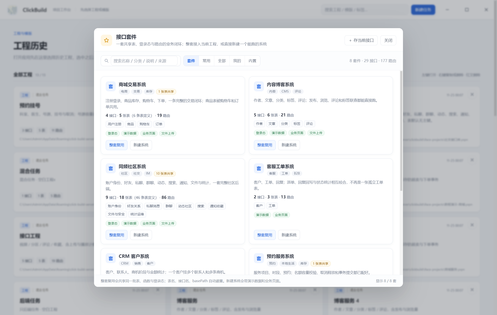

## 新建工程自带账号接口（1.1.78）

“新建任务”不再给一个后端空白工程。选“只后端”或“混合任务”后，工程保存下来就已经有一个可直接运行的「账号权限」接口，省掉每个新项目都要手工补登录的问题。

- **默认表**：`sys_account`，字段包括 `username`、`password_hash`、`nickname`、`role`、`status`，密码字段隐藏且不参与查询。
- **核心路由**：`POST /auth/register`、`POST /auth/login`、`GET /auth/me`、`POST /auth/logout` 四条直接可用；注册即登录，登录签发 Redis 会话 token。
- **用户管理**：同一接口还带 `GET /sys_account`、`GET /sys_account/:id`、`GET /sys_account/search`，默认只允许 `admin`；首个注册账号自动成为管理员，后续注册为普通用户。
- **工程级权限**：新建时自动写入 `admin/user` 两个角色并开启 `permissions.enforce`，不用再进权限页手动配；登录、注册公开，当前用户、退出和用户管理需要 token。
- **只前端例外**：只前端任务仍然保持空白画布，不塞后端接口，接口编辑入口本来也收起。
- **入口统一**：新建任务弹窗、工程历史页“新建任务”、标签栏加号和帮助中心都走同一个 `starterProject()`，不会再出现某个入口建出空工程。

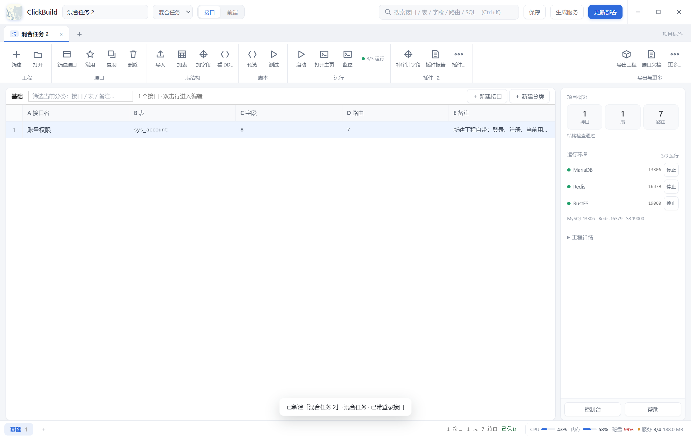

回归：`tools/test-task-types.js` **23/23**，新增默认账号表、登录/注册/当前用户/退出、公开与鉴权边界、admin/user 角色、前端空白和落盘后不丢接口等断言；`tools/test-rbac-live.js` 直接使用新建工程默认内容生成 Node 服务，连接 MariaDB + Redis 跑通注册、登录、当前用户、管理员列表/详情/搜索、普通用户 403、退出失效，**21/21** 通过；本地完整 CI **16/16**，安装前 UI 冒烟 **175/175**。

## 深色模式：整套外框都能暗下来（1.1.83）

以前的主题只换页眉、页脚和强调色，主体永远是白底。1.1.83 加了真正的深色外观：不是给页眉刷一层黑，而是把工作台、表格、编辑器、帮助中心、设置弹窗和前端工坊外框一起换色。

- **三档外观**：主题弹窗顶部新增「浅色 / 深色 / 跟随系统」。`mode` 写进本机设置，启动时按上次选择恢复；选「跟随系统」时监听系统深浅色变化，切系统主题不用重开软件。
- **顶栏一键切换**：右上角多了一个太阳/月亮按钮，点一下就在深浅之间切换并立即保存，不用每次进主题弹窗。
- **不是换肤补丁**：`renderer/wbench-dark.css` 统一接管 `--cb-*` 变量和硬编码表面，覆盖工程历史、Ribbon、业务表格、路由编辑器、代码高亮、脚本助手、实时数据、资源面板、帮助中心、设置、菜单、toast 和生成引导；Tailwind 的中性色在深色下也一并换掉。
- **强调色自动适配**：深色下把选中的强调色提亮给文字和描边用，实心按钮则压深保持白字可读；8 套预设色板、颜色取色器和自定义字体仍然有效。
- **原生边缘不闪白**：主窗口、新项目窗口的 `backgroundColor` 跟着设置走，IPC 同步 `nativeTheme.themeSource`，启动和缩放时不会先闪一块白底。
- **前端工坊半深色**：工坊自己的工具条、素材栏、属性栏和画布外框跟随深色；中间的设计画布仍保留页面真实颜色，避免把用户正在设计的白底页面错误反色。
- **启动不再重置主题**：修掉启动时从服务设置里取主题、取不到就写回默认浅色的旧问题；主题现在从 `iface:boot` 单独下发并回填到 `S.settings.theme`，重启后仍然是上次选的外观。

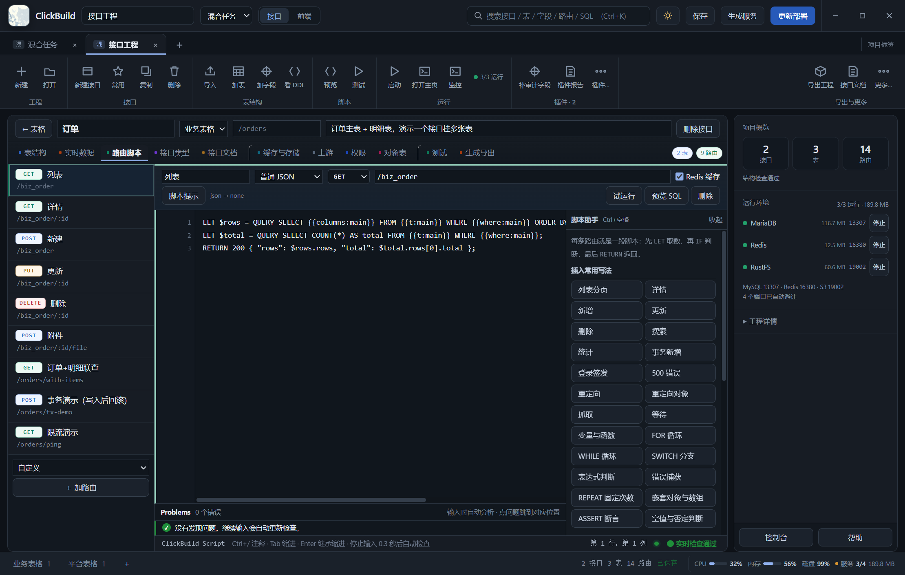

回归：`tools/ui-smoke.js` 新增 10 条深色断言，覆盖根节点 `cb-dark`、设置落盘、工作台表面压暗、强调色提亮、主题弹窗三档回显、跟随系统解析和切回浅色；源码版完整 UI 冒烟 **190/190**，本地 `test:ci` **19/19**。

## 跨接口表查询：一个工程里的表都连起来（1.1.82）

以前每个接口只能查自己挂着的表。订单接口想 JOIN 账号接口的 `sys_account`，得先把表复制一份，或者绕成两个 HTTP 接口再在代码里拼。1.1.82 把“接口”当成表的归属标签，而不是查询边界：**同一个工程里，任意接口的 SQL 都能直接用其它接口的表**。

- **按真实表名引用**：表名在工程内全局唯一，所以最常用的是 `{{t:sys_account}}`。`{{columns:sys_account}}`、`{{where:sys_account}}`、`{{idColumn:sys_account}}` 也都能跨接口用。
- **本接口优先**：本接口的表键（`main`、`item`）先解析，避免两个接口都叫 `main` 时打架；跨接口请写项目里的真实表名。
- **解析顺序**：本接口表键 → 项目表 `ref`/`库名.表名` → 项目表真实表名 → `接口id.表键`（诊断用）。同一工程多个接口共用同一张物理表时，目录只留一条，并记下所有来源接口。
- **全限定写法**：不同库存在同名表时写 `{{t:库名.表名}}`；同名多表会直接报“表名有歧义”，不会猜一张表执行。
- **脚本助手**：路由脚本页新增「跨接口表」下拉，列出当前工程其它接口的表、注释、字段数和 `{{t:ref}}`，点一下插入表名 / 字段 / WHERE / 主键占位符，不用背表名。

一个订单接口跨两张表联查的例子：

```sql
LET $rows = QUERY
SELECT o.id, o.order_no, a.username, a.nickname
FROM {{t:main}} o
LEFT JOIN {{t:sys_account}} a ON a.id = o.user_id
ORDER BY o.id DESC;
RETURN 200 { "ok": true, "rows": $rows.rows };
```

边界也要说清楚：只有同一个工程内可以跨接口；跨工程仍然走 HTTP 接口或导入表。Node 生成服务、Go/Java/Python 原生运行时的 `service.json` 都带同一份项目表目录，所以四种运行时解析同一套占位符；跨库 JOIN 的连接按项目表目录找，不再只看当前接口的第一张表。

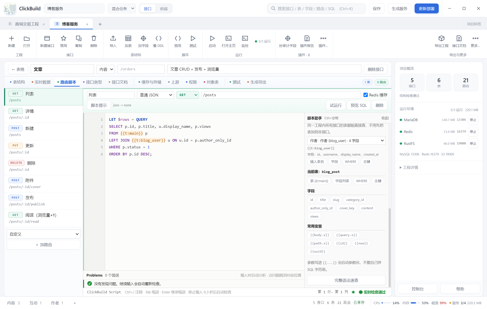

回归：新增 `tools/test-cross-table.js` **15/15**，覆盖目录、共享表合并、本接口优先、真实表名/`接口id.表键`、跨接口 `columns`/`where`/`idColumn`、完整 LEFT JOIN、未知表与歧义提示、原生快照；`tools/test-cross-live.js` 在真实 MariaDB 上生成服务、自动建表并跑通订单接口 LEFT JOIN 账号表，返回 3 行且 `alice`/`bob`/`null` 正确。完整 CI **19/19**，打包测试 **23/23**。

## 资源管理器右键新建（1.1.81）

设置页新增「资源管理器右键新建」，位置在「本地服务端口」之后、「语言运行时」之前。它的作用不是做个按钮放说明，而是在 Windows 资源管理器里真正写一条 `ShellNew`：

- **右键 → 新建**：桌面或文件夹空白处右键，菜单里出现「ClickBuildServer 服务器创建配置文件」；点一下会复制出一个完整的 `.yxpn`，不是 0 字节占位文件。
- **它是什么**：服务器创建配置文件。双击由本软件打开编辑；不是 exe，不会立即启动服务，也不会在后台跑数据库。
- **写到哪**：只写当前用户 `HKCU\Software\Classes\.yxpn\ShellNew`，同时补齐 `.yxpn` 的类型名、图标和打开命令；不请求管理员权限，不改系统级 `HKLM`。
- **模板轻量**：模板是混合任务的账号权限起步工程（1 接口 / 1 表 / 7 路由），用 `writeProject` 只打包工程定义，不夹带 Java 原生库；实测约 5.6 KB。
- **多份不打架**：从资源管理器复制出来的文件名会作为工程名，去掉「新建 」和 `.yxpn` 后再做唯一化，不会多个副本都叫「新建服务器工程」而互相覆盖。
- **刷新**：注册完成后主动通知 Shell 关联变化；如果菜单还没出现，重开一个文件夹窗口即可。

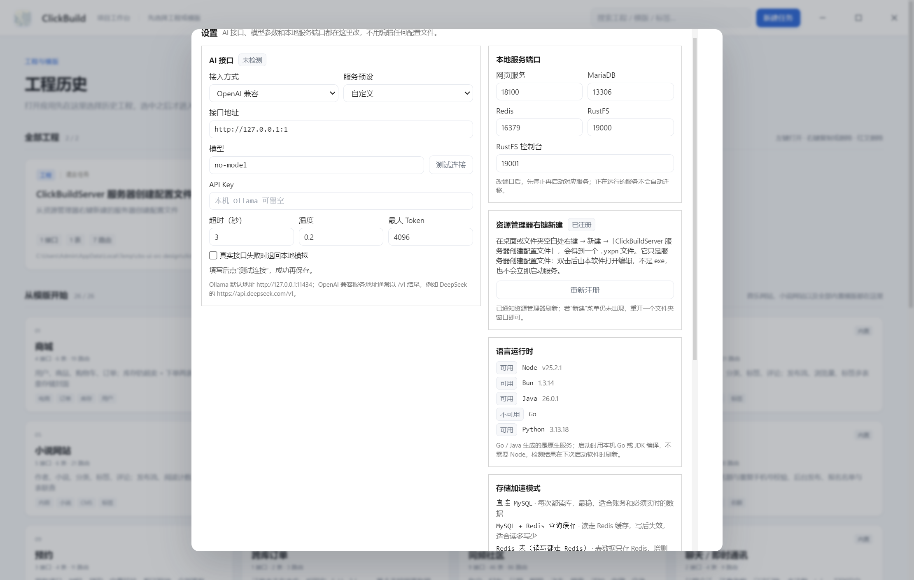

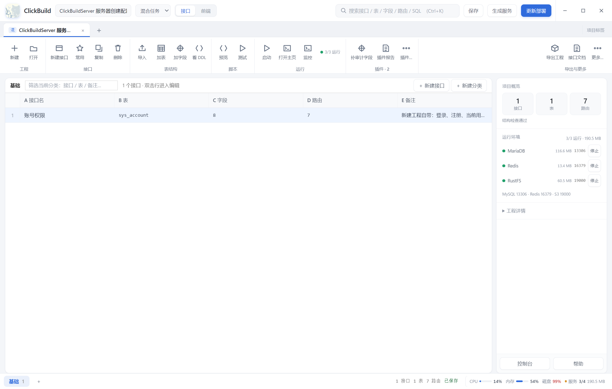

实机验收：在真实 Windows 注册表写入后用资源管理器「显示更多选项 → 新建」看到条目，点击生成 `新建 ClickBuildServer 服务器创建配置文件.yxpn`（约 5.6 KB），读回工程为「新建服务器工程 / 账号权限」；再以第二实例打开该文件，窗口标题按文件名变成「ClickBuildServer 服务器创建配置文件」，工程 1 接口 / 1 表 / 7 路由且底部显示已保存。`tools/test-shell-new.js` **20/20**，源码 UI 冒烟 **180/180**。

## 表里到底有什么：实时数据页签（1.1.80）

表编辑器新增「实时数据」页签，位置在「表结构」之后。它不是生成一份假样例，而是工作台直接只读查询工程配置的 MariaDB，打开就能看到当前库里这张表的真实行。

- **直连真实库**：`app/iface/table-data.js` 用 `mysql2` 建立短连接，先 `COUNT(*)` 再按主键倒序 `SELECT ... LIMIT/OFFSET`，查完立即断开；表名、库名只允许字母、数字、下划线和 `$`，不接受拼接注入。
- **分页与刷新**：表切换、首页/上一页/下一页/末页、每页 20/50/100 行；手动刷新之外可开 3 秒自动刷新。表里 0 行时显示「表里还没有数据」，不是一片空白。
- **连接与状态就地可见**：顶部显示 `host:port/database`、表名、存储方式、总行数、只读标记、查询耗时和更新时间；底部显示当前区间，例如 `1-20 / 120`。
- **错误能直接处理**：`ECONNREFUSED` 给「启动本机 MariaDB」；`ER_NO_SUCH_TABLE` / `ER_BAD_DB_ERROR` 给「生成服务」，并自动暂停轮询，避免每 3 秒重复打库；权限、域名解析等错误也按错误码给不同提示。
- **边界说清楚**：Redis/内存存储模式的表，这里展示 MySQL 里的权威数据，并提示热读层可能更新；页签始终只读，不提供改数据入口。

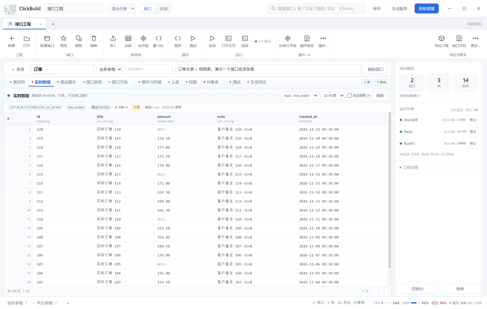

真实 MariaDB 验收：临时库建 45 行和 120 行两张表，覆盖分页、越界回夹、主键倒序、`NULL`/空串、`decimal`/`datetime`、表不存在与库不存在错误码；`tools/test-table-data.js` **22/22**，真实库探针 **12/12**。Electron 实机再跑 120 行表：翻页、50 行/页、空表、错误面板、3 秒自动刷新全部通过，UI 冒烟 **179/179**。

## 工作台界面收口：Word 的三条优点，只取对的那部分（1.1.79）

这轮来自一张 Word 空白文档截图的界面分析。结论不是“照着 Ribbon 抄”，而是把 Word 做对的地方翻译成 ClickBuildServer 自己的语言：

- **保存状态前置**：顶部工程名旁新增一个只在需要时出现的状态胶囊。未保存是琥珀色“未保存”，保存中是灰色“保存中”，失败是红色“保存失败”；保存成功后自动收起，不长期占标题栏宽度。底部状态条仍保留，双位置一致，不再只靠右下角一行灰字。
- **空分类给起步区**：分类里没有接口时，不再只显示“点右上角新建”的灰字，而是三张可点卡片——新建接口、套用接口套件、导入 `.yxpn`。空的表格第一次打开就有下一步，不用先去找入口。
- **不复制 Word 的高 Ribbon**：ClickBuildServer 的 Ribbon 本来就是 88px，并且每个按钮带中文文字、按任务分组、在 1560/1200px 两档继续压缩。再学 Word 做 140px 大 Ribbon 或纯图标工具栏，只会把已经解决的问题重新做坏，所以这轮不增加 Ribbon 高度，也不引入简洁模式切换。

对应回归：`tools/ui-smoke.js` 新增“空分类显示三步起步区”“顶部保存状态未保存时出现、已保存后收起”两项断言，源码 UI 冒烟 **177/177**；原有标题栏不换行、不越界、Ribbon 6 组收敛和窄屏适配断言继续通过。

## 脚本解释器强化：把“能跑”补成“好用”（1.1.77）

这轮没有加新语法堆料，而是把解释器里容易静默出错、或者写起来别扭的地方补齐：

- **动态下标**：`$rows[$i].name`、`$matrix[$i][$j]`、`$map[$key]['字段']` 都能读写，下标可以是任意表达式；`INC / APPEND` 和导出的 JS 同步支持。
- **`IN (1, 2, 3)`**：除 `$x IN $list` 外，支持 SQL 风格的括号列表和空列表 `()`；`ASSERT 2 IN [1, 2], '...'` 里的数组逗号也不会再被错误拆参数。
- **字符串转义**：`\n \r \t \b \f \v \0 \\ \" \'` 与 `\u4f60` 这类 Unicode 转义按预期生效，不再把 `\n` 变成字母 `n`。
- **比较语义对齐**：两边都是非数字字符串时按字典序，ISO 日期可以直接 `BETWEEN '2026-01-01' AND '2026-12-31'`；导出的 JS 用同一个 `CMP` helper，不再出现“服务里 true、导出后 false”。
- **`ELSE IF`** 作为 `ELSEIF` 的别名，两种写法都能过校验。
- **FUNC 顶层提升**：先调用后定义也能用，递归函数不再依赖定义顺序。
- **TRY / FINALLY 修正**：`CATCH` 里再次抛错时 `FINALLY` 仍会执行；`FINALLY` 里的 `RETURN / BREAK / CONTINUE` 按 JS 语义覆盖原结果。
- **运行期行号**：执行错误会带 `scriptLine`，生成服务的 500 响应新增 `line` 字段，日志提示“脚本第 N 行”，不用再靠猜。
- **数字校验**：`1.2.3` 这类非法数字字面量直接报语法错误，不再静默变成 `NaN`。
- **循环上限显式报错**：`FOREACH` 最多 500 条、`FOR / WHILE / REPEAT` 最多 1000 次；超出、负数次数或非数字边界都会直接报错，不再悄悄截断。导出 JS 同步加上守卫，循环变量在循环结束后仍可读取，与服务端保持一致。

回归：`tools/test-script-dsl.js` 从 20 项扩到 **34/34**，覆盖动态下标、嵌套下标、括号列表、转义、FUNC 提升、FINALLY、错误行号、日期比较、循环上限和导出 JS 语义；原 20 项全部保持通过。

## 创建引导：账号权限开箱即用（1.1.76）

新建接口第一步新增「基础账号权限 · 推荐」快捷预设，点「使用账号权限预设」会一次填好 `sys_account` 账号表、7 条路由和鉴权；确认创建后不用再手工拼登录、token 或角色规则。

- **7 条路由**：`POST /auth/login`、`POST /auth/register`、`GET /auth/me`、`POST /auth/logout`、`GET /sys_account`、`GET /sys_account/:id`、`GET /sys_account/search`。
- **token 会话**：登录和注册成功即通过 `TOKEN NEW` 签发 token 并写入 Redis；当前用户和退出直接复用网关解析出的会话，退出时 `TOKEN DEL` 立即失效。
- **角色权限**：首个注册账号自动成为 `admin`，后续注册为 `user`；用户列表、详情和搜索绑定 `admin`，普通用户访问返回 403 `FORBIDDEN`。创建时自动补齐 `admin/user` 两个工程角色并开启 `permissions.enforce`，不用再进权限页手动配。
- **安全默认**：`password_hash` 自动隐藏且不参与查询；登录校验账号 `status`，密码用 SM4 存储；登录、注册公开，其余全部要求 token。
- **手动改也不丢**：模板只是预填，接口名、表名、字段、路由脚本和角色都能在四步引导或创建后的编辑器里继续改；加路由下拉也补齐了登录、注册、当前用户、退出和搜索。

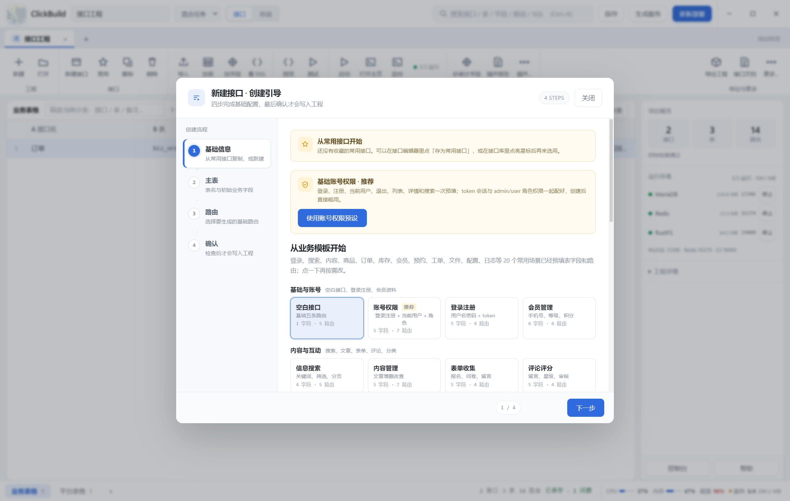

真实服务验收用生成的 Node 服务连接 MariaDB + Redis，覆盖注册首账号为 admin、第二个账号为 user、token 读取当前用户、管理员列表/详情/搜索、普通用户 403、密码登录、错误密码 401、退出后 token 失效，`tools/test-rbac-live.js` **20/20** 通过。

## 表格套件：把物理表单独拿出来复用（1.1.75）

接口套件解决“整套业务”，表格套件解决“我只要这几张表”。接口库新增「表格」页签，直接从 26 套内置工程模版里抽取物理表，不另写一份会和模版漂移的演示数据。前 8 组是带完整接口闭环的业务套件，后面补齐视频、音乐、小说、聊天、会议、餐饮、物流、挂号、报销、IoT、票务、网课、装修、印刷和报价等模版表组。

| 表组 | 物理表 / 表定义 / 字段 / 共享表 |
| --- | --- |
| 商城交易系统表组 | 5 / 6 / 40 / 1 |
| 内容博客系统表组 | 6 / 6 / 36 / 0 |
| 同频社区系统表组 | 18 / 46 / 129 / 10 |
| 客服工单系统表组 | 3 / 3 / 21 / 0 |
| CRM 客户系统表组 | 4 / 4 / 25 / 0 |
| 预约服务系统表组 | 3 / 4 / 21 / 1 |
| 在线课程系统表组 | 4 / 5 / 24 / 1 |
| 问卷收集系统表组 | 3 / 3 / 18 / 0 |
| 视频站表组 | 5 / 6 / 31 / 1 |
| 音乐网站表组 | 5 / 6 / 31 / 1 |
| 小说网站表组 | 6 / 6 / 36 / 0 |
| 活动报名表组 | 3 / 3 / 21 / 0 |
| 跨库订单表组 | 2 / 2 / 12 / 0 |
| 聊天 / 即时通讯表组 | 3 / 4 / 20 / 1 |
| 视频会议表组 | 4 / 5 / 24 / 1 |
| 餐饮点餐表组 | 5 / 7 / 29 / 2 |
| 物流轨迹表组 | 3 / 3 / 18 / 0 |
| 预约挂号表组 | 5 / 6 / 26 / 1 |
| 费用报销表组 | 3 / 3 / 21 / 0 |
| IoT 设备监控表组 | 3 / 3 / 19 / 0 |
| 活动票务表组 | 4 / 5 / 25 / 1 |
| 网课系统表组 | 5 / 6 / 35 / 1 |
| 装修报价表组 | 3 / 4 / 24 / 1 |
| 印刷报价表组 | 2 / 2 / 18 / 0 |
| 软件项目报价表组 | 3 / 4 / 20 / 1 |
| 货运报价表组 | 2 / 3 / 18 / 1 |

共 26 组 / 112 张物理表 / 155 条表定义 / 742 个字段。同一张表被多个接口引用时只列一次，字段、索引和关系合并，商城 `shop_product`、餐饮共享表等共享关系会在卡片上标出。

- **整组加到当前接口**：表结构直接并进当前接口，字段、索引、关系、连接方式和表键一起带过去；现有路由不变，不会为了加表硬改脚本。
- **点单张表加入**：卡片里的表名就是按钮，点哪张只加哪张；适合已有接口只缺一张关联表。
- **新建表接口**：新建一个归到「数据表」分类的接口，带 5 条基础 CRUD，第一张表为 `main`，打开就能查。当前在工程历史页时，会先建一个“XX表组工程”再落接口，不用先回工作台。
- **搜索**：组名、说明、标签、表名、表注释和字段名都在搜索范围内，想找 `price`、`order_no` 这类字段可以直接搜到对应表组。
- **避重**：表名按整个工程避重（撞名自动 `_2`），表键在目标接口内避重，关系 `target/through` 随表名同步重映射；目标接口已有的同名表直接跳过。

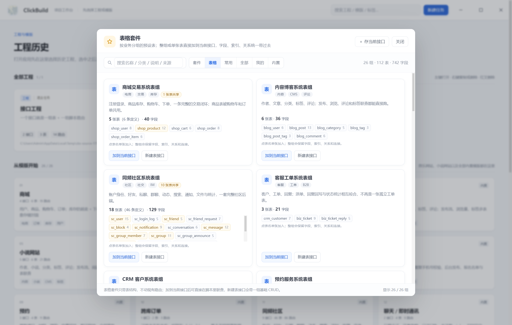

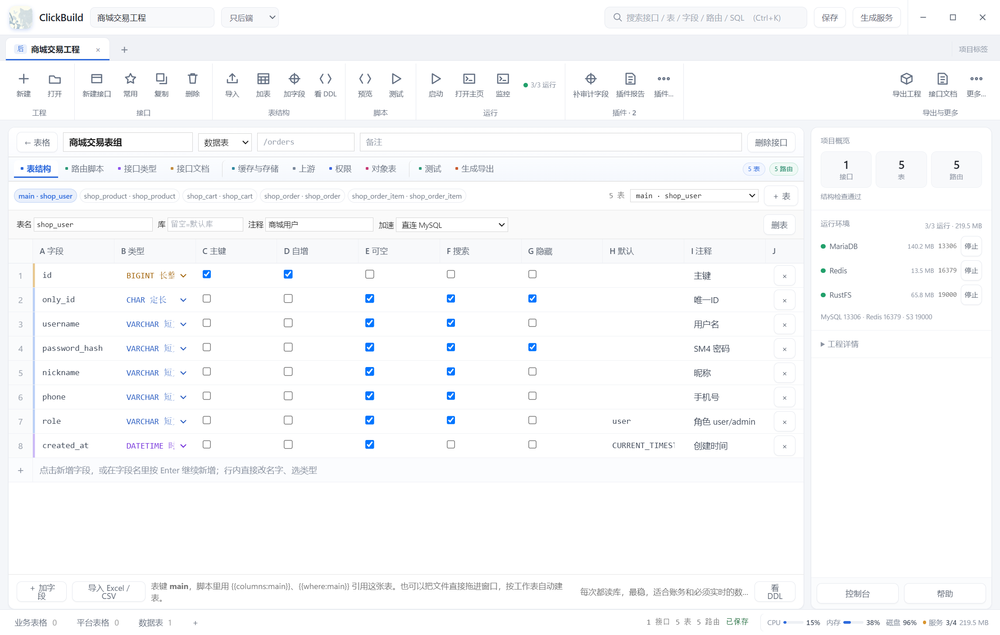

## 控制台、脚本助手与搜索（1.1.26）

- 底部控制台改成 IDEA 式的工具窗：可拖拽调高，可同时打开「生成服务 / MariaDB / Redis / RustFS」多个标签，支持过滤、自动滚动、清屏、复制和单标签关闭；`Alt+F12` 或 ``Ctrl+` `` 开关，服务 stdout / stderr 每秒增量刷新，不会整段重刷。
- 路由页右侧新增脚本助手：列表、新增、校验、事务、抓取、等待、变量函数、FOR/WHILE/SWITCH 等模板，一键插入当前表名、字段列表、WHERE、主键和 `{{body.x}}` 等占位符；`Ctrl+Space` 收起/展开，另有完整语法速查和 `LET / QUERY / EXEC / IF / FOREACH / FOR / WHILE / SWITCH / FUNC / RUN / ASSIGN / THROW` 说明。
- 帮助页顶部新增「在这里能做什么」：建表、生成接口、写脚本、联调、导出五张卡片；新手不用先翻完整文档也能知道下一步点哪里。
- 全局搜索改成打分排序：精确 > 前缀 > 包含，接口 / 路由 / 表 / 字段有优先级，命中词高亮；`↑↓` 选择、`Enter` 跳转，结果超过 60 条时明确显示总数和「显示前 60 条」。点字段结果会直接跳到表结构并聚焦、滚动到该字段。
- 接口列表增加当前分类筛选和 `shown / total` 计数；表头长接口名、表名、备注统一省略号，固定布局不再被撑破。UI 冒烟用 130 个接口验证：工作区和表格无横向溢出，分类筛选能收敛到 1 条，搜索仍能限流和滚动。

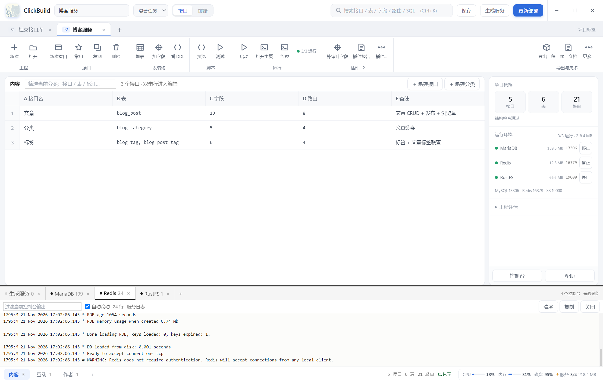

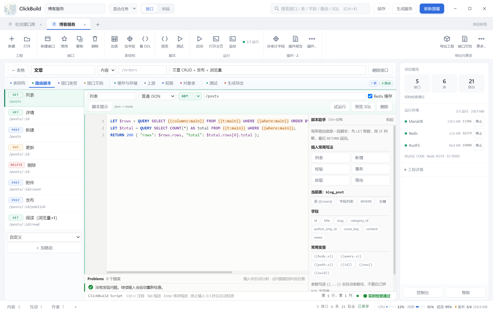

## 资源占用分析（1.1.53）

- 底部状态条不再只写「N 接口 / N 表 / N 路由 / 已保存」，右侧新增 CPU、内存、磁盘、服务运行数和进程内存。点这一块会展开资源占用分析，显示系统与本应用自身占用、每个内置服务的 PID / 内存 / 端口，以及按当前阈值生成的排查提示。
- 系统 CPU 用 `os.cpus()` 两次采样的 idle/total 差值计算，内存用 `os.totalmem()/freemem()`，磁盘用 `fs.statfsSync`，网络用 `netstat -e` 两次累计字节差值；服务内存用 `tasklist /FO CSV` 按 PID 读取。系统指标随工作台 4 秒轮询刷新，`tasklist` 结果缓存 6 秒，避免监控本身变成负担。
- 右侧「运行环境」每个内置服务旁也显示实测内存，标题显示运行数与三台基础服务内存合计；服务停止后内存随之消失，不保留旧值。
- 分析阈值：CPU 65% / 85%，内存 80% / 90%，磁盘可用低于 10 GB 或已用 90% 提示注意、可用低于 3 GB 或已用 97% 标为偏高；依赖服务未全部在线会直接点名。服务级目前只采内存，不做高频 CPU 轮询，系统 CPU 与本应用 CPU 已在同一面板给出。
- 资源采样回归 `npm run test:resources` 1/1；中英文面板、1080 / 1240 / 1480 宽度、真实鼠标展开与「立即刷新」均已实机验收。

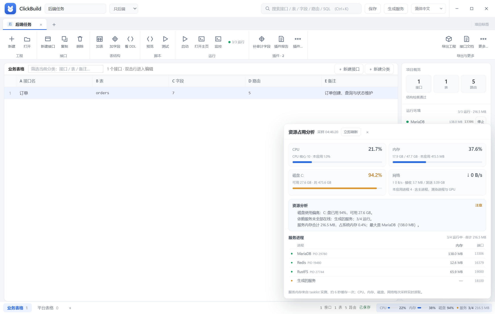

## 自动生成 API 测试（1.1.54）

- 生成服务、更新部署、导出工程都会一起写出 `tests/api.test.js`、`tests/plan.json`、`tests/README.md`；不用手写测试，也不用另装测试框架，直接跑 Node 原生 `node --test`。
- 默认只生成安全用例：列表路由断言 2xx 且响应里能找到 `rows` / `data` 数组；详情、更新、删除用不存在的 ID 断言 404，但只在脚本里真的出现 `RETURN 404` 时才生成，否则写进跳过原因；带鉴权的路由不带 token 断言 401。
- 写入生命周期（新建 → 详情 → 更新 → 删除）单独计数，默认跳过；在工程目录设置 `CBS_WRITE_TESTS=1` 才执行，`finally` 里会兜底删除新建的记录。新建成功但响应没有 ID 时停止后续步骤并输出诊断，不硬编一个假 ID。
- 上传、上游转发、对象表、网页抓取和自定义脚本不假装通过：默认跳过，原因写进 `tests/plan.json`。测试按 `config.json` 的 `PORT` / `API_PREFIX` 和接口的 `basePath` 拼路径，可用 `CBS_BASE_URL`、`CBS_API_PREFIX`、`CBS_TOKEN`、`CBS_AUTH_HEADER` 覆盖。
- 测试页新增「自动测试」区，显示接口 / 路由 / 用例 / 只读 / 写入 / 跳过计数，可单独点「生成测试」，也可打开生成目录；生成页和生成物表也列出 `tests/` 三件套，生成的 Node 工程带 `npm run test:api`。
- 实机验收：真实「后端任务」工程（`basePath=/v1`）生成 5 个用例，安全用例 4/4 通过，开启写入后 5/5 通过，测试数据最后清到 0 行；生成器回归 `npm run test:testgen` 19/19。


## 顶栏 logo 恢复为原图（1.1.58）

- 左上角的 `logo.png` 恢复成 1.1.34 的水彩猫原图（1282×1291，1,950,722 B），不再使用 1.1.49 换上的蓝底白猫应用图标。
- 恢复只动 `assets/logo.png` 这一张界面品牌图；Windows 安装包、桌面快捷方式和任务栏仍使用 `build/icon-256.png` 的蓝底猫图标，安装包不换图标。
- 工作台、工程历史、启动页和关闭页中引用 `../assets/logo.png` 的位置会一起回到原图，尺寸和 `object-cover` 写法保持不变。


## 首页按钮只改本地首页，不拉网站登录（1.1.57）

- 页面栏的小房子以前会先查网站账号，没登录就 `window.open` 到 yxpil.com 的登录页，看起来像“点设为主页却跳去了我的网站”。现在 `homePage` 是工程本地字段，点一下直接把当前页设为首页，导出和分享从这一页开始，不登录也能用。
- 「打开我的主页」同样改成「打开首页」，只切页面标签，不再触发网站登录；网站账号只在「保存到我的网站 / 生成链接」时使用。
- 按钮文案统一成「设为首页 / 当前页已是首页」，页面标签上的“主”标也改为首页；网站面板里真正的「打开我的主页」仍然打开 yxpil.com 的个人主页，两者不再混在一起。
- `ui-smoke` 新增两条断言：未登录点小房子能设置 `homePage` 且不弹网站登录；未登录打开首页只切页、不跳网站。UI 冒烟从 136 升到 **138/138**。


## 案例往 .yxpp 原生里走：真实运行时画布（1.1.56）

- 24 套 app 案例本来就是 PageStudio 原生 `appview` 工程：`project.app` 描述模式、菜单、接口、字段、权限和业务动作，导出后由 `runtime/app-runtime.js` 渲染真实页面，不是另写一套静态 HTML 冒充前端。
- 前端工坊的 `appview` 画布不再画通用骨架。打开案例时，桌面端用案例 `seed.sql` 生成一份只读预览数据，把同一份业务运行时装进画布，直接渲染首页、列表、卡片、后台队列、聊天会话、社区动态；切页面标签会切到对应的 `view`，不是五页同一张假图。
- 预览数据只进 `previewSeed`，不写进 `window.CASE`，也不进生成服务的页面；导出后的 `/` 仍然请求 MariaDB / Redis / RustFS 的真实接口。画布右下角标注「真实运行时预览 · 数据来自案例 seed」，不会把预览数据说成线上数据。
- 新增 `tools/test-yxpp-preview.js`：24 套 app 案例逐个生成预览 HTML，在 Chromium 里跑真实运行时，断言 `window.CBS_PREVIEW` 生效、`fetch` 被本地数据接管、页面正文不少于 20 字、没有「读取失败 / 无法连接服务」，结果 **24/24**。案例生成回归仍为 **60/60**，UI 冒烟 **138/138**，模板 **194/194**。


## 界面细节：HTTP 方法配色（1.1.55）

- `GET` 绿、`POST` 蓝、`PUT` 琥珀、`PATCH` 紫、`DELETE` 红，路由列表、接口类型、权限矩阵、缓存表和接口文档统一使用同一套方法徽标；选中路由的左侧色条与底色跟着方法走，脚本编辑区左边也保留同色细边。
- 路由页签下方加分类色点（表结构 / 路由 / 文档 / 缓存 / 测试 / 导出各一色），右侧接口统计改成浅蓝与浅绿胶囊；选中页签有白底与轻描边，不再是一排纯文字。
- 表结构页按字段类型给第一列加 3px 色条并给类型文字着色：数值琥珀、文本蓝、时间紫、语义青、文件粉、布尔绿、JSON 紫；表标签的选中态从黑底改成浅蓝胶囊。
- 这些颜色只做识别，不做主题变量覆盖：浅色 WPS 主题和深色主题下方法色都固定，不随强调色漂移。

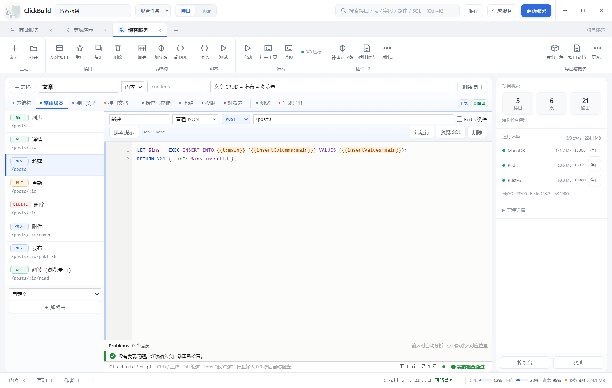


## 前端模式（ClickBuild 前端工坊 / .yxpp）

页眉的「接口 / 前端」切换进入内置前端工坊（`renderer/studio.html`，基于官网最新编辑器内核，但外壳、入口与数据语义已改为 ClickBuild 桌面端原生工作台：单条工程顶栏、当前工程上下文、本机资产与本机 `.yxpp` 操作）。

- 工坊以**当前工程**为唯一数据源：不再读写浏览器里的工程草稿，也不显示独立示例站点；没有 `.yxpp` 时先给一张空白画布，第一次编辑就自动生成并绑定到当前工程。界面语言跟随桌面端 `settings.json`，AI 接口地址由桌面端设置管理，工坊不再自行请求官网语言包或账号接口。
- 编辑停手约 1.2 秒自动回写，另有 20 秒定时兜底；切换视图、启动网页前会强制同步。底部状态栏显示「已同步到当前工程」。
- 页眉的「启动」会补齐 MariaDB / Redis / RustFS，生成当前工程、启动网页服务，并直接在浏览器打开 `/` 网页主页；「打开主页」是常驻入口。
- 生成服务时，`.yxpp` 会一起写入产物：`frontend/index.yxpp`、`frontend/project.json`、`public/index.html`。服务的 `/` 优先返回前端页面，`/frontend/index.yxpp` 提供只读工程。
- `.yxpn` 工程包里同样带 `frontend/index.yxpp`，manifest 里有 `frontend` 元信息，换机器也能继续编辑。
- 26 套内置案例全部预置 `.yxpp` 前端；其中 24 套是 PageStudio 原生 `appview` 业务应用（`project.app` + 业务运行时），打开就是真实的列表、表单、详情、后台工作流和行级动作，不是接口清单或请求调试器。案例的 `seed.sql` 只作为画布预览数据放在 `previewSeed`，导出页面不会带上它；商城、点餐、票务、博客、音乐 / 视频、工单、报销、会议、CRM、社交、聊天、预约等都已用真实数据库和真实上传链路逐项验收；问卷系统、活动报名保留各自的公开填写 / 报名页和管理员后台。

## 前端表单：静默提交、表格表单与按接口生成（1.1.70）

- 普通 `form`、鉴权 `auth` 和新的 `formtable` 共用一套提交属性：`data-ps-silent="1"` 与 `data-ps-method`。原生模式勾选静默后不再整页跳转，改为 fetch 提交；静默只抑制“提交中 / 成功提示”，失败仍显示错误，成功后 `redirect` 照常执行。原生静默 POST 使用 `application/x-www-form-urlencoded`，GET 把参数拼到 query；AJAX 模式按真实方法发送，PUT / PATCH 不再被写成 POST。
- 新增独立“表格表单”组件 `formtable`，每一行是一条记录，同名字段在每行重复提交；字段协议为 `标签|类型|占位|字段名|required`，行数 1–20（画布预览最多 12），提交按钮名字可改。支持 textarea / checkbox / date / datetime-local / time / number / email / tel / url 等输入类型，以及表头、斑马纹、按钮、边框颜色与单元格内边距。HTML 导出直接生成完整 `<form>`，React / Vue 导出通过原始 HTML 注入，运行时仍走同一套 `initForms`。
- 前端工具栏新增“接口表单”：选择已创建的后端接口和写路由（只列 POST / PUT / PATCH），自动按 `route.body` 或主表可写字段生成字段清单，跳过 `id / created_at / updated_at / deleted_at / create_time / update_time` 和隐藏字段，按字段类型映射输入控件，`nullable === false && default == null` 自动加 required；提交地址按 `/api + basePath + route.path` 自动拼接。可生成普通表单或表格录入，并直接设置按钮名、行数和静默提交。
- PUT / PATCH 路径含 `:id` 时不会假装补参数：弹窗显示真实提交地址，并提示插入后在检查器里替换路径；路由没有可写字段时插入按钮禁用并说明原因。
- 验收：`test:formtable` 24/24，`test:ci` 14/14，源码版与 1.1.70 安装版 UI 冒烟均 154/154，覆盖静默导出标记与原生拦截、表格字段 / 行数 / 按钮名、按接口生成并写入 action、检查器改写字段与按钮名。

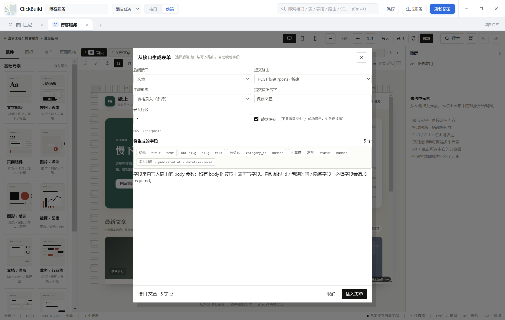

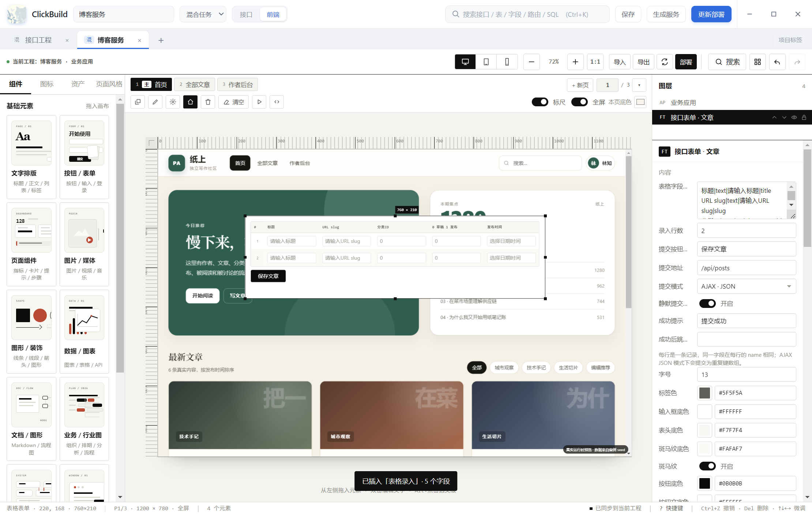

## 停止按钮（1.1.64）

- 工作台 Ribbon「运行」组的「停止」现在真正停掉网页服务和 MariaDB / Redis / RustFS，状态从 `3/3 运行` 变为 `0/3`，按钮回到「启动」；只停网页服务的入口仍在服务列表里单独保留。
- 修掉“重启后点停止没反应”的根因：`stopOne('server')` 在进程内没有子进程句柄时，原先只识别 MariaDB / Redis / RustFS，生成服务直接返回 `already`。现在会先按持久 PID 标记查找，再按端口监听进程的便携 Node + `server.js` / `dev.js` 命令行确认归属；确认后从根进程 `taskkill /T`，热部署的 `node dev.js → server.js` 父子树会一起结束。
- 重启时若首选端口上已有本应用上次启动的生成服务，`preparePorts()` 会认领该端口而不是把它当冲突避让；状态里的 PID 与工程目录来自持久标记，重启后也能看到真实监听进程。
- 无法确认归属时不再静默成功：端口被其他程序占用会返回 `ok:false` 并提示，前端会显示失败 toast，不误杀别的 node 进程。
- 新增 `tools/test-stop-server.js`：覆盖本进程启动后停止、重启后按标记停止孤儿、重启后认领端口、无标记孤儿、无标记热部署父子树、端口被别的程序占用时拒绝，共 6 组场景全部通过。中文 UI 冒烟 141/141。

## 多语言（1.1.63）

- 界面语言扩到 **21 种**：`zh-CN`、`zh-TW`、`en-US`、`ja-JP`、`ko-KR`、`fr-FR`、`de-DE`、`es-ES`、`pt-BR`、`it-IT`、`ru-RU`、`ar-SA`、`nl-NL`、`pl-PL`、`tr-TR`、`th-TH`、`vi-VN`、`id-ID`、`hi-IN`、`cs-CZ`、`sv-SE`；阿拉伯语按 RTL 渲染。
- 常驻顶栏语言下拉已删除。切换入口只在「更多 → 界面语言」和设置中心「界面」区，打开独立选择器；工作台、工程历史页、前端工坊顶栏都不再长期占用语言控件。
- 安装阶段决定首次语言：NSIS 语言选择页支持 19 种内置语言，安装器把选择写入 `%APPDATA%\click-build-server\clickbuild\install-language.txt`；应用首次启动读取该标记、写入 `settings.json` 的 `language` 并删除标记。旧安装包把非中文系统一律写成 `en-US` 的情况会被系统语言纠正；未知语言不写入，交给系统语言判断。
- 所有语言包都不是手写文案：`tools/generate-i18n.js` 读取中文词条与句式，调用 B 站 Index-Translate 免费公网 API（`https://index-translate.bilibili.com/v1`，默认 `Index-Translate-35B-A3B`）生成 `app/i18n/locales/<locale>.json`；占位符先保护再回填，失败重试并自动拆批，进度可续跑。历史页、Ribbon、侧栏、语言选择器与前端工坊缺失的中文串放在 `tools/i18n-extra-zh.json`。
- 重新生成单语或全部语言：`node tools\generate-i18n.js --locale ja-JP --incremental`、`node tools\generate-i18n.js --all --concurrency 4`；英文兼容脚本 `tools\generate-i18n-en.js` 只是转发到通用生成器。
- 安装器的 19 种语言许可证正文同样不是手写：`node tools\translate-license.js` 用同一个 Index-Translate API 生成 `build/license_<locale>.txt`，长文本遇到网关 504 时自动切成段落逐段翻译再拼回，繁体中文从简体许可证转写。
- 语言包离线存放：`app/i18n/locales/<locale>.json`，含精确词条与动态消息模式；主进程 `app/i18n/index.js` 负责安装期语言、读包和写设置，渲染层 `renderer/i18n.js` 翻译文本节点、`title` / `placeholder` / `aria-label` / `alt` 以及 MutationObserver 新增的节点；前端工坊由宿主传入同一套词条、句式与 `dir`。
- 已覆盖工作台主界面、工程历史页、Ribbon、四步创建引导、AI / 监控 / 文档 / 插件 / 模版库 / 接口库、接口编辑器六个页签，以及前端工坊（含 iframe 标题、缩放与图标提示）。26 套模版、75 个内置接口的名称、说明和标签都已预翻译；用户自己的工程名、说明等业务数据保持原样。

## 工程历史预览（1.1.14）

- 打开应用先进入工程历史预览页，不再直接把最近工程铺进工作台；选中历史工程后才进入接口工作表。带 `?project=名称` 或 `?openYxpn=路径` 启动时仍直接打开对应工程。
- 预览页列出全部历史工程，显示接口 / 表 / 路由统计、更新时间与 .yxpn 工程包路径。文件被外部删除后仍保留历史条目，卡片标 `LOST` 并显示“找不到文件”；此时打开会提示“找不到文件”。
- 每张历史卡片右上角有大红色圆形删除叉；右键卡片可直接打开、复制或删除工程。复制会生成“工程名 副本 / 副本 2”，删除缺失文件的历史会二次确认并清理索引。
- 预览页下方直接列出全部内置与自存模版，点选后新建工程并进入工作台；已有工程时先确认。新增“音乐网站”和“小说网站”模版，内置模版总数 26。

## 更新部署（1.1.13）

- 顶部「更新部署」按钮，以及服务组的「更新」、前端工坊的「更新部署」，执行同一套流程。
- 点击后先保存当前工程和前端工坊的改动，再重新生成 `server.js`、`src/modules/`、`sql/`、`docs/` 与 `public/index.html`，然后重启生成服务。
- 服务未运行时会自动启动；MariaDB / Redis / RustFS 未运行时会先补齐依赖。
- 更新会清理被删除接口留下的旧模块目录和编号 SQL；`src/modules/_` 开头的自定义模块、用户自己加的 SQL 不会被删。
- 端口被其他进程占用、校验未通过或写入失败时直接返回错误，不会假装部署成功。
- 表结构变更仍只写入新的 `sql/` 文件，已有数据库不会自动迁移；需要保留数据时请自行执行 `ALTER TABLE`。

## 快速开始

### 直接安装（Windows）

```text
dist\ClickBuildServer-Setup-1.1.65.exe
```

本机构建安装包 226,548,322 B（约 216 MB），构建时间 2026-11-21 14:53:10，SHA256 `CA65B4B6F9B099121A82D6C2BE78C2A82D665246FE7DAF088C41CDD152E67530`。GitHub Actions 发布的 `v1.1.65` 安装包为 226,551,035 B，SHA256 `9175F09253AF1794A5A941533F63B80CBF042777B5394026B8B2F03CCFF10CF8`；Release 同时上传 `.blockmap` 与 `.sha256`。

也可以从 GitHub Releases 下载最新版：[ClickBuildServer Releases](https://github.com/yxpil/ClickBuildServer/releases/latest)。

### Linux（AppImage / deb）

Linux 版与 Windows 共用同一套 Electron 主进程、生成器和界面，内置服务换成 Linux x86_64 原生构建：

| 组件 | 版本 | 打包位置 |
| --- | --- | --- |
| Node | 25.2.1 | `resources/runtime/node/bin/node` |
| MariaDB | 13.0.2（已 strip） | `resources/services/MariaDB/bin/mariadbd` |
| Redis | 8.10.3（musl 静态编译） | `resources/services/Redis/redis-server` |
| RustFS | 1.0.6 | `resources/services/RustFS/rustfs` |

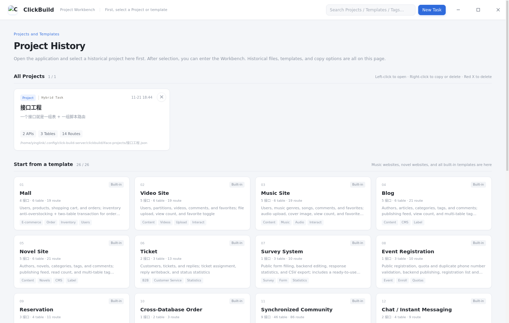

在 Linux / WSL 上构建：

```bash
sudo apt-get install -y build-essential musl-tools unzip curl pkg-config
npm ci
bash tools/vendor-services-linux.sh   # 下载并组装四个 Linux 二进制，产物不提交 Git
npm run test:services:linux           # 真实启动 MariaDB / Redis / RustFS 再停止
npm run dist:linux                    # AppImage + deb
```

产物在 `dist/ClickBuildServer-<version>-x86_64.AppImage` 与对应的 `.deb`。当前 1.1.65 本地最终产物：AppImage 308,335,899 B，SHA256 `510499A860DCDF1C680837A0EF293F010862E75B7D94DB0DEAB6B52DAE3A7C7C`；deb 200,260,410 B，SHA256 `A0B76E4191F821797DB8B2FDE47FFE9C4C5882E71E192FDF279DA9C7B861B25F`。两者都在 WSL Debian 13 上真实启动过，AppImage 可 `--appimage-extract-and-run` 直接跑，deb 可 `dpkg -i` 安装到 `/opt/ClickBuildServer`。也可以只构建解包目录做快速验证：

```bash
npm run dist:linux:dir
```

AppImage / deb 必须在 Linux 或 WSL 内打包；Windows 上只能构建 `dist/linux-unpacked`，因为 electron-builder 的 AppImage / fpm 工具是 Linux 可执行文件。

Linux 运行要求：x86_64、glibc 2.28+、`libcrypt.so.1`、`libsystemd.so.0`，以及 `libgtk-3-0` / `libgtk-3-0t64` 等 Electron 图形库（deb 已声明依赖，AppImage 需系统自备）。不需要系统预装 Node、MariaDB、Redis 或 RustFS。Electron 用户数据在 `~/.config/click-build-server`，源码脚本生成时回退到 `~/.local/share/click-build-server`，与 Windows 的 `%APPDATA%\click-build-server` 隔离。Linux 进程识别走 `/proc` 与 `ss`，停止服务用进程组 + POSIX 信号递归结束子进程；磁盘、网络、服务内存采样也改为读取 `/proc` 和 `statfs`。

1.1.72 把工程本体从 `<工程名>.json` 改成 `<工程名>.yxpn`：工程、前端和包清单装进一个 zip，保存时不再写 JSON 单文件。包内是 `manifest.json`（`kind: "project"`）、`project.json`、`README.md`，绑定前端时再带 `frontend/index.yxpp` 和 `frontend/project.json`；这是轻量工程包，不跑代码生成，自动保存不会把整个服务产物塞进去。包旁生成 `.cache/<工程名>/` 可读工作副本（同样展开这些文件，附 `README.cache.txt`），只用于查看，改缓存不会回写工程。旧版 `.json` 在第一次扫描或打开时自动迁移成 `.yxpn`，原文件保留为 `.json.bak`；历史索引里的旧路径同步替换，不出现指向已删文件的幽灵记录。用 13 个真实工程副本实测：首次迁移并列出全部工程约 0.84 秒，原有接口数、表数、路由数、前端 HTML 长度逐项一致；最大工程 433 KB JSON 压成 34 KB 包，大工程单次保存约 73 ms，仍走 1.2 秒防抖自动保存。验收：`test:ci` 14/14，`test-history` 18/18，`test-task-types` 14/14，`test-pack` 23/23，源码版与 1.1.72 安装版 UI 冒烟均 156/156（新增“工程本体是 .yxpn 包”）。Windows 安装包 225,045,662 B，构建时间 2026-11-25 00:26:23，SHA256 `26B5F6C9075221867693E89543F224B25D0CE4E42A1EB1551C2F4D33B71145CB`。

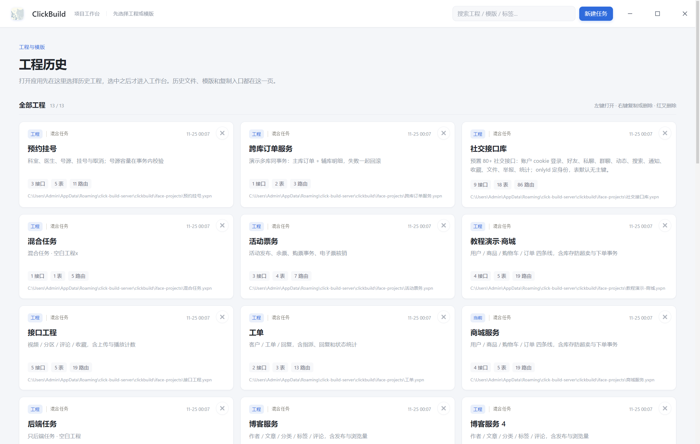

1.1.71 把 `.yxpn` 导出从“只能落到默认生成目录”改成可选保存位置：点导出后打开系统保存对话框，默认文件名是 `<工程名>.yxpn`，可换目录、改文件名、覆盖已有包；文件名没有扩展名时自动补 `.yxpn`，取消对话框不会产生文件。IPC 同时保留 `filePath` 参数，自动化或插件可直接指定完整目标路径落盘，不再被迫先弹窗。验收：UI 冒烟新增“导出文件落到指定路径”，源码版 155/155，`test:ci` 14/14。Windows 安装包 225,043,013 B，构建时间 2026-11-24 23:55:03，SHA256 `9FA7858B76B9D2A2F76551538B2AA08C61336D9E6A3D0151B3D3447AB4EA4873`。

1.1.70 把 `.yxpp` 前端表单补成一套能直接接后端的完整链路。普通表单、鉴权表单和新增的“表格表单”共用静默提交：勾选后不再整页跳转，原生模式改 fetch，静默只隐藏“提交中 / 成功提示”，失败仍报错，成功后跳转照常；原生静默 POST 用 `application/x-www-form-urlencoded`，GET 拼 query，AJAX 模式按 `data-ps-method` 真发 PUT / PATCH，不再一律写成 POST。表格表单 `formtable` 每行一条记录，同名字段重复提交；字段用 `标签|类型|占位|字段名|required` 自定义，行数 1–20，提交按钮名字、表头、斑马纹、按钮和边框颜色都可改，HTML / React / Vue 导出都带完整表格。前端工具栏新增“接口表单”：选择已有接口的 POST / PUT / PATCH 路由，按 `route.body` 或主表可写字段自动生成字段，跳过系统字段与隐藏字段，按类型映射输入控件，`nullable === false && default == null` 自动必填，提交地址自动拼 `/api + basePath + route.path`，可一键生成普通表单或表格录入。路径含 `:id` 时弹窗会标明真实地址并提示插入后替换，没有可写字段的路由直接禁用插入。验收：`test:formtable` 24/24，`test:ci` 14/14，源码版和 1.1.70 安装版 UI 冒烟均 154/154（含静默导出标记与原生拦截、表格字段 / 行数 / 按钮名、按接口生成并写入 action、检查器改写）。Windows 安装包 225,042,134 B（约 214.6 MB），构建时间 2026-11-24 23:41:10，SHA256 `0EEA9EACAD61012FD6044D6308F038DD66C2C588831A4F80A3CDA86E6BD3B49A`。

1.1.69 把新建接口的第一步扩成 20 个常见业务模板，按「基础与账号 / 内容与互动 / 交易与库存 / 运营与服务 / 系统与工具」5 组展示。除原有空白、登录注册、搜索、内容、商品、表单、短链、探活外，新增会员管理、订单管理、库存管理、优惠券、预约管理、工单处理、评论评分、分类标签、文件资料、消息通知、配置中心、操作日志；每张卡片显示字段数与路由数。点模板会一次填好接口名、说明、主表、业务字段、路由和鉴权，再按四步继续改；表名使用 `member_profile / order_record / inventory_stock / coupon_record` 等独立键，避开默认工程已有的 `biz_order`。验收：新增 `test:guide-templates` 126/126 检查 20 个模板的字段类型、路由白名单、表名唯一与系统字段冲突，`test:ci` 13/13，源码版 UI 冒烟 149/149（含模板数量、分组、卡片计数与订单模板实际预填）。

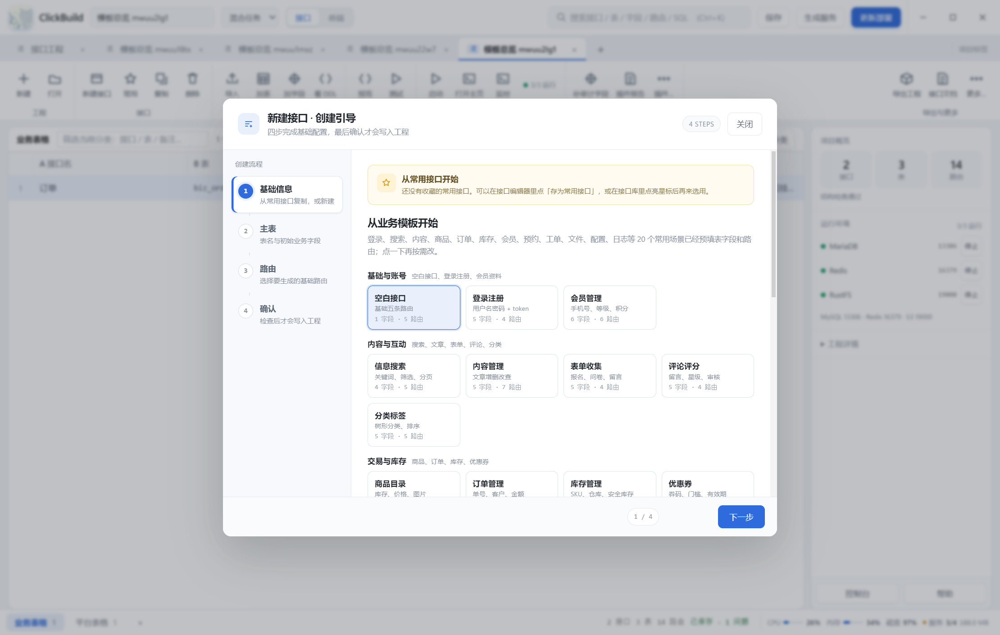

1.1.68 把 Excel / CSV 变成建表入口：文件直接拖进工作台任意位置，松手后弹预览，按第一行表头生成字段并自动推断 int / bigint / decimal / bool / date / datetime / json / text 类型；`.xlsx` / `.xlsm` 多工作表会分别建表，单表也可选择覆盖当前表字段。解析器不依赖第三方包，自己读 ZIP + SpreadsheetML，支持共享字符串、内联字符串、日期序列号与样式、隐藏工作表跳过、64MB / 20 万行 / 256 列上限；CSV / TSV 支持 BOM、GBK / GB18030、逗号 / 分号 / 制表符 / 竖线自动识别、引号内逗号与换行，以及重复表头、空表头、`id / created_at / updated_at` 重名避让。中文表头会映射成安全字段名，手机号、编号、身份证等保留为文本，密码类字段默认隐藏；导入只建表结构，不把行数据写进 MySQL。Ribbon 新增“导入”，表结构页按钮与右键菜单共用同一条链路，旧版 `.xls` 明确提示另存为 xlsx。验收：`test:table-import` 10/10，`test:ci` 12/12，真实 Electron 拖放与 IPC 解析通过，源码版 UI 冒烟 144/144（含 Ribbon 导入入口、全窗口拖拽遮罩、预览弹窗的表数 / 字段 / 样例 / 覆盖当前表），预览确认后生成 DDL 包含 `ti_fixture_1 / ti_fixture_2`，日期列落为 `DATE`、金额列落为 `DECIMAL(18,2)`。

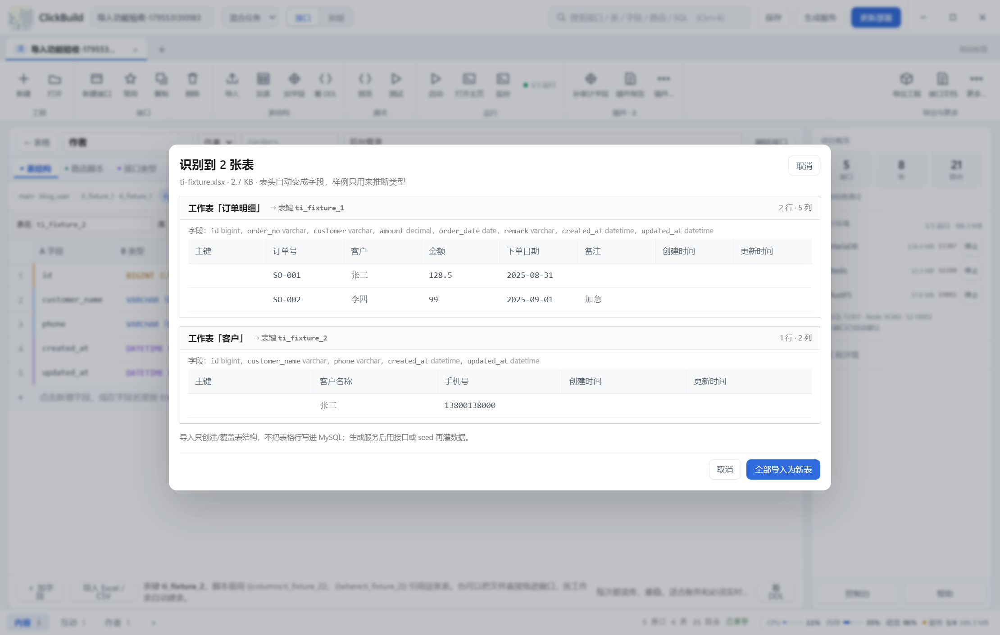

1.1.75 把表格套件从 8 套接口套件扩到全部 26 套内置模版：26 组 / 112 张物理表 / 155 条表定义 / 742 个字段，前 8 组保留完整业务套件，后面补齐视频、音乐、小说、活动报名、跨库订单、聊天、会议、餐饮、物流、挂号、报销、IoT、票务、网课、装修、印刷和报价等表组。组名、说明、标签、表名、注释和字段名都可搜索，找 `price`、`order_no` 这类字段会直接落到对应表组。所有 26 组都在临时工程里全量接入并过 `validateProject`；`test-kits` 102/102，源码版与安装版 UI 继续 168/168。

1.1.74 把 1.1.73 的接口套件再拆出一层「表格套件」：接口库新增「表格」页签，从 8 套已验收套件里抽取物理表，得到 8 组 / 46 张物理表 / 77 条表定义 / 314 个字段；同名共享表合并字段、索引与关系，并标出共享关系。整组可直接并进当前接口，现有路由不变；卡片里的表名按钮支持单张加入；「新建表接口」会落到「数据表」分类，带 5 条基础 CRUD、第一张表为 `main`，当前停在工程历史页时先建一个表组工程再进入工作台。表名按全工程避重、表键按接口避重、关系 `target/through` 随表名重映射，重复表直接跳过。实测商城表组接入空工程得到 5 表 / 5 路由并生成服务，`GET/POST /api/shop_user` 返回 200/201，PUT/DELETE 返回 200；按接口加入时路由数保持 11 不变；单表接入、撞名 `_2`、重复跳过全部通过。`test-kits` 74/74，源码版 UI 冒烟 168/168。


1.1.66 补上真正的 HTTP 重定向：脚本 `RETURN 301 "/login";`、`RETURN 302 { "location": "https://example.com" };` 以及 303/307/308 都会自动写 `Location` 响应头并返回空响应体，浏览器和 `curl -L` 能直接跟随；对象里的 `location / Location / redirect / url` 都可识别，`__headers` 可附带额外响应头。自定义 `handler` 也能返回 `{ status, headers, body }`，3xx 带 `Location` 时同样不写响应体。3xx 路由不再读写 Redis 缓存，缓存 key 加入 method + path，避免多个路由共用同一张表模板时串读；导出的 JS 路由同步生成 `responseMeta`，301 不再丢 `Location`。同时修复 Windows 全新数据目录下 `mariadb-install-db` 不认识 `--no-defaults/--basedir` 导致 MariaDB 初始化失败的问题。验收：`test:ci` 10/10，源码版 UI 冒烟 141/141，真实生成服务 301/302/303/307/308 与自定义 handler 全部带 Location 并跟随到 200，普通列表缓存仍正常命中。1.1.66 同时把脚本解释器扩成更完整的业务语法：`ASSIGN / INC / DEC / APPEND / PUSH` 负责赋值和数组累积，`FOR / WHILE / SWITCH / CASE / DEFAULT / BREAK / CONTINUE` 负责区间循环、条件循环和多分支，`FUNC / RUN / INVOKE / THROW` 负责纯表达式函数、调用和主动报错；裸写 SQL 会被明确拒绝，必须走 `QUERY` / `EXEC`，函数调用用 `RUN` 避开 SQL 的 `CALL`。实测生成服务 `GET /api/syntax/demo` 返回 `{"sum":13,"list":[12],"db":0}`，`THROW` 路由返回 500 并带 `route / method / path / hint / traceId`；脚本助手新增「变量与函数 / FOR 循环 / WHILE 循环 / SWITCH 分支」四条模版。

1.1.65 是双平台发布版：Windows 产品行为与 1.1.64 一致，同时新增 Linux x86_64 的 AppImage / deb，内置 MariaDB 13.0.2、Redis 8.10.3、RustFS 1.0.6 与 Node 25.2.1，并在 Linux 上真实跑通三台服务起停、生成服务 CRUD 与资源采样。CI 与 Release 统一走 `npm run test:ci` 的 10 套回归，补入停止按钮 6/6 与 21 语言包 158/158；发布构建固定 `--publish never`，不再让 electron-builder 在没有 `GH_TOKEN` 时自动上传；标签必须与 `package.json` 版本一致，安装包按精确文件名校验并同时上传 `.blockmap` 与 `.sha256`；上传 action 升级到 Node 24 的 `softprops/action-gh-release@v3.0.4`。本地 `test:ci` 10/10、1.1.65 安装版 UI 冒烟 141/141。

1.1.55 把工作台的接口方法做成固定语义色：GET 绿、POST 蓝、PUT 琥珀、PATCH 紫、DELETE 红，路由列表、详情/更新/删除表、权限矩阵、缓存表与接口文档共用同一套徽标；选中路由的左侧色条、浅色底和脚本编辑区细边都跟着方法走。编辑器页签加分类色点，右侧表 / 路由统计改成浅蓝与浅绿胶囊，表标签选中态由黑底改为浅蓝胶囊；表结构页按字段类型给第一列加 3px 色条并给类型文字着色。颜色只做识别，不跟 WPS 强调色漂移；源码版与 1.1.56 安装版 UI 冒烟均为 136/136。1.1.54 把 API 测试从“手写”改成“跟工程一起生成”：`codegen` 每次生成服务、更新部署或导出工程，都会写出 `tests/api.test.js`、`tests/plan.json`、`tests/README.md`；测试页新增「自动测试」区，可单独点「生成测试」并看到接口 / 路由 / 用例 / 只读 / 写入 / 跳过计数。默认只生成安全用例：列表 2xx 且能找到 `rows` / `data`，详情 / 更新 / 删除用不存在 ID 断言脚本声明的 `RETURN 404`，鉴权路由不带 token 断言 401；上传、上游转发、对象表、抓取和自定义脚本跳过并写明原因。写入生命周期单独计数，默认跳过，只有 `CBS_WRITE_TESTS=1` 才新建→详情→更新→删除，并在 `finally` 里兜底删除；新建成功但响应没有 ID 时停止后续步骤，不编假 ID。真实「后端任务」工程（`basePath=/v1`）生成 5 个用例，只读 4/4、开启写入 5/5，测试数据清到 0 行；`test-testgen` 19/19，模版回归 194/194，多语言 24/24。1.1.53 是前一版的现场监控：底部状态条加入 CPU、内存、磁盘、服务运行数与进程内存，点开是资源占用分析面板，列本应用和每个内置服务的 PID / 内存 / 端口，并按阈值给出排查结论；资源采样全部现场读取，服务内存 `tasklist` 缓存 6 秒，系统指标跟随既有 4 秒轮询，不新增高频定时器。

1.1.62 把单接口库升级成“常用接口”体系：保存当前接口时可直接填分类、说明并勾选收藏；Ribbon 新增星标“常用”，更多菜单拆出“常用接口”和“接口库”；管理页支持常用 / 全部 / 我的 / 内置四个视图、名称与分类筛选、说明搜索、星标切换、编辑名称 / 分类 / 说明、取消收藏、删除与复用统计。新建接口的四步引导第一步新增“从常用接口开始”，选中后直接完整复制表、字段、路由、脚本和文档，不再走后面三步。后端修掉重复插入同一接口时的路由冲突：按方法 + 路径全工程避重，表名替换后仍冲突的静态段追加 `-2 / -3`，参数名不变；收藏、分类、说明和使用次数写入 `_meta.json`，删除时同步清理。`test-iface-library` 33/33，源码版 UI 冒烟 141/141。

1.1.48 把「新窗口」从套壳的独立窗口补成真正和主工作台同款：新窗口使用与主窗口一致的无边框窗口（`frame:false` / `thickFrame:true`），不再出现 Windows 原生标题栏，内容直接从 WPS 标签栏开始；子窗口复用同一份工作台，自动带多项目标签、任务类型下拉、未保存点、主题、语言和自绘的最小化 / 最大化 / 关闭按钮，最大化图标会随窗口状态在「最大化 / 还原」之间同步。新窗口按父窗口位置和所在显示器工作区计算大小与位置，优先 1480×940、最小 1080×700，保证不跑到屏幕外；菜单栏、外链打开策略也与主窗口一致。点「新窗口」或标签右键「在新窗口打开」前，若打开的是当前活动工程，会先 `flushAndSave` 当前工程，保存失败就停在原窗口并提示，避免子窗口读到旧磁盘内容。实测子窗口标题栏宽 1480 时 logo、工程名、任务类型、视图切换、搜索、保存 / 生成 / 更新、语言和窗口按钮全部单行显示、无溢出；原生标题栏已消失，最大化状态回传正常。

1.1.47 把“多开项目”真正做成 WPS 式标签，不再靠多个独立窗口。同一个窗口顶部可以并排开多个工程标签，标签显示任务类型、工程名和未保存点；点标签直接切换，点 × 关闭，右键可「在新窗口打开 / 关闭这个标签 / 关闭其他标签」，`Ctrl+Tab` / `Ctrl+Shift+Tab` 循环切换，`Ctrl+T` 新建任务。切换、关闭、新建或套用模版前都会先 `flushAndSave`，把前端画布和工程改动落盘；保存失败就停在原工程并提示，不会静默丢改动。关闭最后一个标签回到工程历史页，关标签不会删工程文件。新增三类工作任务：新建时先选「混合任务（默认）/ 只后端任务 / 只前端任务」。只前端隐藏接口、表结构、脚本、运行和 AI 搜索入口，进入前端工坊；只后端收起前端工坊，保留接口工作台；标题栏的任务类型下拉可随时改，旧工程没有字段时按混合任务处理。历史卡片和标签都显示任务类型，按类型筛选也能命中。任务类型单测 13/13，UI 冒烟 133/133（新增“新建先选三类任务再开新标签”“WPS 式标签可来回切换工程”断言）。

1.1.46 修掉两个真实使用里的硬伤：工作台「新建」不再用示例工程覆盖当前工程，模版「套用」也不再替换当前工程，两个入口都改成先保存当前工程、再新建一个不重名的工程；保存失败就取消新建，原工程和未保存改动都保留。插件系统升到 v2：插件可用 `activate(api)` 注册 Ribbon 命令、接管保存/生成/导出/服务启停、注册工程模版、保存设置与私有数据、读写插件目录、访问网络或在授权后加载 Node 模块；插件面板新增启停、重载、新建脚手架、命令、模版、日志、开发者文档和界面内 API 说明，旧 `apply(project, api)` 继续兼容。内置 `audit-stamp` 用「补审计字段」「插件报告」、`generate.before` 注入和「审计示例」模版证明链路不是空壳。插件回归 22/22，UI 冒烟 131/131（新增“新建先保存再开新工程”“套用模版不覆盖”和插件 Ribbon 断言）。完整插件规范见 [docs/PLUGINS.md](docs/PLUGINS.md)。

1.1.45 是真人模拟暴露问题后的收尾版：同一生成目录重新生成时会清掉 1.1.42 遗留的 `launcher/`，不再让用户看到早已不会运行的 Java/Go 启动器；生成服务停掉后状态继续按本次实际端口探测，不会因为首选端口上恰好有别的程序就误报“生成的服务正在运行”。端口回归 11/11，模版生成回归 194/194。

1.1.44 是全量测试与真人模拟后的修复版：修掉 RustFS 与 RustFS 控制台同时被占用时会分到同一个端口的 bug，现在两个端口分开避让，S3 与控制台都能起来；补齐「同频社区」模版说明与「社区 / 动态」英文词条，国际化回归 20/20；把写死版本号的测试改成语义化版本校验。安装版 UI 冒烟 129/129，源码版 129/129；真实服务端到端、社交接口库、跨库、帮助页、Rust 运行时、内核与真实 MariaDB 全部重跑通过。

1.1.43 把 Phase 1 内核接进主生成链路，并把 Rust 全栈渲染器修到真能跑：`app/generator/sql.js` 统一走 `kernel/dialects`，MySQL / PostgreSQL / SQLite 三种方言可由 `project.dialect` 或 `generateSql(ir, { dialect })` 选择；旧 IR 通过 `kernel/ir-adapter` 转成元模型实体。Rust 生成器修掉搜索文本拼接、`QueryBuilder` 绑定生命周期、`AppError` 错误链、S3 SigV4 返回类型和 bootstrap 返回值，`cargo check` 通过；真实 MariaDB 上完成建表、`cargo run`、admin 登录和列表查询。完整导出不再生成转发 Node 的 `launcher/Server.java`、`launcher/main.go`，Java / Go 只走 `native/`。新增 `test-kernel-sqlgen` 4/4、真实 MariaDB 生成脚本 1/1、Rust 编译 5/5、Rust 运行 2/2。

1.1.42 把路由脚本编辑器补成 IDEA 风格：错误和警告直接标在具体列上，不再整行糊成一片。错误用红色波浪线，gutter 显示红色圆形感叹号；警告用琥珀色波浪线，gutter 显示三角感叹号；鼠标悬停显示错误码、消息和修复建议，点问题面板或 gutter 会精确选中出错的 token。底部状态改成带感叹号徽标的“1 个错误 · 2 个警告”，Problems 面板按严重级别排序并显示行:列。语法分析补齐括号不匹配 / 未闭合、块注释未闭合、字符串引号未闭合、占位符未闭合、空 QUERY / EXEC，并保留未声明变量、赋值未使用等警告；全部 17 个工程 390 条路由实测 0 误报。脚本检查器回归 18/18，UI 冒烟 129/129。

1.1.41 把启动和退出真正收尾干净：启动时先枚举本安装包 `resources/services` 下的 `mariadbd.exe`、`redis-server.exe`、`rustfs-windows-x86_64.exe`，把上次异常退出留下的进程停掉，再分配端口、启动三台服务；退出时弹出关闭提示页，按“生成的服务 → Redis → RustFS → MariaDB”逐个停止，等本次自己启动的端口真正释放后才退出。只处理本安装包路径下的进程，系统安装的 MariaDB 不会被误杀；启动页会写明“上次遗留进程 N 个”，关闭页会显示当前停到哪一台。

1.1.40 启动阶段改成先准备、再进界面：新增独立启动页，显示品牌图、世界轨道加载动画、四段任务（环境与工具链 / 端口分配 / 内置服务 / 工作台）和实时百分比；启动时自动检测 Node、Bun、Java/JDK、Go、Python、Rust、Git，并自动启动 MariaDB、Redis、RustFS。端口被别的程序占用时向后自动避让（最多 40 个），本安装包自己的服务可认领现有进程，启动页和右侧栏都会写明“从哪个端口换到哪个端口”；二次启动或上次异常退出后不会误杀别人的进程。新增 `tools/test-port-fallback.js` 8/8，UI 冒烟 127/127。

1.1.39 把工作台从“按钮全摊开”改成按主任务分组：顶部 Ribbon 从 9 组 30 多个图标收到 6 组 15 个，只保留新建 / 打开、接口、表结构、脚本、运行和导出；模版库、接口库、导入导出、AI、设置、帮助等低频操作收进“更多…”两列说明卡片。右侧固定栏删掉“操作提示”和与底栏重复的工程统计，改成三格项目概览、内置服务运行状态（运行数 / 端口 / 单服务启停）和可折叠的工程详情，宽度 288 → 264；顶部“保存 / 生成服务 / 更新部署”保持唯一主入口，工具条不再重复“保存 / 更新”。源码版 UI 冒烟 126/126。

1.1.38 导出工程改成先选类型、只生成选中一套：Node / Bun、Go、Java、Python 分别只写自己的服务入口、依赖、原生目录与 IDEA 运行配置，不再把四套运行时一起塞进工程；Node 导出不再夹带 `native/java` 和 Java jar，`.run` 启动配置只给 Node / Bun。新增 `tools/test-export-single-runtime.js` 31/31。

1.1.28 把内置案例从“接口说明页”彻底改成真正能用的业务应用：PageStudio 新增原生「业务应用」`appview` 组件，`.yxpp` 带 `project.app` 时由 `app-runtime.js` 按同一份业务模型渲染真实列表、筛选、新建 / 编辑表单、详情、行级动作、统计和后台流程，24 套案例各生成 4–7 个页面；详情改用 `allColumns` 取回隐藏正文，表单会补 hidden 但可写的业务字段，多表接口按路由实际表生成字段，列表支持行级审批 / 加入 / 离开 / 结束 / 核销等动作，并按状态隐藏无效按钮。媒体站有真实上传与 `<audio>` / `<video>` 播放、`Range` 206 静态路由，对象存储不可用时自动落本地 `uploads/`；博客、工单回复、报销审批、会议纪要、餐厅开台下单结账、活动票务核销、CRM 联系人 / 商机、聊天收发、社交 86 条路由都已用真实数据库验收。导出工程不再只有 Node：源码导出弹窗可选 Node / Bun / Go / Java / Python，Python 已实测 `/` 业务前端、`/api` 真实数据、详情正文与回复、日期序列化和本地媒体；Node 模板同步补齐 `/uploads/` 的 MIME 与 Range。案例前端检查 60/60、24/24 生成通过，24/24 真实服务首页冒烟通过，社交 117/117、86/86 路由覆盖。

1.1.27 是 1.1.26 的全量回归基线版本：功能代码与 1.1.26 一致，只同步测试结果与版本文档；本轮完整跑通 26 套测试、1002 条断言，覆盖离线单元、真实 MariaDB / Redis / RustFS、21 套行业案例、社交接口库 86 条路由、问卷/报名真实 HTTP、四套导出运行时、源码版与安装版 UI 冒烟，以及本机真实 Ollama 生成与 UI 追加链路；安装版与源码版 `ui-smoke` 均为 124/124。测试结果表已按本轮实际输出更新，后续版本以这一版作为安装包回归基线。

1.1.26 把工作台补成“新手能直接上手、接口多了也不乱”的版本：底部控制台改为 IDEA 式可拖高工具窗，生成服务 / MariaDB / Redis / RustFS 可同时开多个标签，支持过滤、自动滚动、清屏、复制和单标签关闭，`Alt+F12` 或 ``Ctrl+` `` 开关，日志按行差量刷新；路由页右侧新增脚本助手，提供列表、新增、校验、事务、抓取、等待六类模板和当前表 / 字段 / 占位符 chips，点一下插到光标处，`Ctrl+Space` 收起，另带完整语法速查；帮助页新增“在这里能做什么”五张卡片；搜索改为精确 / 前缀 / 包含打分，命中高亮，`↑↓` 选择、`Enter` 跳转，超过 60 条显示总数和“显示前 60 条”，点字段结果直接跳到表结构并聚焦该字段；接口表新增当前分类筛选与 `shown / total` 计数，长名称省略号，130 个接口下工作区和表格均无横向溢出。验收：`test-i18n` 20/20、`test-pack` 19/19、`test-export-runtimes --no-serve` 17/17，源码版 `ui-smoke` 124/124（含脚本助手、双控制台、130 接口、分类筛选、搜索限流、字段跳转）。

1.1.25 把导出工程的可配置性补齐：导出根目录新增 `config.json`，端口、接口前缀、MySQL、Redis、S3、错误页开关、500 详情、日志等级、缓存前缀、请求体上限和 `RESET_DB` 共 21 个参数都能直接改，不必改源码；键名与运行时环境变量一一对应，优先级为系统环境变量 > `config.json` > `.env` > 内置默认值，`.env` 仅生成全注释的覆盖示例。Node、Python Flask、Go、Java 四套运行时都读取同一份 `config.json`，并统一改为重启生效；Node 的请求体上限、错误页和缓存前缀，Python 的 `MAX_CONTENT_LENGTH`、Go 的 `env()`、Java 的 `Config` 都已接入。配置文件允许用户用记事本保存带 BOM 的 UTF-8，四套读取逻辑都会剥掉 BOM。验收：改 `PORT=18997` 后 Node 在 18997 启动并连接 MySQL/Redis/S3，改 `API_PREFIX=/cfgapi` 后 `/cfgapi/users` 200、旧 `/api/users` 404；Python 18992、Go 18990、Java 18989 同样按配置文件端口和前缀启动；`test-export-runtimes --no-serve` 17/17，`test-integration` 6/6、`test-ai` 18/18、`test-pack` 19/19、`test-i18n` 20/20、`test-rowstore` ok、`test-deploy` 11/11，安装版 `ui-smoke` 114/114。

1.1.24 把生成服务从“接口生成器”扩展成可对接上游、可抓取、可多语言运行、可权限治理的集成平台：新增上游服务器表，支持新增 / 编辑 / 删除、探测 `/openapi.json`、`/swagger.json`、`/api-docs` 并把前 20 条路径一键生成本接口的转发路由；代理路由按 `upstream + target` 转发请求方法、请求体、请求头、响应状态与响应头，固定 target 时路径参数会按顺序拼到上游地址，也支持上游鉴权头、超时和 `stripPrefix`。脚本解释器新增 `WAIT`（最长 60 秒，带 DEBUG 日志）和 `CRAWL`（限制响应大小、超时、默认禁止内网地址，返回 `status / ok / url / contentType / title / text / matched / links / bytes`），与原有 `TX BEGIN / COMMIT / ROLLBACK`、跨库事务提交和回滚一起构成等待与事务能力。新增 Python Flask 原生运行时 `native/python/app.py`：直接读取同一份 `service.json`，用 Flask + PyMySQL + Redis + MinIO 执行同一套脚本 AST，支持列表 / 详情 / 新建 / 更新 / 删除 / 上传 / 代理 / 对象表 / 抓取、SQL 占位符、token 与角色权限；运行时检测新增 Python，生成服务的启动选择可直接拉起 Flask，不经过 Node。接口对象存储抽象为“对象表”：`iface.objects` 配桶 / 前缀 / 每页条数，生成 `GET /objects` 返回 `{ key, name, size, url, lastModified }` 与 marker 分页，支持 `?key=` 删除和 `download=1` 302 到 presigned URL；编辑器新增“对象表”页签，可预览 RustFS / S3 当前桶并一键生成对象表路由。权限控制改为路由 × 角色矩阵：勾选角色自动开启 `auth`，`permissions.enforce` 开启后 token 内 `roles` 与路由角色无交集返回 403，无 token 返回 401；新增 / 删除角色会同步清理路由引用，校验阶段拒绝“路由角色不在权限矩阵里”。脚本执行与控制台联动：路由页新增“试运行”弹窗，按当前启动服务的 `/api + basePath + path` 发请求，支持路径参数与 JSON 请求体，直接显示状态码、耗时、URL 与响应；监控日志行可点击跳到对应接口 / 路由。AI 前端生成修复为模型返回的新前端不再被旧前端覆盖，并加入 `normalizeAiFrontend`、标题 / 按钮对比度修正和前端更新日志；真实 `qwen3.8:27b` 复测从旧前端 29 字符变为 6384 字符、3 个顶层元素的会员管理前端。验收：`test-integration` 6/6、`test-ai` 18/18、`test-pack` 19/19、`test-i18n` 20/20、源码版 `ui-smoke` 114/114；Node 与 Flask 两端均跑通列表 / 详情 / 代理 / 抓取 / 对象表，CRAWL 返回 48 字节与 `WAIT 30ms` 日志，代理 `/echo/123` 上游收到 `/echo/123`。1.1.23 把“表级加速”里被当成查询缓存的四种模式真正落成表存储：Node 运行时新增 `src/rowstore.js`，用嵌入式 SQL 引擎在进程内建表，`redis` 模式读写都走 Redis Hash、写操作不再落 MySQL，`lru` 只存进程内存并按上限淘汰，`lru-redis` 每次写入同步 Redis，`periodic` 按表级 `flushMs` 定期落盘；`TTL`、重启恢复、事务提交 / 回滚、自增主键、单表与多纯表 JOIN 都有测试覆盖。`cache` / `redis-mysql` 仍保持“MySQL 权威写入 + Redis 读缓存”，不再和纯表混称。Go / Java 原生运行时没有纯表引擎，改为启动时拒绝非 `mysql` 模式并明确报错，不再静默直连 MySQL；界面同步标注纯表只由 Node 运行时执行。真实服务验收：`POST /api/posts` 后 MySQL 行数 0、Redis 表 1 行，重启服务仍能读到；真实 Ollama `qwen3.8:27b` 生成 2 个接口耗时 54.9s，`contextUsed:true` 且未重复已有接口；`test-pack` 19/19、`test-i18n` 20/20、安装版 `ui-smoke` 107/107。1.1.22 修复工程历史卡片的红色删除叉视觉偏移：不再用字体字形 `×` 做居中，改为两条 2px 白色短棒按 45° / -45° 在圆心的绝对坐标交叉，圆内十字在任意 DPI 下都对齐圆心。1.1.21 把设置、文件关联与运行时可交付化：设置中心可改 AI 接入方式（Ollama / OpenAI 兼容 / DeepSeek）、endpoint、模型、Key、超时、温度、最大 Token 和五个本地服务端口；`.yxpn` / `.yxpp` 双扩展关联，`.yxpp` 打开只更新前端绑定，不再覆盖同名工程接口。生成器新增 Go 与 Java 原生服务：Go 直接 `go build` 出二进制，Java 用 `javac` 编译 `icb` 包并经 JDBC 运行，均支持路由、脚本、事务、token 与内置函数。表结构新增七种加速模式（直连 MySQL、Redis 查询缓存、Redis 临时缓存表、Redis 热读 + MySQL 权威、LRU 内存淘汰、LRU + Redis 两级、定期刷新），可按表选择 TTL / LRU 上限 / 刷新间隔并全局搜索；新增 CSV / TSV / TXT 表格导入，按列位置替换字段并保留主键、自增与查询属性。回归 `test-pack` 19/19、`test-i18n` 20/20、`ui-smoke` 107/107。1.1.20 修复小窗口与高 DPI 下的布局挤压：标题栏副标题断点提前到 1560，工程名、视图切换、搜索、保存 / 生成 / 更新、语言与窗口控制全部禁止收缩和换行；1080 最小宽度下按钮仍单行可读，1280 宽搜索框缩到 220，Ribbon 在 1320 以下自动换行，全部功能组不再被横向裁掉。1.1.19 新增「问卷系统」和「活动报名」两套可直接使用的业务案例：问卷系统包含公开问卷列表、动态题目渲染（单选 / 多选 / 评分 / 文本）、匿名提交、管理登录、题目编辑、发布 / 结束、逐题统计、答卷明细与 CSV 导出；活动报名包含公开活动页、名额进度、姓名 / 手机号报名、事务名额控制、重复手机号拦截、管理后台、报名名单与 CSV 导出。两套案例各自带管理员表，首次用 `admin / Admin@123456` 登录自动创建并 SM4 入库，不依赖生成服务的全局 `/auth/login`；有答卷 / 报名时删除分别返回 409 `HAS_RESPONSES` / `HAS_SIGNUPS`。真实 HTTP 冒烟 22/22、23/23，全部案例前端回归 60/60。

1.1.18 把内置前端工坊从“官网单文件换皮嵌入”改成 ClickBuild 桌面端原生工作台：整块删除官网游戏逻辑子系统（约 15.8 万字符的样式、面板与 PSGameRuntime），内层顶栏不再显示官网品牌、账号、站点发布、分享、模板、工程、网页 AI 与导出代码入口，只保留“当前工程”上下文和设备、缩放、搜索、中英切换、响应式、撤销/重做、导入导出、同步、部署；官网“网站素材库”与云端筛选整组隐藏，资产面板改为“预设 · 本机项目”，全局搜索过滤官网命令；桌面端原 40px 工坊标题栏收进编辑器顶栏，导入/导出/同步/部署通过 `cbs:app:action` 桥接复用父窗口能力，整个前端只剩一条 46px 原生顶栏；语言由父窗口 `settings.json` 传入并在 `CBS_EMBED` 下使用内置词条，不再请求官网 `/api/ui-i18n`，也不写浏览器语言缓存；主题收紧为 228/292 三栏、纸面 `#F3F3F0`、24px 状态栏。1.1.17 内置前端工坊整体升级为 yxpil.com/studio 最新 `yxpilStudio` 单文件编辑器：左侧改为组件 / 图标 / 资产 / 页面风格，画布带刻度、标尺与多页标签，右栏图层与属性检查器，并保留响应式方案与游戏逻辑面板；桥接改为回传完整 `project` 与 `buildExport(css)` 导出的多页 HTML，父窗口据此生成 `.yxpp`，多页页面与导航不再丢页。嵌入态跳过浏览器工程草稿、网站账号、站点发布、共享工作站、模板中心、工程文件与网页 AI 等联网入口，品牌改为 `CLICKBUILD/FRONTEND`，只保留当前工程同步、预览、SVG 导入与代码导出。案例自带的可交互运行时 HTML 通过 `<!-- cbs:studio-export -->` 标记与编辑器导出页区分，设计编辑不会冲掉登录、路由试运行等脚本。新增多页工程持久化断言，源码版与安装版 `ui-smoke.js` 均 **103/103**。1.1.16 修复高 DPI 下最大化与 1080 窄窗口的标题栏裁切和换行：关闭按钮不再越界，品牌、工程名、搜索、保存/生成/更新、语言选择在 1080 宽仍单行可读；Ribbon 在 1480 默认窗口完整显示全部入口，1080 以下保留横向滚动兜底；工作台套用模版不再把当前工程改名并覆盖同名真实工程；UI 冒烟改用隔离工程并完整恢复用户设置，新增标题栏、Ribbon、窗口控制与数据清理断言。1.1.15 AI 生成接入本机 Ollama（原生 `/api/chat`，模型列表 / 连接测试 / 180 秒超时），同时支持 OpenAI 兼容与本地模拟；请求会携带工程名、分类、接口、表、字段、路由、前端与当前选中项，替换时保留工程名/前端/连接/主题/自定义函数，追加时跳过重复接口与表；HTTP 401/404/500、模型不存在、超时、坏 JSON、空响应不再静默回退，弹窗直接报错且不改动当前工程；新增模拟服务测试 `tools/test-ai.js` 与真实 Ollama 验收脚本。1.0.4 起，生成服务自带 `/help` 帮助页（快速入口、接口路由、请求约定、SQL 占位符、脚本语句、内置函数、curl 示例），并在 `/docs` 和 `/console` 页眉提供入口。1.0.5 统一了失败响应的顶层 `error` / `message`，并修正 7 条内置案例详情路由缺失 404 的问题。1.0.6 把 MariaDB / Redis / RustFS 一并打进安装包，服务路径只从安装资源解析，不再依赖任何用户目录。1.0.7 增加独立工程导出，带 `.idea` 与 Node 运行配置，IntelliJ IDEA 可直接打开。1.0.8 把生成服务改成模块化单体：一个接口一个 `src/modules/` 目录，自动加载，公共能力留在 `server.js`。1.0.9 重做多表切换栏：表多时横向滚动 + 快速下拉，表名/库/注释移到独立一行，不再挤掉右侧控件。1.0.10 补齐空白区域右键菜单、表/字段右键操作和快捷键；自动保存改静默，底栏显示未保存/保存中/已保存。生成服务新增全局 404/500 错误页、`dev.js` 热部署和 Node/Bun/Java/Go 启动选择；导出工程时可关闭错误页或 500 详情。1.1.0 新增「社交接口库」预置工程：9 个接口、86 条路由、18 张唯一表，覆盖账户、好友、私聊、群聊、动态、搜索、通知、收藏、文件、举报和统计；统一用 `onlyId` 标识用户，登录自动下发 HttpOnly cookie，所有表默认无主键。1.1.1 新增单接口库：22 套模版里的 63 个内置接口都能单独浏览、搜索、插入，编辑后的接口可命名存入本地接口库，自存接口重名直接拒绝；插入时接口名、表名、basePath 自动避重。1.1.2 补默认错误语义：新建接口的详情/更新/删除/附件路由对不存在的记录统一返回 404；路径存在但方法不对返回 405 并带 `Allow`；超过 64MB 的请求体返回 413；OpenAPI 补齐 404/405/413 等默认响应。1.1.3 给全部 22 套案例工程补齐完整的 `.yxpp` 前端：每套案例都带前端工程、可直接运行的案例控制台和按案例定制的导航/指标/分类/接口清单；套用模版即可切到前端模式，生成服务的 `/` 直接打开案例前端，支持登录、路由试运行、数据表格与 JSON 响应。1.1.4 把「新建接口」改成四步创建引导：先配接口名/分类/路径前缀，再定主表名与初始业务字段，随后选择基础路由与鉴权方式，最后预览确认；未点确认前不会写入工程，取消也不产生改动。1.1.5 重做前端工作台与启动链路：「启动」直接补齐依赖、生成当前工程、启动服务并打开 `/` 网页主页；前端工坊改用 yxpil.com/studio 最新页面并去掉旧站品牌、外部追踪与浏览器草稿，以当前工程为唯一数据源，编辑自动回写并 20 秒定时兜底，没有 `.yxpp` 时先给空白画布、首次编辑自动绑定。1.1.6 把生成服务控制台的「健康」改成「检查全部」：逐接口检查路由注册、表/字段存在性和脚本语法，返回通过/失败与错误详情；只做只读结构检查，不执行写请求，同时新增 `/_health/interfaces` 接口。1.1.7 给生成服务的列表查询加过滤器：`{{where}}` 支持 `__ne`、`__gte`、`__gt`、`__lte`、`__lt`、`__like`、`__regex`、`__iregex`、`__notregex`、`__contains`、`__startswith`、`__endswith`、`__in`、`__between`、`__isnull`、`__notnull`，`keywordRegex` 对搜索字段走 REGEXP；控制台新增过滤条件输入框，条件自动拼到请求上，字段名走白名单、值全部参数化。1.1.14 新增工程历史预览：启动先进入历史与模版选择页，选中工程后才进工作台；历史卡片支持大红叉删除、右键打开/复制/删除，文件丢失时保留条目并提示“找不到文件”；预览页可直接套用 24 套模版，新增音乐网站与小说网站。1.1.13 新增「更新部署」：顶部、服务组和前端工坊各有一个入口，点击后保存当前工程，重新生成后端路由、SQL、文档与前端页面，自动补齐依赖并重启生成服务；已删除接口的旧模块和编号 SQL 会同步清理，`src/modules/_` 自定义目录和用户 SQL 保留。1.1.12 安装器新增「可选组件」页，可勾选是否安装使用文档与示例工程，生产环境可全部取消；默认勾选，程序本体、运行时和内置服务始终安装。1.1.11 安装器新增中文 / 英文使用条款与免责声明页，明确仅限合法用途并由使用者自行承担责任；项目改为 Apache License 2.0，附完整 LICENSE 与 NOTICE。1.1.10 修复导出工程的 Java / Go 路由骨架：中文接口名不再统一生成 `IfaceItemItemRoute`，类名与文件名一致、Go 常量与函数按路由唯一命名，并加入 `go.mod` 便于编译检查。1.1.9 窗口右上角关闭按钮左移 6px，避免贴住屏幕边缘。1.1.8 增加桌面端中英双语：离线语言包覆盖工作台、创建引导、各弹窗、接口编辑器与前端工坊，22 套模版和 63 个内置接口的元数据一并预翻译；首次启动按系统语言选择，安装器也按 Windows 系统 UI 语言自动切换中英文。

安装包已内置便携 Node（Windows `resources/runtime/node/node.exe`，Linux `resources/runtime/node/bin/node`）与三台本地服务（`resources/services/`），不依赖系统 Node，也不要求电脑上预先装数据库；Windows 安装时注册 `.yxpn` 文件关联，Linux 通过 `.desktop` MIME 关联打开同两种工程包。运行时数据只写用户数据目录，Windows 为 `%APPDATA%\click-build-server`，Linux 安装版为 `~/.config/click-build-server`（源码脚本生成时回退 `~/.local/share/click-build-server`），源码和配置里不写死盘符。

### 从源码运行

```bash
npm install
npm start                 # Electron 界面
```

源码运行前先生成内置服务目录（默认从仓库旁边的 `ClickBuild` 复制，也可以用 `CBS_SERVICES_SRC` 指定源目录）：

```powershell
npm run vendor:services
```

脚本只收 MariaDB 必需 bin/lib/share、Redis 运行文件和 RustFS，产物约 432 MB，落在 `vendor/services`（不提交到 Git）。Linux 用 `bash tools/vendor-services-linux.sh` 生成 `vendor/services-linux` 与 `runtime/node-linux`，合计约 484 MB。界面右侧“本地服务”里点启动，会拉起这三台内置服务：

| 服务 | 默认端口 | 用途 |
| --- | --- | --- |
| MariaDB | 13306 | 业务表 + 日志表 |
| Redis | 16379 | 缓存 / token / 限流 / 服务间消息 |
| RustFS（S3 兼容） | 19000（控制台 19001） | 附件对象存储 |

再点“生成服务”，产物落在 `generated/iface/<工程名>`，用内置 Node 启动：

```powershell
cd generated\iface\接口工程
$repo = (Resolve-Path '..\..\..').Path
$env:NODE_PATH = Join-Path $repo 'node_modules'
$env:RESET_DB='1'
Join-Path $repo 'runtime\node\node.exe' server.js
```

Linux / WSL 等价命令：

```bash
cd generated/iface/接口工程
export NODE_PATH="$(cd ../../.. && pwd)/node_modules"
export RESET_DB=1
../../../runtime/node-linux/bin/node server.js
```

打开 <http://127.0.0.1:18100/> 是生成服务的控制台，`/docs` 是自动 API 文档，`/help` 是运行时帮助与脚本语法页。

## 不用界面也能生成 / 测试

```bash
runtime\node\node.exe tools\build-iface.js --seed     # 用示例工程生成
runtime\node\node.exe tools\e2e.js http://127.0.0.1:18100   # 23 项端到端断言
runtime\node\node.exe tools\test-pack.js               # .yxpn 打包 / 复制接口 / AI / 文档
runtime\node\node.exe tools\ui-smoke.js 9222           # 界面冒烟（需 --remote-debugging-port=9222）
```

## 界面

- **Excel 网格**：行号 + A–E 列；双击行进入接口编辑器，分类在底部 sheet 页（双击改名、右键新建/导出）。
- **全局搜索** `Ctrl+K`：接口 / 表 / 字段 / 路由 / SQL 一把搜。
- **六页编辑器**：表结构、路由脚本、缓存存储、接口文档、测试、生成导出。
- **Ribbon**：工程、接口、表结构、脚本、运行、导出与更多，再加一个按插件动态出现的「插件」组。
- **新窗口**：从「新窗口」或标签右键打开的新窗口与主窗口同款：无边框自绘标题栏、多项目标签、任务类型、主题、语言和窗口按钮都复用同一套；打开当前工程前先保存，最大化 / 还原状态会回同步。
- **多项目标签**：同一窗口像 WPS 一样开多个工程标签。标签显示任务类型、工程名和未保存点；点标签切换、点 × 关闭、右键可「在新窗口打开 / 关闭这个标签 / 关闭其他标签」，`Ctrl+Tab` / `Ctrl+Shift+Tab` 循环切换，`Ctrl+T` 新建任务。切换或关闭前会先把当前前端画布与工程改动落盘，保存失败就停在原工程。
- **三类任务**：新建任务先选「混合任务（默认）/ 只后端任务 / 只前端任务」。只前端隐藏接口/表/脚本/服务入口，只后端收起前端工坊，标题栏任务类型可随时改；旧工程没有类型时按混合任务处理。
- **模版库**：26 套内置工程（商城 / 视频站 / 音乐网站 / 博客 / 小说网站 / 工单 / 问卷系统 / 活动报名 / 预约 / 跨库订单 / 同频社区 / 聊天等）。套用模版和「新建」都先保存当前工程，再用模版/示例新建一个工程；当前工程不会被覆盖。当前工程也能“存模版”，启动预览页可直接套用全部模版。
- **插件**：`plugins/<id>/plugin.json + index.js`。新插件用 `activate(api)` 注册 Ribbon 命令、接管保存/生成/导出/服务启停、注册模版、保存设置与数据；旧 `apply(project, api)` 继续兼容。面板里可启停、重载、新建脚手架、安装/卸载、看日志和开发者文档。完整规范见 [docs/PLUGINS.md](docs/PLUGINS.md)。
- **内置插件**：`audit-stamp` 演示命令、工程写入、生成钩子和插件模版；`trace-tag` 演示旧写法并注入 `REQ_TAG()`。
- **Defender**：插件面板里可一键把仓库、运行时、生成目录加入 Windows Defender 排除项。
- **右键**：接口行、分类 sheet、路由都能右键（打开 / 复制 / 重命名 / 删除 / 导出）。
- **复制接口**：自动编号 `订单2`、`订单3`，表名同时加后缀，路由路径自动避让。
- **主题**：页眉/页脚/强调色/字体，存在本机设置。
- **截图**：`docs/screenshots`（运行时截）。

## 脚本语法（每条路由一段）

```text
LET $u = QUERY SELECT id, password_hash FROM {{t:main}} WHERE username = {{body.username}} LIMIT 1;
IF LEN($u.rows) == 0
  RETURN 401 { "ok": false, "error": "NO_USER" };
END
IF SM4_DEC($u.rows[0].password_hash, 'clickbuild-key') != {{body.password}}
  RETURN 401 { "ok": false, "error": "BAD_PASSWORD" };
END
LET $t = TOKEN NEW { "onlyId": $u.rows[0].only_id, "username": {{body.username}} };
LOG INFO '登录成功';
RETURN 200 { "ok": true, "token": $t.token };
```

支持：

- `LET $x = QUERY|EXEC SQL;`、`LET $x = 表达式;`
- `ASSIGN $x = 值;`、`$x = 值;`、`$x += 1;`（`+= -= *= /=`）、`INC $n;` / `INC $n BY 2;` / `DEC $n;`
- 嵌套赋值：`$user.name = 'A';`、`$list[0] = 9;`、`$user.score += 1;`；`INC / DEC / APPEND / PREPEND` 都支持 `$user.score`、`$user.tags` 路径
- 动态下标：`$rows[$i].name`、`$matrix[$i][$j]`、`$map[$key]['字段']`，下标支持 `$i + 1`、`LEN($list) - 1` 等表达式
- `APPEND $list, 值;` / `PREPEND $list, 值;` / `PUSH $list, 值;`（尾部追加或头部前插，循环里拼数组）
- `IF / ELSEIF / ELSE IF / ELSE / END`、`FOREACH $row IN $list / END`
- `FOR $i = 1 TO 5 STEP 1 / DOWNTO / END`、`WHILE 条件 / END`、`REPEAT 5 TIMES / REPEAT 5 TIMES AS $i / END`、`SWITCH 表达式 / CASE 1, 2 / DEFAULT / END`
- 循环上限：`FOREACH` 最多 500 条，`FOR / WHILE / REPEAT` 最多 1000 次；超出、负数次数、非数字边界直接报错，不会静默截断
- `BREAK`、`CONTINUE`、`FUNC 名称($a, $b) = 表达式;`、`RUN 名称(参数);` / `INVOKE 名称(参数);`、`THROW '错误信息';`
- `TRY / CATCH $err / FINALLY / END`：捕获运行错误，catch 对象有 `name / message / stack`；`CATCH` 可省略变量，默认 `$err`
- `ASSERT 条件, '失败信息';`：条件不成立立即抛错，可交给 `TRY` 捕获
- 表达式：`条件 ? 值1 : 值2`、`$a ?? $b`、`AND / OR / NOT`（也支持 `&& / || / !`）、`$x IN [1,2]` / `$x IN (1, 2, 3)` / `NOT IN`、`$x LIKE '张%'` / `NOT LIKE`（`%` 任意串、`_` 单字符）、`$x BETWEEN 1 AND 9` / `NOT BETWEEN`、`$x IS NULL` / `IS NOT NULL`；字符串比较按字典序，数字字符串和 ISO 日期可直接比大小
- `TX BEGIN|COMMIT|ROLLBACK`（写路由默认自动事务）
- `HTTP GET|POST|PUT|DELETE 'url' {json}`（服务间调用）
- `PUBLISH 'channel' expr`（Redis 消息）
- `TOKEN NEW|GET|DEL`（onlyId + token 会话）
- `LOG TRACE|DEBUG|INFO|WARN|ERROR|FATAL expr`（彩色控制台 + 落库 + SSE）
- `RETURN [status] {json};`；3xx 可写 `RETURN 301 "/login";`，或 `RETURN 302 { "location": "https://example.com" };`，服务会自动补 `Location` 响应头。301/302/303/307/308 都可用，响应体为空，浏览器和 `curl -L` 会跟随。

自定义语句和 SQL 严格分开：裸写 `SELECT / INSERT / UPDATE / DELETE / REPLACE / CREATE / ALTER / DROP / TRUNCATE / CALL / SET …` 会直接报语法错误，必须写成 `QUERY SQL;`（要结果集）或 `EXEC SQL;`（执行写入）。函数调用有意使用 `RUN` / `INVOKE`，避开 SQL 的 `CALL`；`SET $x = ...` 只表示变量赋值，不会被当成 SQL `SET`。完整示例：

```text
LET $sum = 0;
FUNC DOUBLE($a) = $a * 2;
FOR $i = 1 TO 3
  INC $sum BY $i;
END
ASSIGN $sum = DOUBLE($sum);
SWITCH $sum
CASE 12
  LOG INFO '命中 12';
DEFAULT
  LOG WARN '其他值';
END
RETURN 200 { "sum": $sum };
```

错误捕获、固定次数循环和嵌套字段：

```text
LET $user = { "name": {{body.name}}, "score": 0, "tags": [] };
$user.score += 1;
PREPEND $user.tags, 'vip';
REPEAT 3 TIMES AS $i
  INC $user.score BY $i;
  APPEND $user.tags, $i;
END
TRY
  ASSERT $user.score BETWEEN 1 AND 100, '分数超出范围';
  RETURN 200 { "ok": true, "user": $user };
CATCH $err
  LOG ERROR $err.message;
  RETURN 400 { "ok": false, "message": $err.message };
FINALLY
  LOG DEBUG '校验结束';
END
```

函数：`HASH / MD5 / SHA1 / SHA256 / SM3 / SM4_ENC / SM4_DEC / SUBSTR / LEFT / RIGHT / LEN / UPPER / LOWER / TRIM / CONCAT / REPLACE / SPLIT / JOIN / NOW / TODAY / UUID / BASE64 / URL_ENC / RAND_INT / MASK / JSON_GET / IF / IN / COALESCE …`，另可在“导出处”写自定义函数。

SQL 里也能直接写这些函数（执行前由解释器算成参数再下发，避免不同数据库函数名打架）。

SQL 里还能引用脚本变量：`$i.product_id` 会自动换成参数，`$oid.rows.0.id` 取上一句结果；显式写法是 `{{vars.i.product_id}}` / `{{last.insertId}}`。

## 占位符

| 占位符 | 展开 |
| --- | --- |
| `{{t:key}}` / `{{table:key}}` | 表名（可带库名） |
| `{{columns:key}}` | 查询列（`*` 或字段列表） |
| `{{insertColumns:key}}` / `{{insertValues:key}}` | 插入列 / 值（值走 `?` 参数） |
| `{{updateSet:key}}` | UPDATE SET 片段 |
| `{{where:key}}` / `{{orderBy:key}}` | 条件（支持 `__gte/lte/gt/lt/like/in/between/ne`、`keyword`、`sort` 白名单） |
| `{{idColumn:key}}` / `{{limit}}` / `{{offset}}` / `{{page}}` | 主键列 / 分页 |
| `{{body.x}}` / `{{query.x}}` / `{{path.x}}` / `{{user.x}}` | 请求与登录态 |
| `{{onlyId}}` / `{{token}}` / `{{uuid}}` / `{{now}}` / `{{remoteIp}}` / `{{traceId}}` | 平台值 |
| `{{objectKey}}` / `{{objectUrl}}` / `{{bucket}}` | 对象存储上传结果 |

## 一条接口连多库多表

每个接口的每张表可选 `conn`（main / 你新加的 mysql 连接）；脚本里可以混着查，事务只对同池生效，跨池失败会写 FATAL 日志并回滚已进入的连接（尽力补偿，不做分布式两阶段）。

服务之间：脚本里 `HTTP` 直连别的服务，或 `PUBLISH` 到 Redis 频道；默认约定 Redis `db0` + `icb:*` 前缀。

## 导出工程（IDEA 可直接打开）

`工程 → 导出工程`（或「生成导出」页）先在弹窗里下拉选择 **导出类型**：Node.js / Bun / Go / Java / Python。选一个父目录后，会在里面新建 `<工程名>` 独立目录，只写入这一套服务端实现和公共的 SQL、文档、`config.json`、`.env`、`public/`、`.idea`，不再把四套运行时一起塞进工程。

- `.idea/clickbuild.iml` + `modules.xml`：IDEA 选 **File → Open** 直接识别工程；Node / Bun 还带 `.run/启动接口服务.run.xml`。
- `README-IDEA.md`：按当前导出类型写启动步骤，不会在 Go 工程里让你 `npm install`。
- 公共文件始终包含 `config.json`、interfaces.json、`sql/`、`docs/`、`public/`、`RUN.md`。
- 导出的工程不依赖 ClickBuild 的安装目录；Node 工程换机器只要 Node 和依赖装好，Go / Java / Python 按 `RUN.md` 的对应命令启动。

`服务 → 微服务` 的独立服务产物同样带 `.idea`，弹窗里可以直接「用 IDEA 打开」。

## .yxpn 工程包

从 1.1.72 起，工程本身也存成 `.yxpn` 包，磁盘上不再有 `<工程名>.json`。包内是 `manifest.json`（`kind: "project"`）+ `project.json` + `README.md`，绑定前端时再带 `frontend/index.yxpp` 和 `frontend/project.json`；不跑代码生成，所以每次自动保存只写工程定义，包体很小。包旁会生成 `.cache/<工程名>/` 可读工作副本（同样展开这几个文件，另有 `README.cache.txt`），只用于查看，改它不会回写工程。旧版 `<工程名>.json` 在启动扫描或打开时自动迁移成 `.yxpn`，原文件重命名为 `.json.bak` 保留；历史索引里的旧 `.json` 路径也会自动换成 `.yxpn`，不会出现指向旧文件的幽灵记录。

`导出包` 仍是另一件事：生成完整分享 ZIP（纯 Node 实现，带 CRC32），包含 `manifest.json` + `project.json` + `interfaces.json` + `sql/*` + `docs/*` + 导出代码；如果工程绑定了前端，还会带 `frontend/index.yxpp`、`frontend/project.json` 和 `public/index.html`，manifest 里有 `frontend` 元信息。`导入包` / 双击 `.yxpn` 直接打开（`关联` 按钮写入 HKCU 文件关联）。

1.1.71 起，导出 `.yxpn` 会先打开系统保存对话框，可以自行选择目录、文件名和覆盖目标；默认位置仍是生成目录下的 `yxpn/<工程名>.yxpn`。文件名没写 `.yxpn` 会自动补上，取消对话框不会写出半成品。自动化或插件也可以给 `exportYxpn(project, { filePath })` 传完整目标路径直接落盘。

## AI 生成（1.1.15）

`AI 生成` 打开对话框，支持三种来源：本机 Ollama（原生 `/api/chat`，`format: json`）、OpenAI 兼容接口（`/v1/chat/completions`）和本地模拟。弹窗里可以直接选模型、填地址 / Key、设超时、测试连接；打开时会探测本机 Ollama 并列出 7 个可用模型，默认超时 180 秒，适合 27B 级本地模型。

- **当前工程上下文**：请求会带上工程名、描述、分类、现有接口、表 key / 表名 / 字段、路由、`basePath`、前端 `.yxpp` 名称与元素数、当前选中接口。弹窗底部会显示“当前工程：X 接口 / Y 表 / Z 路由 · 选中 …”，生成日志会回报“已读取上下文”。
- **替换模式**：用 AI 返回的接口集合替换当前接口，但保留当前工程名、前端绑定、MySQL / Redis / RustFS 连接、主题、服务列表和自定义函数，不再把工程名改成模型随口起的英文名。
- **追加模式**：保留当前接口，只追加新接口；同名接口或同表名会被跳过并提示，若全部重复则明确失败，不会静默覆盖。
- **错误不吞**：HTTP 401 / 404 / 500、模型不存在、超时、空响应、坏 JSON、工程校验失败都会在弹窗里显示“失败：…”并保持当前工程不变。只有显式勾选“失败时退回本地模拟”才会回退，并保留原始错误原因。
- **本地模拟**：未配置或选择“本地模拟”时按“订单/商品/用户/注册/登录/附件”关键词产出工程，不调用真实模型，日志会明确标注。

配置写在 `%APPDATA%\click-build-server\clickbuild\settings.json`，界面保存后形如：

```json
{
  "ai": {
    "provider": "ollama",
    "endpoint": "http://127.0.0.1:11434",
    "model": "qwen3.8:27b",
    "apiKey": "",
    "timeout": 180000,
    "temperature": 0.1,
    "maxTokens": 4096,
    "fallbackMock": false
  }
}
```

OpenAI 兼容服务把 `provider` 改成 `openai`、`endpoint` 填到 `/v1` 即可。`tools/test-ai.js` 用本地模拟服务覆盖成功 / 上下文 / 追加 / 坏 JSON / 401 / 404 / 500 / 超时 / 空响应；`tools/test-ai-ollama.js` 与 `tools/test-ai-ui.js` 用本机真实模型验收。

## 生成出来的服务

- 模块化单体：每个接口一个 `src/modules/<序号_接口名>/` 目录，`index.js` 导出表结构、路由、存储与文档；`src/modules/index.js` 按目录名自动加载，`server.js` 只保留数据库、缓存、鉴权、事务、日志这些公共运行时。
- 多 MySQL 连接池、按连接执行 `sql/*.sql`
- 事务 / 限流 / 时间窗 / 熔断
- 分级日志：控制台彩色 + 内存环形 + SSE + 按等级落 `sys_log`（可换库）
- onlyId + token（Redis，Bearer 或 cookie）
- 对象存储 presigned 上传、回填对象键
- `/_health` `/_meta` `/_routes` `/_docs`(OpenAPI) `/docs`(HTML) `/help`(帮助/语法) `/_logs` `/_logs/stream`
- `RESET_DB=1`：启动时清空本工程库，互不牵连

### 扩展一个接口模块

模块里直接改 `routes` 即可；需要脚本解释器表达不了的逻辑时，给路由加 `handler(ctx, api)`：

```js
module.exports.routes.push({
  method: 'GET', path: '/orders/stat', name: '订单统计',
  handler: async (ctx, api) => ({
    ok: true,
    total: (await api.db.query('SELECT COUNT(*) AS n FROM biz_order'))[0].n,
  }),
});
```

`handler` 和脚本路由共用鉴权、限流、时间窗、事务和 Redis 缓存；`api` 提供 `db.query / db.execute`、`redis`、`s3`、`log`。模块还可导出 `async setup(api)`，在 MySQL / Redis / S3 就绪后做索引、预热、定时任务等初始化，`setup` 里同样能用 `api.db`。新增模块只要往 `src/modules/` 放一个目录，不用改 `server.js`。

`handler` 也可以直接返回响应头，例如 301 跳转：

```js
handler: async () => ({ status: 301, headers: { Location: '/login' }, body: { ok: true } })
```

3xx 带 `Location` 时服务会返回空响应体，避免把 JSON 包塞进跳转；`204/304/HEAD` 也按无响应体处理。


## 模版 / 插件 / 文档

- 模版：`app/iface/templates.js`，内置 26 套业务工程（商城 / 视频站 / 音乐网站 / 博客 / 小说网站 / 工单 / 问卷系统 / 活动报名 / 预约 / 跨库订单 / 同频社区 / 聊天 / 视频会议 / CRM / 在线课程 / 餐饮 / 物流 / 预约挂号 / 费用报销 / IoT / 活动票务 / 网课系统 / 装修报价 / 印刷报价 / 软件项目报价 / 货运报价），用户模版落 `%APPDATA%\click-build-server\clickbuild\templates\`。
- 插件：`app/iface/plugins.js`，API v2。新插件 `activate(api)` 注册命令/钩子/模版，旧 `apply(project, api)` 兼容；内置 `plugins/audit-stamp` 演示四类能力和 `plugins/trace-tag` 演示旧写法。完整 manifest、权限、钩子和 API 见 [docs/PLUGINS.md](docs/PLUGINS.md)；回归 `tools/test-plugins-v2.js`。
- 接口文档：编辑器第 3 页可填接口级 7 项 + 每条路由 4 项，直接进 `docs/openapi.json` 与 `/docs`。
- Defender：`app/iface/defender.js`，读写 `Get-MpPreference`；权限不足会原样报错。

### 社交接口库（builtin:social）

- 位置：`app/iface/cases/social.json`，由 `tools/make-social-case.js` 生成；模版卡片显示 **9 接口 · 46 表引用 · 86 路由**，实际落库 18 张唯一表，全部无主键。
- 覆盖：账户身份、好友关系、私聊消息、群聊、动态社区、搜索、通知收藏、文件与安全、统计运维；路由统一前缀 `/social`。
- 身份：注册 / 登录返回 `onlyId` 与 Bearer token，同时下发 `Set-Cookie: icb_token=...; Path=/; HttpOnly; SameSite=Lax; Max-Age=7200`。所有受保护路由只认 token / cookie 里的 `onlyId`，写操作不接受请求体伪造用户 ID；退出登录返回 `Max-Age=0` 清除 cookie。
- 无主键：表结构不强制主键，DDL 不生成空 `PRIMARY KEY ()`，模型校验只给 warning；新建空白表默认只有 `created_at / updated_at`。
- 验收：`node tools/test-social.js http://127.0.0.1:18100`，会真实跑完全部 86 条路由、cookie 下发/清除、私聊/群聊权限、文件上传与统计，结果 **117/117**。

### 单接口库（1.1.1，1.1.62 起支持常用收藏与创建引导复用）

- 位置：`app/iface/iface-library.js`；内置条目从 26 套工程模版自动拆出，共 **75 个**，社交接口库贡献 9 个。
- 入口：Ribbon「接口」组有 **常用** 星标按钮，「更多…」里有 **常用接口**、**接口库** 和 **存为常用接口**。常用接口页支持名称 / 分类 / 说明 / 来源搜索，常用 / 全部 / 我的 / 内置四个视图，分类下拉与星标切换。
- 收藏与分类：保存当前接口时可填接口名、分类、说明，并默认勾选“加入常用”；内置接口也可以点亮星标、改分类和说明，但不能改名。编辑、取消收藏、删除都即时写回接口库，不影响已经复用到工程里的接口。
- 创建引导复用：新建接口第一步顶部会列出已收藏的常用接口（分类 · 名称 · 表/路由数），点「用这个接口」会完整复制表、字段、路由、脚本和文档，跳过后面三个步骤。
- 不重名：自存接口名按 `trim + NFKC + 小写` 比较，和全部内置/自存条目都不能重名，重复直接返回“接口库里已有同名接口：…”，不会覆盖。内置条目之间历史遗留的重名仍可浏览，但不会新增同名自存条目。
- 插入避重：只追加、不覆盖。同名接口自动加 ` (2)`；表名冲突加 `_2`；`basePath` 冲突加 `_2`；接口 id 重新生成。路由也按 `method + path` 全工程避重，表名替换后仍冲突的静态段或参数前一段追加 `-2 / -3`，参数名保持不变；插入后整体过模型校验。
- 存储：`%APPDATA%\click-build-server\clickbuild\iface-library\`，一条自存接口一个 JSON；收藏、分类、说明覆盖、使用次数和最近使用时间写在同目录 `_meta.json`，先写 `.tmp` 再 `renameSync`；删除接口时同步清理对应元数据。
- 双保险：原有“把当前工程存为模版”也新增模版同名拒绝（内置与自定义一起比较），覆盖“编辑后的接口库另存为工程模版”的用法。
- 验收：`node tools/test-iface-library.js`，覆盖内置 75、社交 9、保存/收藏/分类/说明、改名、同名拒绝、二次插入路由避重、使用次数、删除与元数据清理、工程模版重名，结果 **33/33**；源码版 UI 冒烟 **141/141**，含常用接口管理页、存为常用接口表单和创建引导第一步入口。

## 微服务 / 守护进程

- `服务 → 微服务`（或接口右键）：按接口 / 分类导出独立服务到 `generated/iface/<名字>`，勾分类自动带整类接口。
- 每个产物自带 `daemon/watchdog.js`（崩溃退避重启，1s→10s）、`daemon/start.ps1`、`daemon/install-service.ps1`（登录自启计划任务）。
- 拆分后记得改 `.env` 的 `PORT`、`MYSQL_DB`、`CACHE_PREFIX`；跨服务用 `HTTP` / Redis `PUBLISH`。

## CI/CD

GitHub Actions 工作流在 `.github/workflows/`：

- `ci.yml`：推送到 `main`、PR、手动触发；Windows runner 先还原 `vendor/services`，再 `npm ci` → `npm run test:ci` 跑 12 套回归 → `npm run dist:dir` 构建 unpacked 版；Linux runner 先装 `build-essential / musl-tools / unzip`，用缓存的 `tools/vendor-services-linux.sh` 组装四个 Linux 二进制 → `npm run test:ci` → `npm run test:services:linux` 真实起停三台服务 → `npm run dist:linux:dir`，并校验 `dist/linux-unpacked/clickbuildserver`、内置 `mariadbd` 与 `runtime/node/bin/node` 都存在。
- `release.yml`：推送 `v*` 标签触发；先校验标签与 `package.json` 版本一致，再还原 `vendor/services`、跑同一套 `test:ci` → `npm run dist -- --publish never` 构建 NSIS 安装包 → 校验精确文件名与 `.blockmap`、生成 `.sha256` → 用 `softprops/action-gh-release` 创建 Release 并上传 `.exe`、`.blockmap` 与 `.sha256`。发布任务不取消进行中的同标签构建，避免上传到一半被新任务打断。

过去 1.1.46–1.1.53 的 Release 都在最后一步失败：标签构建触发 electron-builder 自动上传，而 runner 没有 `GH_TOKEN`，日志为 `GitHub Personal Access Token is not set`。1.1.54 前的 `7d90b99` 已改为 `--publish never`，上传只交给 `action-gh-release`；本轮又把同样的保护写进版本校验、文件校验和显式 `GITHUB_TOKEN`，避免回归。

`vendor/services` 不进 Git，CI 从 `services-v1` Release 的 `vendor-services.zip` 还原（约 139.5 MB）；本机构建用 `npm run vendor:services` 从旁边的 `ClickBuild` 目录收集，打包前 `npm run check:services` 会按平台核对 MariaDB / Redis / RustFS 与内置 Node 是否齐全。Linux 的 `vendor/services-linux` 与 `runtime/node-linux` 同样不进 Git，由 `tools/vendor-services-linux.sh` 从 Node / MariaDB / Redis / RustFS 上游固定版本下载并校验 SHA256，CI 缓存下载压缩包。

`main` 已启用分支保护：禁止 force push 和删除分支；合并 PR 前必须通过 `Test & build (Windows)` 状态检查。当前不强制走 PR，也不要求分支必须是最新提交，保留直接推送 `main` 的维护方式。

本地等价命令：

```powershell
npm ci
npm run vendor:services
npm run test:ci
npm run dist:dir                    # CI 构建 unpacked
npm run dist -- --publish never     # 发布安装包，禁止 electron-builder 自动上传
```

`test-help.js` 需要本机 MariaDB / Redis / RustFS（13306 / 16379 / 19000），因此放在本地真实验收，不放进无服务的 GitHub runner。

## 测试

| 套件 | 结果 |
| --- | --- |
| `npm run test:ci`（CI 顺序执行 15 套核心回归，含停止按钮 / 多语言 / 表格导入 / 引导模板 / 接口套件 / 表格套件） | **15/15** |
| `tools/test-templates.js --gen`（26 套模版 + 插件 + 文档 + 每条详情 404） | **194/194** |
| `tools/test-plugins-v2.js`（命令 / 权限 / 钩子取消与改写 / 模版 / 脚手架 / 安装卸载 / 旧插件兼容） | **26/26** |
| `tools/test-task-types.js`（三类任务常量 / 默认混合 / 落盘重读 / 非法回退 / 历史索引 / 复制保留） | **14/14** |
| `tools/e2e-cases.js`（21 套行业案例真实 HTTP） | **106/106** |
| `tools/test-help.js`（生成服务 `/help`、404/405/413、OpenAPI 默认响应） | **28/28** |
| `tools/test-resources.js`（Electron 真实采样：CPU / 内存 / 磁盘 / 网络、tasklist 进程内存、分析结论、二次采样） | **1/1** |
| `tools/test-testgen.js`（自动测试计划 / 只读写入计数 / 404 与 401 / 跳过原因 / 生成文件语法） | **19/19** |
| `tools/test-new-iface.js`（新建接口默认路由、404 与创建引导参数） | **22/22** |
| `tools/test-script-dsl.js`（三元 / 空值合并 / 逻辑优先级 / IN / LIKE / BETWEEN / IS NULL / TRY / REPEAT / ASSERT / 嵌套赋值 / lint / 导出 JS 编译） | **20/20** |
| `tools/test-table-import.js`（CSV 表头 / 引号换行 / 分号 / GBK / 重名避让 / xlsx 多工作表 / 共享与内联字符串 / 日期样式 / 损坏文件拒绝） | **10/10** |
| `tools/test-guide-templates.js`（21 个创建引导模板 / 5 组场景 / 字段类型与路由白名单 / 表名唯一 / 系统字段冲突） | **135/135** |
| `tools/test-rbac-live.js`（账号权限预设真实 Node 服务 + MariaDB + Redis：首账号 admin、普通用户 403、token 会话与退出失效） | **20/20** |
| `tools/test-social.js`（社交接口库 86 条路由真实 HTTP） | **117/117** |
| `tools/test-iface-library.js`（单接口库 75 内置 / 收藏 / 分类 / 改名 / 二次插入路由避重 / 删除） | **33/33** |
| `tools/test-kits.js`（8 套接口套件目录 / 26 组模版表组 / 共享表 / 空工程不产生 `_2` / 碰撞避重与前缀 / 函数冲突 / 表格套件整组与单表接入 / 关系重映射 / 全部可校验生成） | **102/102** |
| `tools/smoke-survey.js`（问卷系统真实 HTTP：登录/建卷/发布/答卷/统计/删除保护/关闭） | **22/22** |
| `tools/smoke-signup.js`（活动报名真实 HTTP：名额事务/重复手机号/满员/名单/删除保护） | **23/23** |
| `tools/test-case-frontends.js`（26 套案例完整 .yxpp / 生成产物 / 真实 `/` / 全部接口健康检查 / 过滤正则） | **60/60** |
| `tools/test-filters.js`（过滤器运算符 / 参数化 / 通配符转义） | **15/15** |
| `tools/test-history.js`（历史索引 / .yxpn 工程包 / 可读缓存 / 缺失文件 / 复制 / 删除 / 旧 JSON 迁移） | **18/18** |
| `tools/test-deploy.js`（更新部署旧产物清理 / 自定义模块与 SQL 保留） | **11/11** |
| `tools/test-i18n.js`（21 语言包 / 动态模式 / 安装器 19 种语言 / 19 份许可证 / 安装期语言） | **158/158** |
| `tools/test-stop-server.js`（停止按钮：本进程停止 / 重启孤儿 / 端口认领 / 无标记 / 热部署父子树 / 拒绝误杀） | **6/6** |
| `tools/ui-smoke.js`（真实 Electron 渲染进程，含历史预览/工程新建/三类任务标签/标签切换/模版不覆盖/插件 Ribbon、Excel 导入入口与预览、自动保存/启动主页、AI 配置与失败保护、新建引导 21 个模板与账号权限预设落库、未登录设首页、.yxpn 工程本体、接口套件整套接入、表格套件整组/单表/新建表接口） | **174/174**（源码版 1.1.76） |
| `tools/test-yxpp-preview.js`（24 套 app 案例的 `.yxpp` 画布真实运行时预览：CBS_PREVIEW、mock fetch、正文与失败文案断言） | **24/24** |
| `tools/test-ai.js`（模拟 Ollama / OpenAI：上下文、追加/替换、坏 JSON、401/404/500、超时、空响应） | **18/18** |
| `tools/test-ai-ollama.js` + `tools/test-ai-ui.js`（本机 Ollama `qwen3.8:27b` 真实生成与 UI 追加） | **通过**（48.8s / 46.7s） |
| `tools/test-pack.js`（.yxpn 打包回读 / 工程本体包 / 复制编号 / AI / OpenAPI） | **23/23** |
| `tools/test-export-runtimes.js --go`（Node/Bun/Java/Go 四套运行时，Java/Go 骨架编译） | **23/23** |
| `tools/test-integration.js`（生成服务集成与导出配置） | **6/6** |
| `tools/test-rowstore.js`（纯表存储四种模式） | **通过** |
| `tools/test-pure-redis.js`（真实 Redis 存储 create/list/detail/update/search） | **通过** |
| `tools/e2e.js`（示例工程注册/CRUD/缓存/事务/限流/上传/日志） | **23/23** |
| `tools/e2e-template.js`（商城模版真实下单与库存事务） | **13/13** |
| `tools/e2e-crossdb.js`（跨库下单、辅库明细与失败回滚） | **11/11** |


## 已知限制

- 跨 MySQL 实例不做两阶段提交，只做单池事务 + 补偿回滚 + 日志追。
- 验证码样式、短信脚本示例还没内置成品，只能自己用 `HTTP` + 自定义函数拼。
- 主窗口和新窗口都是无边框自绘标题栏，但同一工程被两个窗口同时打开时还没有跨窗口锁：两边各自保存会以最后一次写入为准，暂未提供“只读接管”或编辑锁。
- Java / Go 已是原生服务：Go 读取 `service.json` 直接编译运行，Java 用 JDK 编译 `native/java` 后经 JDBC 直连 MySQL，都不再启动 Node；两者暂未接 Redis / S3 / 外部 HTTP，也没有纯表引擎，启动时遇到 `store.mode != mysql` 会拒绝启动；需要纯表存储请用 Node 运行时。运行原生服务需要本机安装 Go 1.21+ 或 JDK 17+。
- 实时游戏服务（长连接、房间、tick、帧同步）尚未开始实现，能力清单与顺序见 `docs/路线图-实时游戏服务.md`。

## 许可证与使用条款

- 本项目采用 **Apache License 2.0** 发布，完整条款见仓库根目录 `LICENSE`，版权与归属声明见 `NOTICE`。
- 仅限合法用途：禁止把本软件用于违反法律法规的活动，包括未授权访问、攻击、数据窃取、诈骗、传播恶意程序、侵犯隐私等。
- 使用者对自己创建的服务、处理的数据和发布的内容承担全部责任；在适用法律允许的最大范围内，作者、版权持有人与贡献者不承担因使用本软件产生的任何损失或法律责任。
- Windows 安装器提供 19 种语言选择页，并把选择写入应用首次启动语言；条款与免责声明跟随安装器语言显示，继续安装即表示同意。

## 文档

- `docs/执行文档.md`：完整设计、语法、数据模型、测试与后续计划


